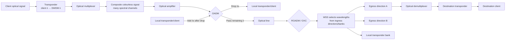

# Diagram — глава 9: DWDM optical path



## Resource model

```text
fiber
  → frequency plan
    → spectral slots
      → wavelength/spectral channels
        → add/drop or cross-connect state
          → optical power / dispersion constraints
```

## Equipment evolution

```text
fixed OADM
  → wavelength-specific physical add/drop

OXC
  → mesh cross-connect

ROADM + WSS
  → remote wavelength routing
  → optionally colorless / directionless architecture
```

Provenance: `p0268:c01`–`p0281:c01`.
