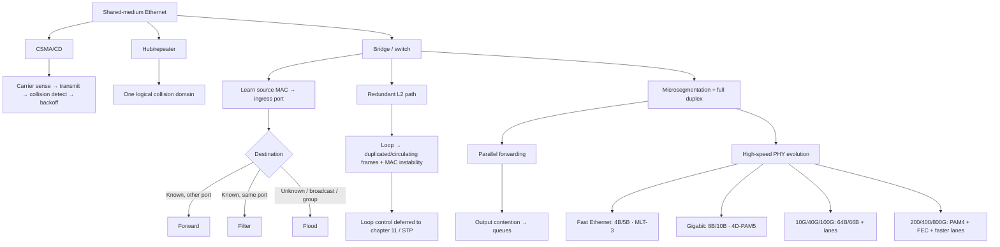

# Diagram — глава 10: Ethernet evolution



## Stable vs changing parts

```text
Mostly stable:
  Ethernet frame + MAC forwarding model

Changed over generations:
  medium access: shared half-duplex → switched full-duplex
  PHY: coding, lane count, optics/copper, FEC, symbol rate
  switch implementation: software bridge → ASIC/FPGA/NPU fabrics
```

Provenance: `p0287:c01`–`p0325:c01`.
