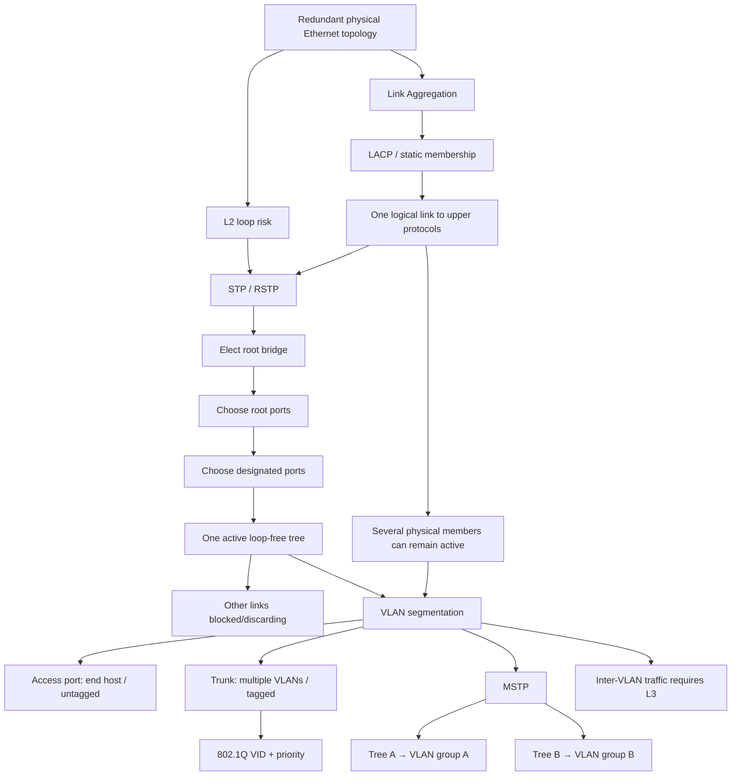

# Diagram — глава 11: L2 redundancy and segmentation



## Failure-domain view

```text
redundant links without STP/RSTP
  → loops / frame duplication / unstable learning

single STP tree
  → reliable but some links idle

LAG
  → active parallel capacity between two systems

VLAN
  → separate broadcast/L2 domains

MSTP
  → different VLAN groups use different active trees
```

Provenance: `p0326:c01`–`p0350:c01`.
