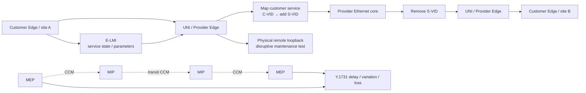

# Diagram — глава 12: Carrier Ethernet service and OAM



## Carrier-grade gaps addressed by the chapter

```text
classic Ethernet
  → cheap/simple best-effort frame forwarding

carrier requirements
  → customer/provider address separation
  → controllable resilient paths
  → connectivity/fault OAM
  → delay/loss performance monitoring
  → service-state visibility

Provider Bridge
  → Q-in-Q / C-VID + S-VID
  → still customer-MAC scaling and STP limits

PBB / MPLS-based evolution in source
  → stronger separation / different provider transport model
```

Provenance: `p0351:c01`–`p0360:c01`.
