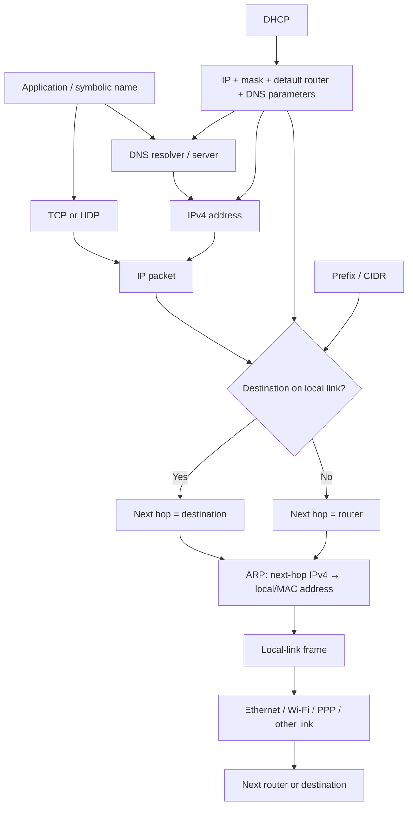

# Diagram — глава 13: TCP/IP addressing and support services



## Addressing chain

```text
symbolic name
  → DNS
  → IPv4 address/prefix
  → routing/on-link decision
  → ARP/local mapping for next hop
  → link-layer frame
```

## DHCP role

```text
client local broadcast
  → server or relay
  → offers
  → client selects/request
  → selected server acknowledges
  → lease/configuration becomes active
```

Provenance: `p0365:c01`–`p0398:c01`.
