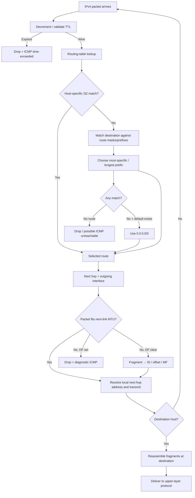

# Diagram — глава 14: IPv4 forwarding path



## Diagnostics

```text
ping
  → ICMP echo request/reply
  → reachability + RTT/loss sample

traceroute / tracert
  → probes with increasing TTL
  → ICMP time-exceeded reveals intermediate routers

ICMP
  → reports conditions
  → does not retransmit lost IP data
```

## QoS model

```text
IntServ + RSVP
  → reserve resources per flow, end to end
  → poor source-described scalability

DiffServ
  → mark packet class in DS/DSCP
  → router applies PHB per hop
  → EF / AF / LE / best effort in source
```

Provenance: `p0399:c01`–`p0441:c01`.
