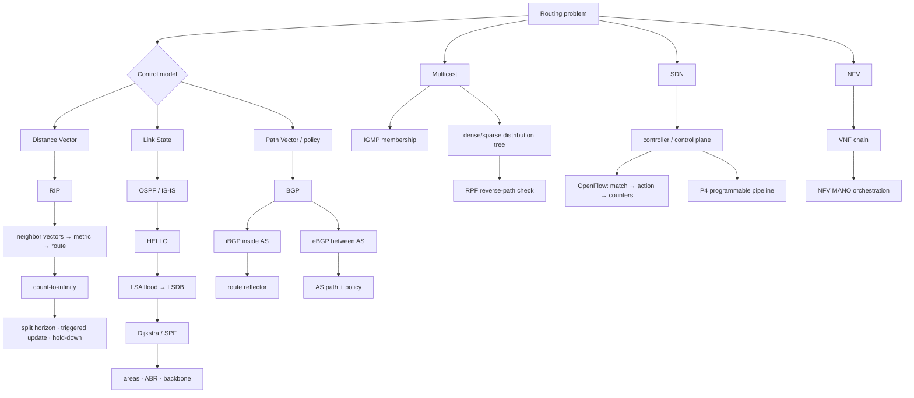

# Diagram — глава 16: routing control → programmable networking



## Operational dependency

```text
unicast:
  neighbor/session → protocol database → selected route → forwarding next hop

multicast:
  membership → tree state → RPF → replication interfaces

SDN:
  controller intent → rule installed on device → counter/state → forwarding

NFV:
  orchestrator intent → VNF lifecycle → service-chain connectivity → packet flow
```

Provenance: `p0472:c01`–`p0513:c01`.
