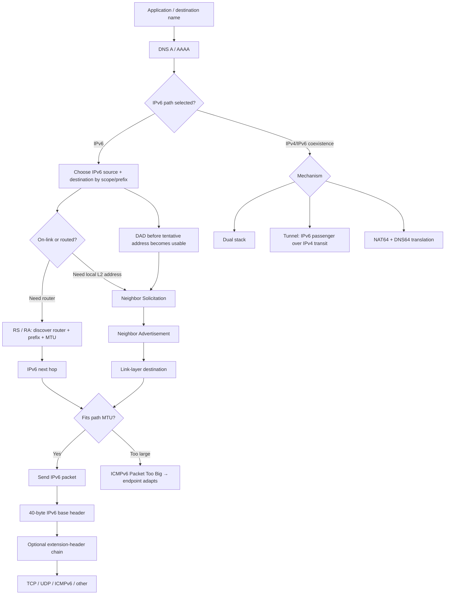

# Diagram — глава 17: IPv6 addressing, ND and coexistence



## Neighbor Discovery dependency

```text
Router discovery:
  RS → RA → prefix / MTU / default-router information

Duplicate-address check:
  tentative address → NS to solicited-node multicast
  reply present → duplicate exists

Address resolution:
  target IPv6 known → derive solicited-node multicast
  NS → NA → learn target link-layer address
```

## Transition models

```text
dual stack:
  same node has independent IPv4 + IPv6 configurations

tunnel:
  IPv6 packet remains passenger payload across IPv4 transit

translation:
  IPv6-only and IPv4-only endpoints communicate through protocol/address translation
```

Provenance: `p0514:c01`–`p0545:c01`.
