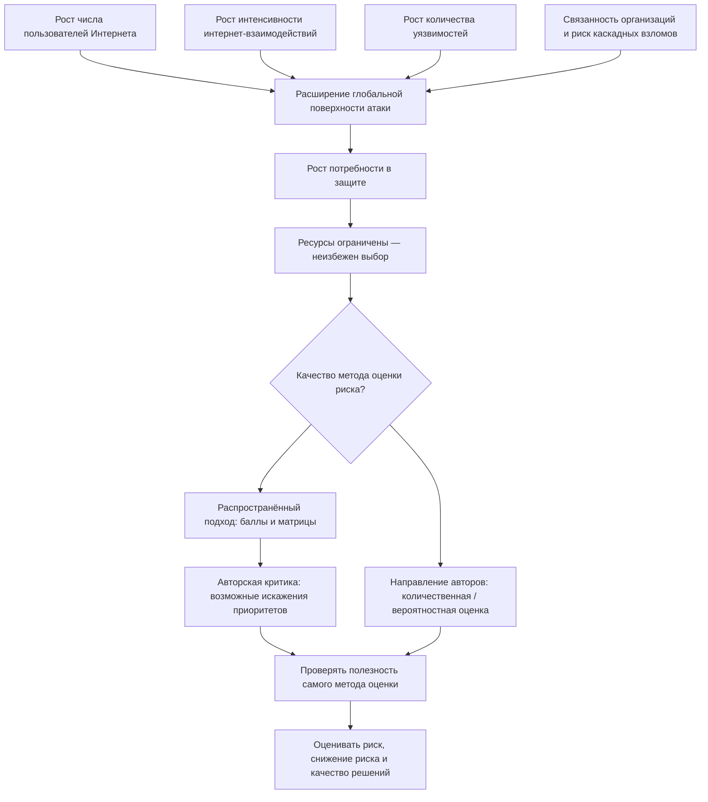
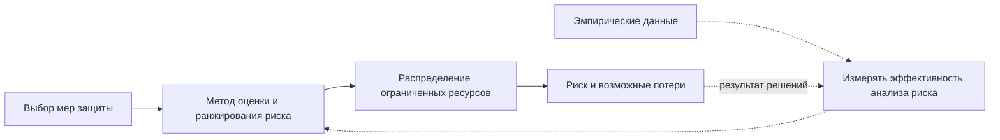

# Логика главы 1 — Mermaid

**Книга:** `cybersecurity-risk-hubbard-seiersen-ru`  
**Provenance:** `e0013:c01–c04` (`OPS/ch1-11.xhtml`), `e0014:c01–c04` (`OPS/ch1-12.xhtml`).

## Аргумент о поверхности атаки и ресурсах

Четыре фактора взяты из `e0013:c03–c04`. Стрелка к росту числа взломов в главе сформулирована как **гипотеза**, а не доказанная количественная причинность.

## «Самая нужная заплатка»

- `e0013:c01`: риск и снижение риска следует оценивать, в том числе в денежном выражении, чтобы выбирать варианты распределения ресурсов.
- `e0014:c02–c03`: авторы оспаривают полезность субъективных матриц и баллов.
- `e0014:c03–c04`: авторы предлагают оценивать сам метод, улучшать его количественными методами и эмпирическими данными.

## Не представлено в этом источнике

- Точный внешний вид `рис. 1.1` (в текстовом RAG есть только подпись и словесная ориентация углов). Схема выше **не является** реконструкцией рисунка из книги.
- Синтаксис команд, диагностические метрики инфраструктуры, формулы риска, численные acceptance thresholds и rollback: `[Not applicable] / [Needs confirmation]`.
- Измерения текущей (2026) поверхности атаки: `[Needs confirmation]`.
