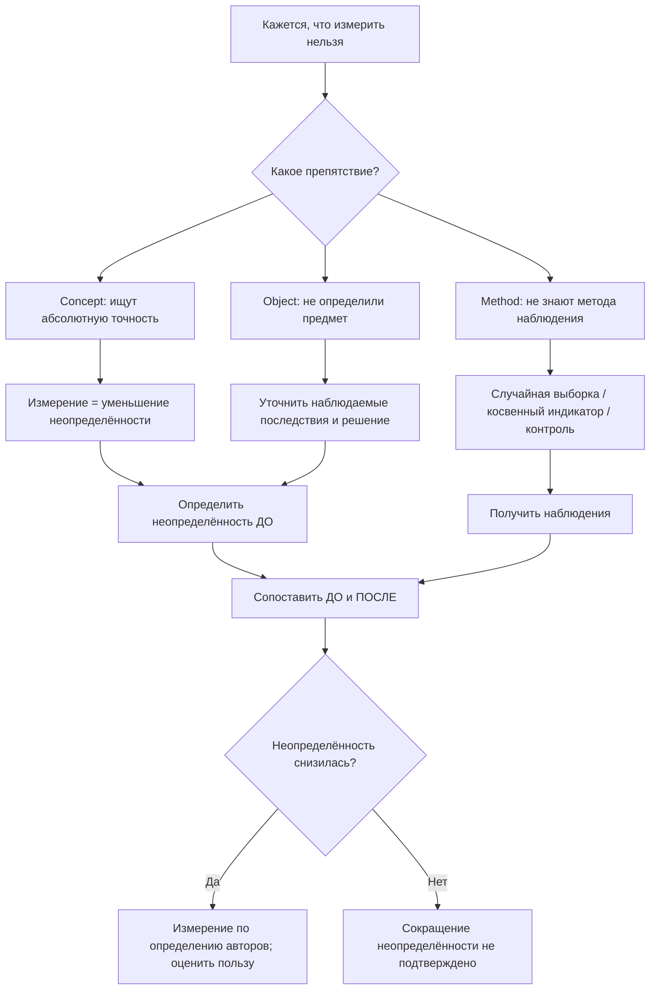
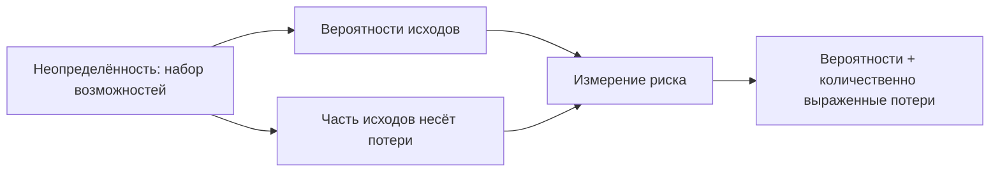
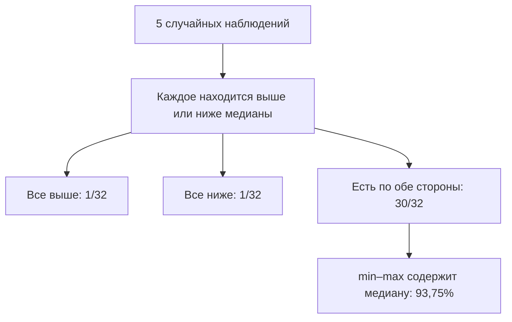

# Глава 2 — логика измерения (Mermaid)

**RAG provenance:** `cybersecurity-risk-hubbard-seiersen-ru:e0015:c01`, `e0016:c01–c08`, `e0017:c01–c04`; EPUB spine 15–17, `OPS/ch1-13.xhtml` → `OPS/ch1-15.xhtml`.

## COM → уменьшение неопределённости

Иллюстрация описанной последовательности, а не готовый production-процесс (`e0015:c01`, `e0016:c01–c08`, `e0017:c01–c02`).

## Объект → риск

`e0016:c08`: безопасность становится измеримой, когда задано, какие конкретные риски должны уменьшиться.

## Правило пяти

`e0017:c03`. Ограничение: результат об охвате медианы при предпосылках авторского расчёта; размер итогового интервала заранее не известен. Глава не содержит команд и плана технических изменений.
