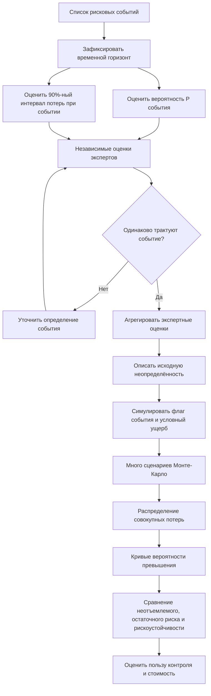
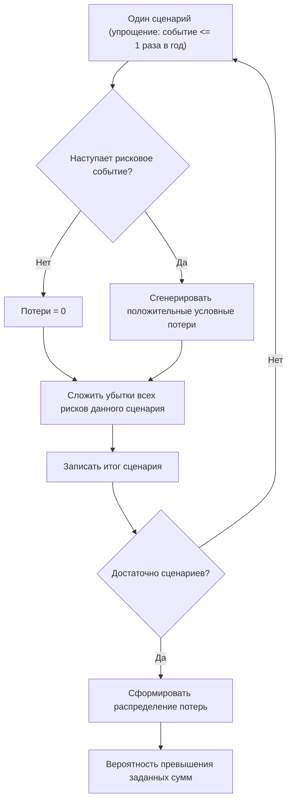
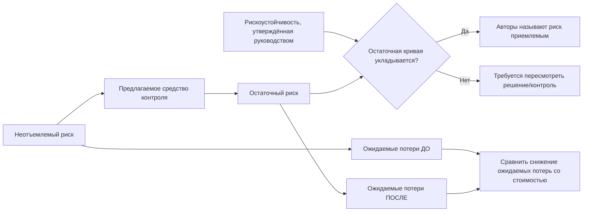

# Глава 3 — диаграммы процесса (Mermaid)

**Provenance:** EPUB spine 18–20, `OPS/ch1-16.xhtml` → `OPS/ch1-18.xhtml`. RAG `e0018:c01–c03`, `e0019:c01–c05`, `e0020:c01–c07`, book `cybersecurity-risk-hubbard-seiersen-ru`. Диаграммы — **схематическое изложение текста**, не оригинальные рис. 3.1–3.3.

## 1. Замена матрицы риска на вероятностную модель

`e0018:c01–c03`, `e0019:c01–c05`, `e0020:c01–c06`.

## 2. Логика Monte Carlo — расчётный уровень

Ограничение: сценарий учебный. Глава отдельно предупреждает об изменчивости редких событий и сумм с тяжёлыми хвостами (`e0019:c01–c05`). Для зависимых событий далее потребуется развитие модели (`e0020:c07`).

## 3. Приоритизация контроля

Из `e0020:c01–c06`. Источник говорит о соотношении пользы/затрат, но **не предоставляет в текстовом RAG саму формулу рентабельности**. Диаграмма не подменяет согласования руководства.

## Provenance/safety gates

- Excel/табличные формулы — только из `commands.md` с отмеченными проблемами извлечения.
- Нет исходных визуальных объектов рис. 3.1–3.3 и табл. 3.1–3.4; эта схема их не перерисовывает.
- Не выполнять изменения реальной инфраструктуры; данные для операционной реализации и rollback: [Needs confirmation].
