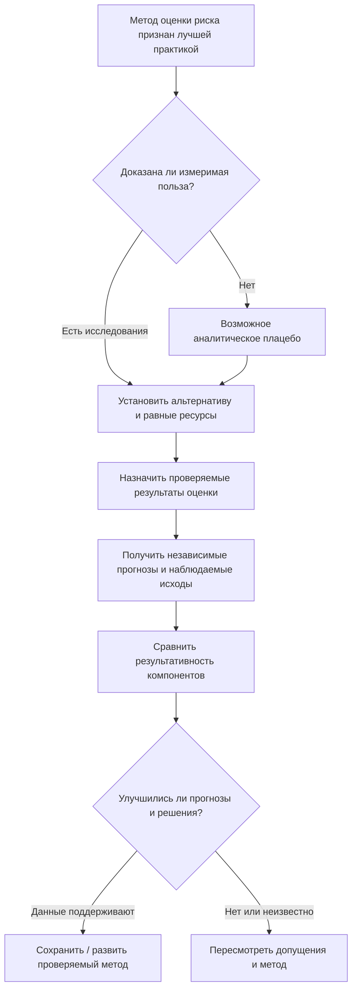
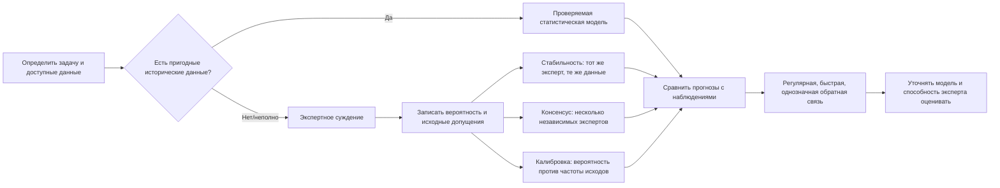
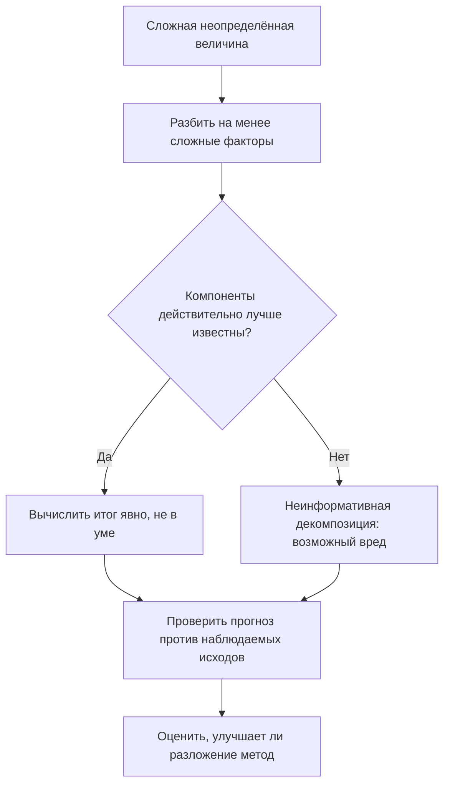

# Глава 4 — схемы измерения эффективности методов (Mermaid)

**Source:** `cybersecurity-risk-hubbard-seiersen-ru`, EPUB spine 21–23, `OPS/ch1-19.xhtml` → `OPS/ch1-21.xhtml`. RAG: `e0021:c01–c05`, `e0022:c01–c04`, `e0023:c01–c11`.

## 1. Проверяем метод, а не субъективное впечатление

Фрагменты: `e0021:c01–c05`. Это схема **аргументации авторов**, не предписанный ими протокол рандомизированного испытания.

## 2. Компоненты оценки: эксперт, алгоритм, обратная связь

Основа: `e0022:c01–c04`, `e0023:c01–c07`. В главе статистические модели не считаются всегда превосходящими экспертов, а согласованность не считается синонимом точности.

## 3. Декомпозиция с условием полезности

Основа: `e0023:c08–c09`. Авторы подчёркивают контекстную зависимость эффективности декомпозиции.

## Ограничения

Оригинальные рисунки 4.1 и 4.2 с результатами исследований **не восстанавливаются по памяти** (см. `source-findings.md`). Функции, команды, параметры CI, операции с production и rollback из главы отсутствуют: `[Not applicable]` / `[Needs confirmation]`.
