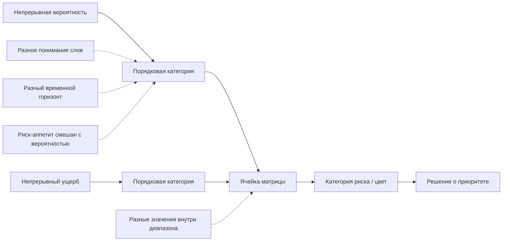
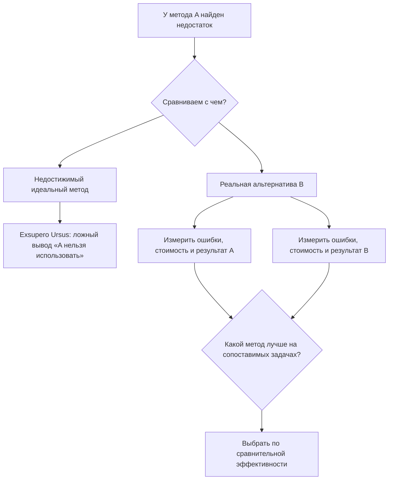
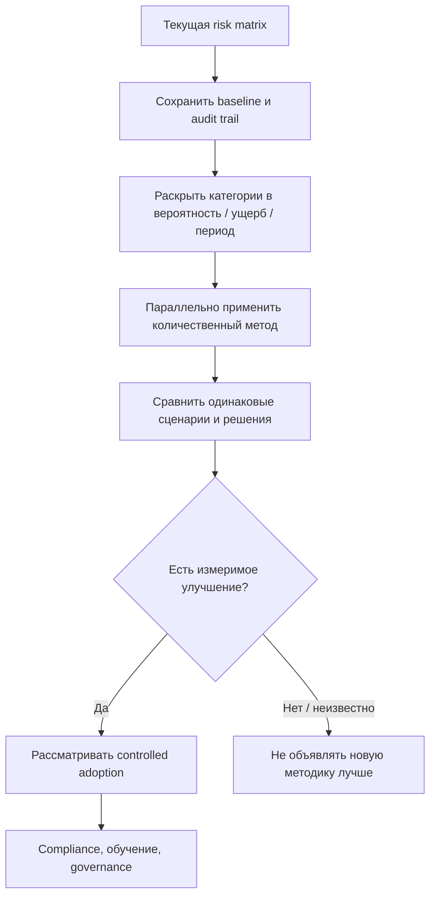

# Глава 5 — Mermaid: от матрицы к сравнительной проверке

**Provenance:** EPUB spine 24–26, `OPS/ch1-22.xhtml` → `OPS/ch1-24.xhtml`; RAG `e0024:c01–c02`, `e0025:c01–c09`, `e0026:c01–c12`.

## 1. Где теряется информация

По `e0025:c02–c06`: авторы связывают матрицы с неоднозначностью вербальных шкал и сжатием диапазона.

## 2. Exsupero Ursus — правильное сравнение

Основа: `e0026:c01,c04–c08`.

## 3. Проверка миграции методологии

Последняя схема — безопасная операционализация логики главы, а не дословный runbook авторов.

## Ограничения

Исходные рис. 5.1–5.3 и таблицы 5.1–5.4 не воспроизводятся как оригиналы. Конкретных production-команд, rollback и корпоративных acceptance thresholds в главе нет.
