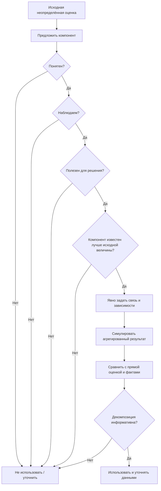
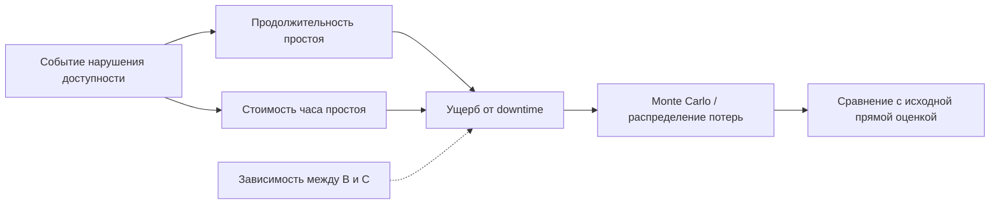
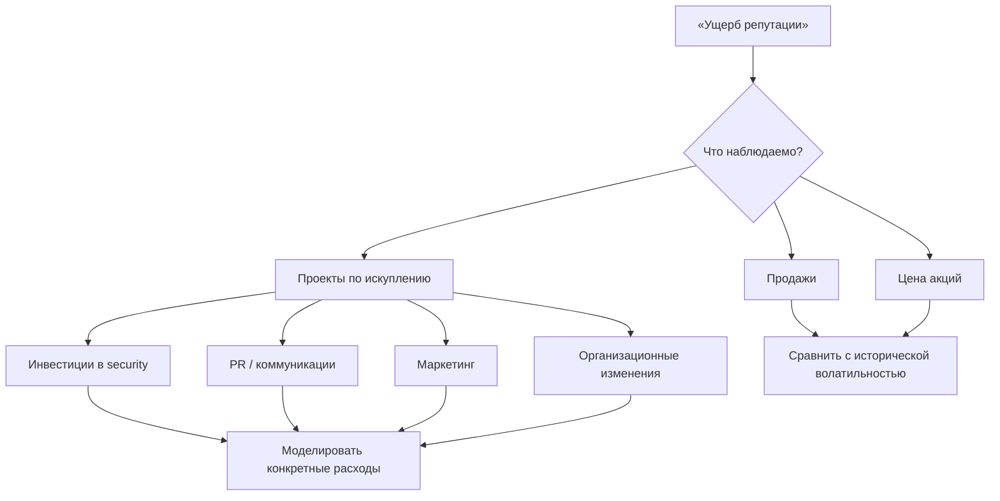

# Глава 6 — Mermaid: информативное разложение

**Source:** EPUB spine 28–30, `OPS/ch1-26.xhtml` → `OPS/ch1-28.xhtml`; RAG `e0028:c01–c04`, `e0029:c01–c05`, `e0030:c01–c05`.

## 1. Решение — разлагать или нет

Основа: `e0029:c01–c05`.

## 2. Пример доступности

Если B и C зависимы, их нельзя автоматически моделировать как независимые (`e0029:c04–c05`).

## 3. Репутация → наблюдаемые последствия

Основа: `e0030:c01–c04`. Графики 6.1–6.4 не реконструируются.

## Boundary

Исходная Excel-формула categorical event в `e0028:c02` имеет source-code mismatch из-за двух `СЛЧИС()`; см. `source-findings.md`. Диаграммы выше не исправляют формулу и не являются production runbook.
