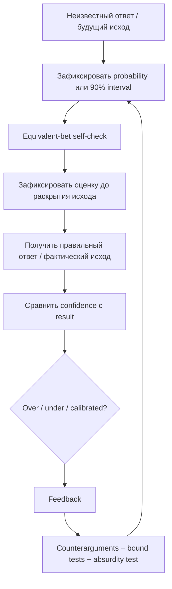
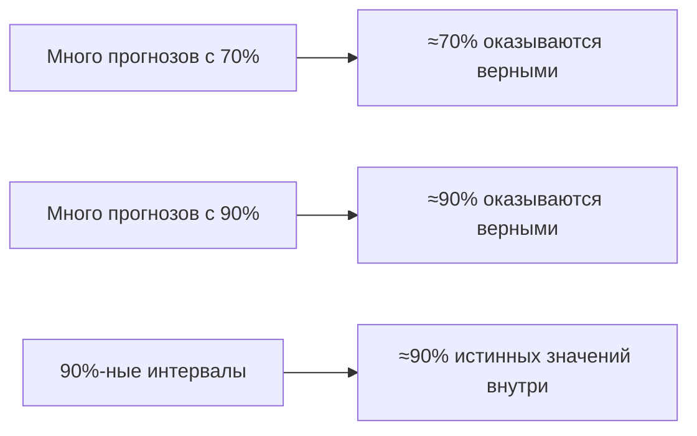
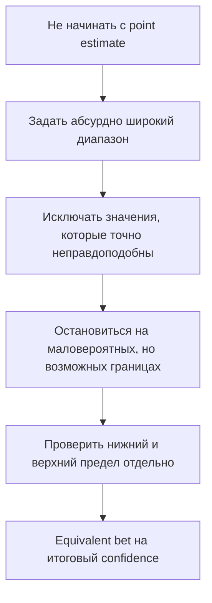

# Глава 7 — Mermaid: калибровка субъективных вероятностей

**Source:** EPUB spine 31–33, `OPS/ch1-29.xhtml` → `OPS/ch1-31.xhtml`; RAG `e0031:c01–c03`, `e0032:c01–c09`, `e0033:c01–c04`.

## 1. Цикл калибровки

Основа: `e0032:c01–c07`.

## 2. Что значит «калиброван»

Единичный прогноз не подтверждает и не опровергает калибровку (`e0031:c02`).

## 3. Anti-anchoring flow

Основа: `e0032:c04–c07`.

## Boundary

Таблица 7.2 содержит упражнение, но тексты вопросов отсутствуют в extracted RAG; они не реконструируются. Рис. 7.1–7.3 также не воспроизводятся как оригиналы.
