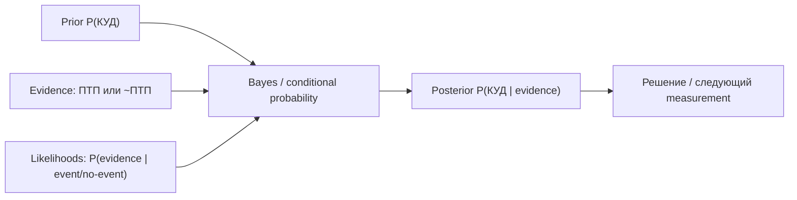
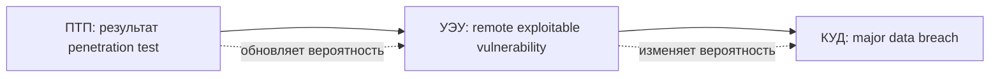
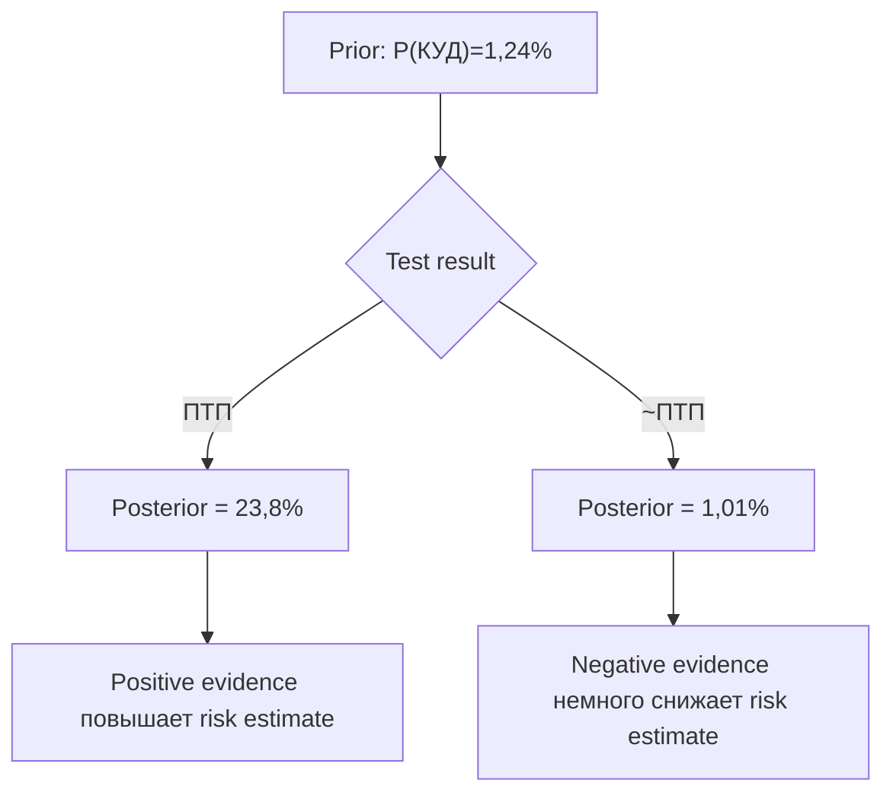
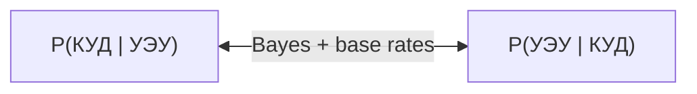

# Глава 8 — Mermaid: prior → evidence → posterior

**Source:** EPUB spine 34–35, `OPS/ch1-32.xhtml` → `OPS/ch1-33.xhtml`; RAG `e0034:c01–c03`, `e0035:c01–c05`.

## 1. Байесовское обновление

## 2. Учебная causal/dependency chain

Это decomposition учебного примера, не доказанная causal model конкретной организации.

## 3. Sanity-check posterior

Источник: `e0035:c04–c05`.

## 4. Не путать условные вероятности

Они в общем случае **не равны**.

## Boundary

Рис. 8.1–8.2 не реконструируются как оригинальные изображения. Повреждённая числовая запись шага 3 сохраняется в `commands.md` и `source-findings.md`; diagram не исправляет источник.
