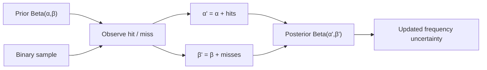
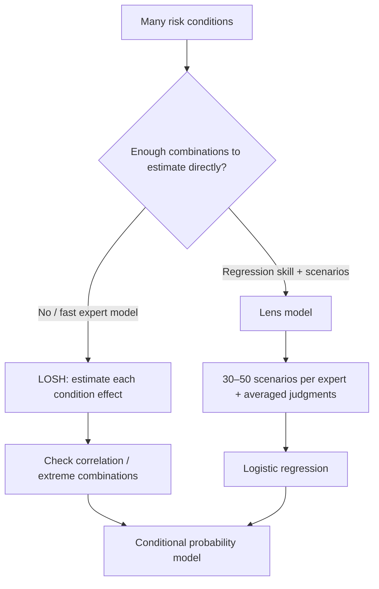
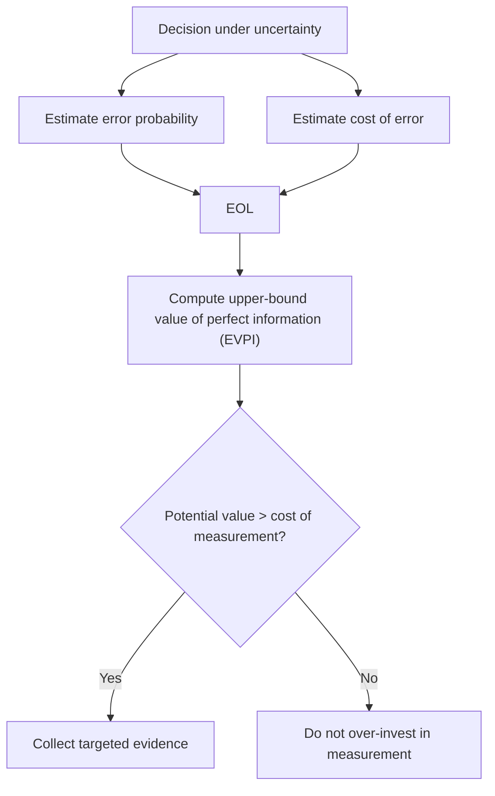
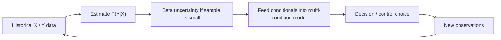

# Глава 9 — Mermaid: от малого количества данных к решению

**Source:** EPUB spine 36–39, `OPS/ch1-34.xhtml` → `OPS/ch1-37.xhtml`; RAG `e0036:c01`, `e0037:c01–c07`, `e0038:c01–c08`, `e0039:c01–c05`.

## 1. Beta update

## 2. Multiple conditions

## 3. Value of Information

## 4. Empirical update loop

## Boundary

ЛОШ source formula/sign conflict and `P(Y|X)` prose/formula state conflict are preserved in `source-findings.md`. Figures 9.x/tables 9.x are not reconstructed as originals.
