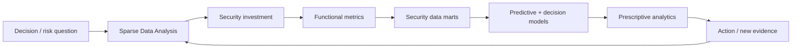
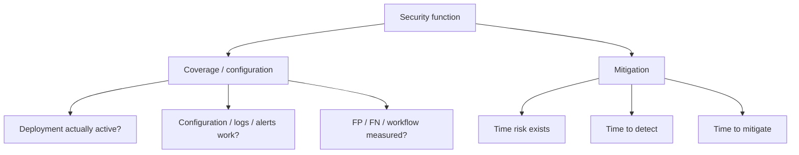
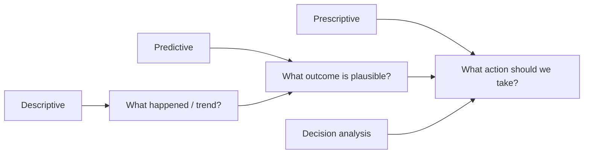
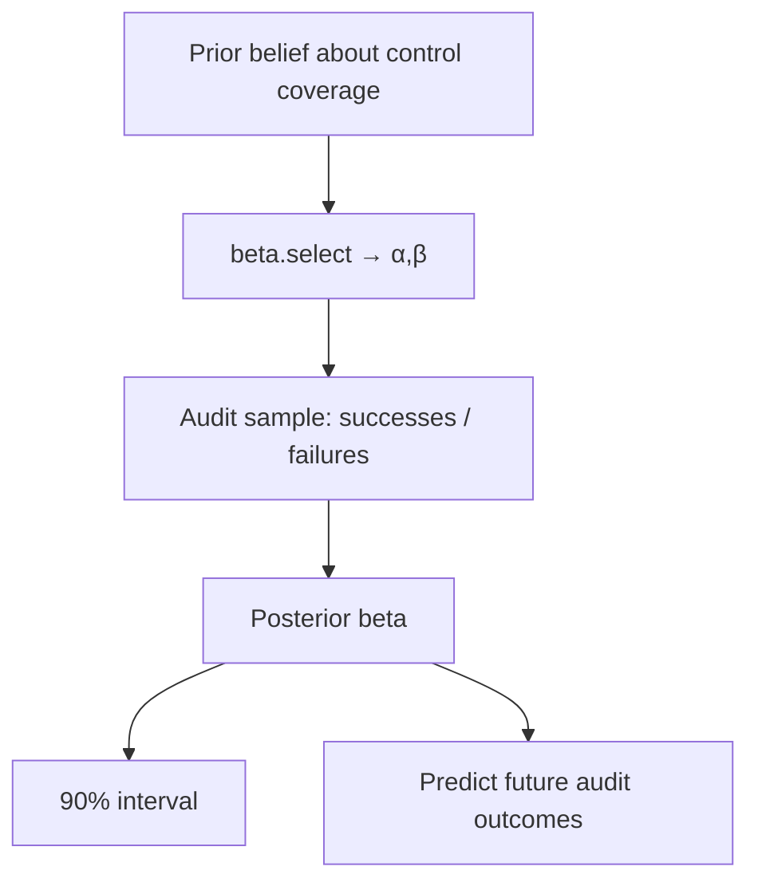

# Глава 10 — Mermaid: зрелость метрик безопасности

**Source:** EPUB spine 41–42, `OPS/ch1-39.xhtml` → `OPS/ch1-40.xhtml`; RAG `e0041:c01–c04`, `e0042:c01–c05`.

## 1. Maturity path

## 2. Functional metrics

## 3. Analytics classes

## 4. Sparse-data R example

## Boundary

R source code contains typographic/extraction defects and an internally inconsistent `rbeta` line; diagrams do not silently correct it. Figures 10.1–10.3 are not reconstructed as original visuals.
