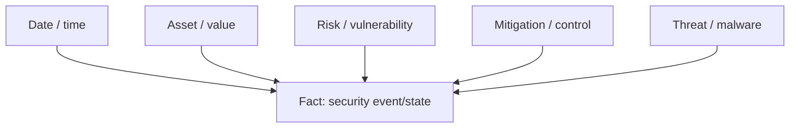
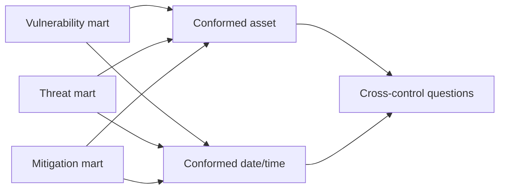
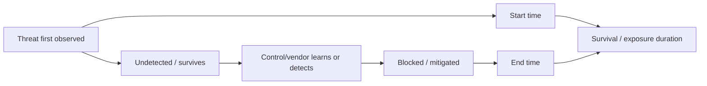
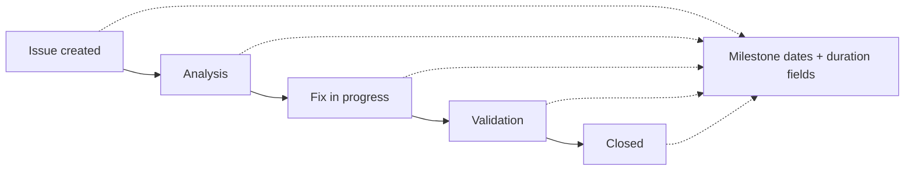

# Глава 11 — Mermaid: dimensional security metrics

**Source:** EPUB spine 43–44, `OPS/ch1-41.xhtml` → `OPS/ch1-42.xhtml`; RAG `e0043:c01–c02`, `e0044:c01–c06`.

## 1. Basic security mart

## 2. Conformed dimensions connect marts

## 3. ПУКД survival flow

## 4. Accumulating snapshot

## Boundary

Figures 11.1–11.7 and tables 11.1–11.5 are not reconstructed as original layouts. No DDL/SQL is inferred from conceptual models.
