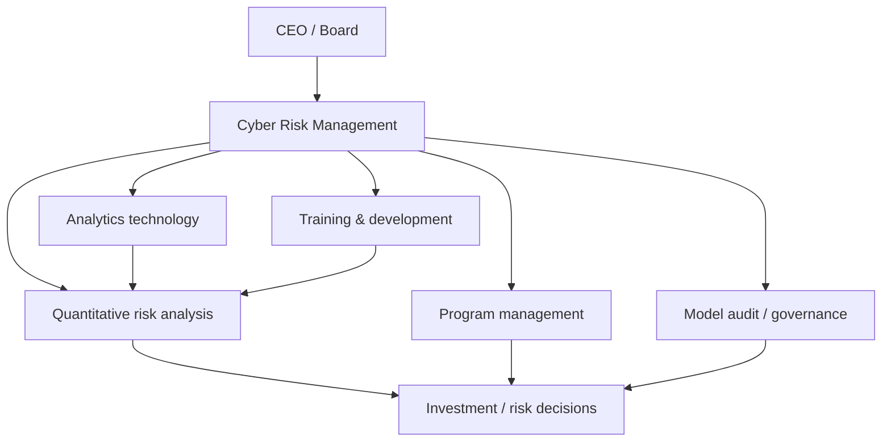
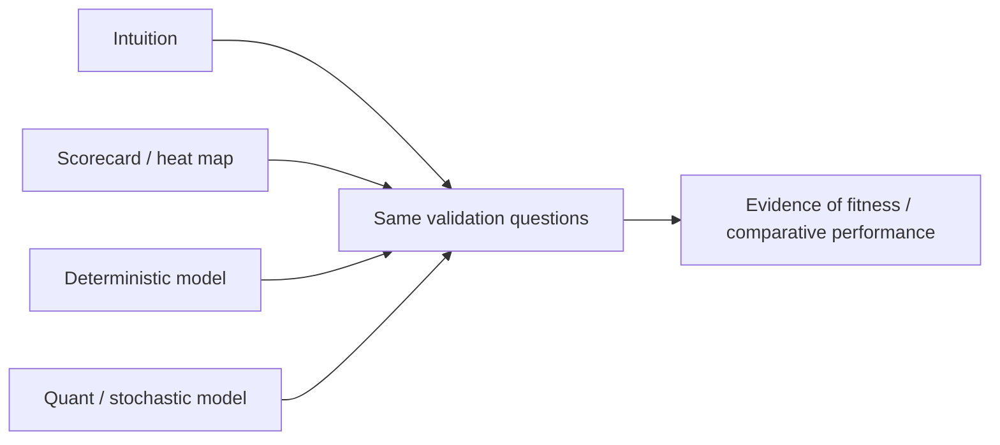
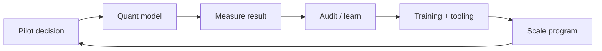

# Глава 12 — Mermaid: программа управления киберрисками

**Source:** EPUB spine 45; RAG `e0045:c01–c08`.

## 1. Program structure

## 2. Equal model-audit principle

## 3. Adoption loop

## Boundary

Рис. 12.1 не реконструируется как оригинальная оргсхема. Диаграммы — conceptual summary источника.
