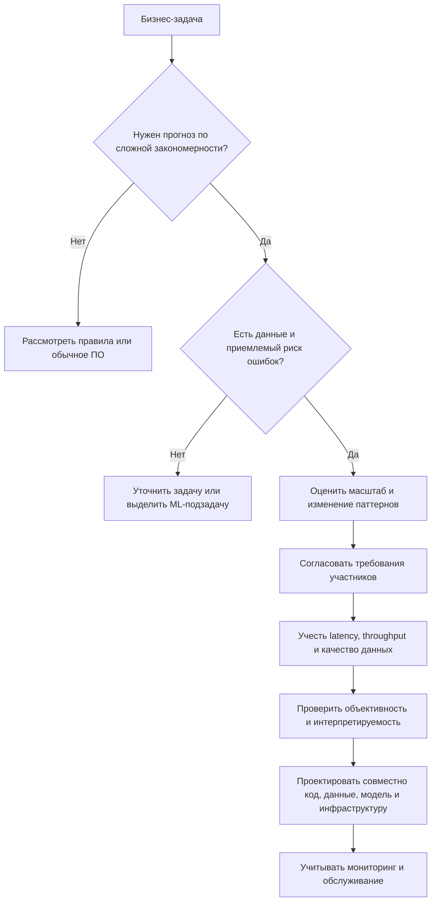

# Глава 1 — логика выбора ML и границы системы

RAG source SHA-256: 0bcacadb4e1dc2235cb58f975111e1633527217127c5871edb894fe2b8f4c80c. PDF pp. 24–46, printed pp. 23–45; chapter starts at p0024-c01, next chapter at p0047-c01. Chunk prefix: designing-machine-learning-systems-chip-huyen-ru:p####:c01.

Схема ниже **аналитически объединяет исходные тезисы**, не воспроизводит изображения PDF и не выдаёт себя за исполняемый runbook.

Привязка: критерии применимости [p0026-c01; p0027-c01; p0029-c01; p0030-c01], требования [p0035-c01], производственные компромиссы [p0038-c01; p0040-c01; p0041-c01], системный взгляд [p0043-c01; p0044-c01; p0045-c01]. Конкретные числовые пороги и порядок production-изменений: [Needs confirmation].
