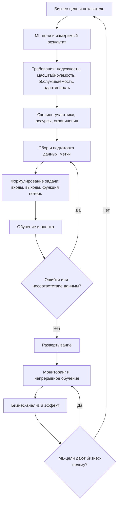
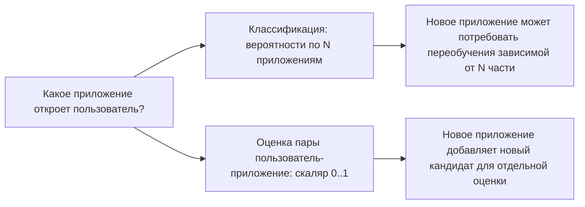

# Глава 2 — системная и итеративная логика

Canonical RAG: designing-machine-learning-systems-chip-huyen-ru; source SHA-256 `0bcacadb4e1dc2235cb58f975111e1633527217127c5871edb894fe2b8f4c80c`; PDF p.47–67 (печатные p.46–66), начало `p0047-c01`, следующий заголовок главы 3 — `p0068-c01`; TOC `p0006-c01` / `p0007-c01`.

**Источники связей:** business vs ML [p0047-c01 — p0049-c01], четыре требования [p0050-c01 — p0053-c01], шесть шагов и пример возврата к метрике [p0053-c01 — p0055-c01], задача по входам/выходам и целевой функции [p0055-c01; p0056-c01; p0060-c01]. Диаграмма является аналитической структурой текста, а не восстановлением неиндексированного рисунка 2.2.

## Отдельный пример — альтернативная формулировка

RAG `p0059-c01`: второй подход не делает единственного предсказания вместо N — он выполняет оценки для кандидатных приложений, поэтому не утверждается экономия числа прогнозов. Конкретные критерии выбора формулировки: [Needs confirmation].
