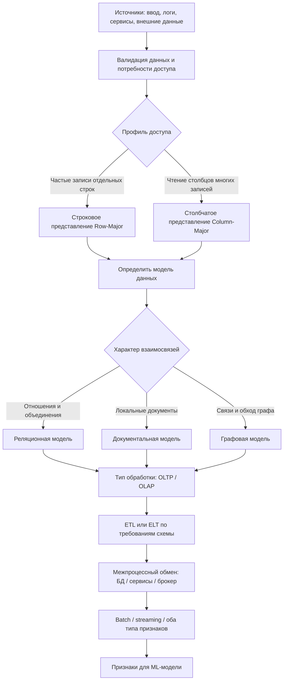
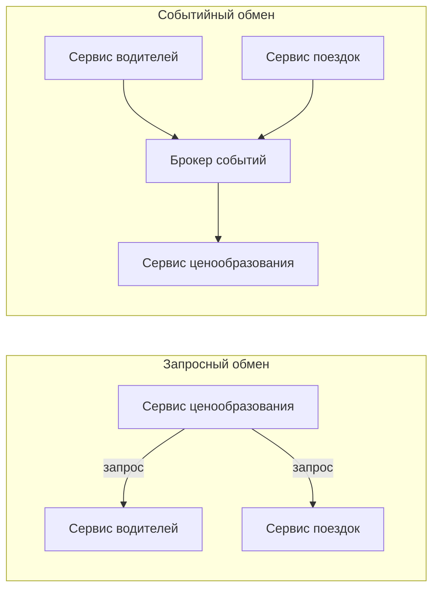

# Глава 3 — архитектурная логика данных

Canonical source: `designing-machine-learning-systems-chip-huyen-ru`; SHA256 `0bcacadb4e1dc2235cb58f975111e1633527217127c5871edb894fe2b8f4c80c`; chapter 3 PDF pages **68–98** (printed **67–97**). TOC `p0007-c01` (PDF p. 7); chapter opens at `p0068-c01`, next chapter opens at `p0099-c01`. Chapter-specific RAG chunks under `books/designing-machine-learning-systems-chip-huyen-ru/rag/chunks/p0001-p0100/p####-c01.md`.

Следующие схемы **производны от текста** и не воспроизводят изображения книги 3.1–3.11.

## Путь выбора представления и использования данных

Основания: [p0069-c01; p0073-c01; p0074-c01; p0077-c01; p0081-c01; p0083-c01; p0085-c01; p0088-c01; p0089-c01; p0090-c01; p0095-c01]. Альтернативы — не строгие взаимоисключающие решения: автор отмечает гибридные модели и совмещение batch/stream. Алгоритм на схеме — аналитическая организация тезисов, не универсальная инструкция выбора технологии.

## Запросный поток против событийного

Источник: пример райдшеринга [p0091-c01–p0093-c01]. Синхронные запросы создают зависимости по доступности; брокер объединяет публикацию/получение данных. Это упрощённая схема из текста, не заявляется точная реализация Lyft.

## Наблюдение и изменение

Глава обсуждает выбор и компромиссы, а не конкретную миграцию работающей БД. Изменения схемы, конвейера ETL, топологии брокера и параметров окна требуют тестов и rollback **[Needs confirmation]**. [p0084-c01; p0088-c01; p0095-c01]
