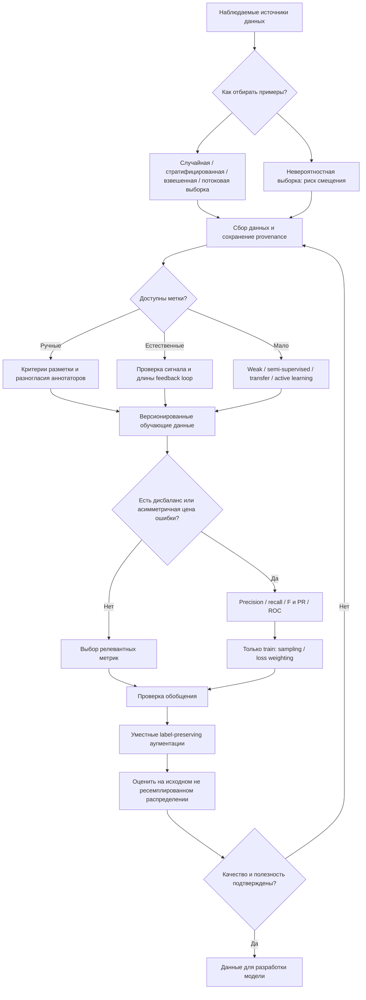
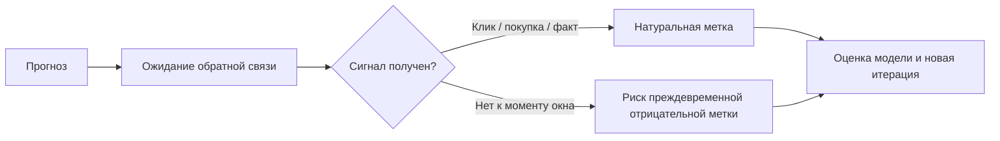

# Глава 4 — RAG-обоснованный контур подготовки обучающих данных

Book RAG SHA-256 `0bcacadb4e1dc2235cb58f975111e1633527217127c5871edb894fe2b8f4c80c`; book id `designing-machine-learning-systems-chip-huyen-ru`; chapter 04 **PDF p.99–135 (printed p.98–134)**; TOC `p0007-c02` + `p0008-c01`; start `p0099-c01`; next chapter starts PDF p.136, `p0136-c01`. Indexed chunks `rag/chunks/p0001-p0100/p0099-c01.md`–`rag/chunks/p0101-p0200/p0135-c01.md`.

**Провенанс:** sampling `p0100-c01`–`p0105-c01`; labeling `p0106-c01`–`p0118-c01`; imbalance/metrics `p0119-c01`–`p0128-c01`; augmentation `p0129-c01`–`p0132-c01`; original evaluation warning `p0126-c01`.

Диаграмма — структурирование инженерных идей из главы, **не** воспроизведение рисунка 4.1–4.12 и не заданный книгой исполняемый pipeline. Критерий R, значения метрик и rollback — **[Needs confirmation]**.

## Узел delayed natural labels

**Источник:** `p0108-c01`–`p0111-c01`. Окно обратной связи, сила сигнала и вероятность поздних событий зависят от задачи, не задано универсальное значение.
