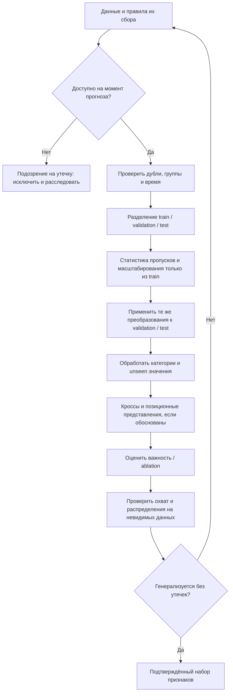
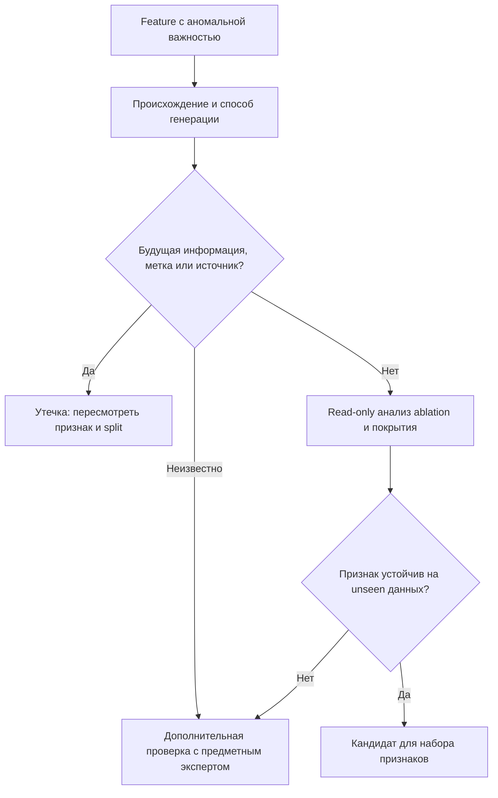

# Mermaid — глава 5: конструирование признаков и устранение утечек

Канонический RAG: `designing-machine-learning-systems-chip-huyen-ru`, source SHA-256 `0bcacadb4e1dc2235cb58f975111e1633527217127c5871edb894fe2b8f4c80c`. Глава 5: PDF **136–161**, печатные **135–160**; TOC `p0008-c01`, открытие `p0136-c01`, следующая глава начинается `p0162-c01`. Источники — только адресуемые `books/designing-machine-learning-systems-chip-huyen-ru/rag/chunks/p0101-p0200/p####-c01.md`; без прямого чтения PDF, веба и восполнения из памяти.

## Логика разработки признаков

Основание: причины утечек `p0151-c01`–`p0155-c01`; обработка `p0140-c01`–`p0150-c01`; важность и обобщение `p0155-c01`–`p0160-c01`. Это структура текста, не реплика рисунков книги. Решение об изменениях требует исходных тестовых данных и отдельного согласования; числовые пороги **[Needs confirmation]**.

## Диагностика подозрительно сильной фичи

Основание: `p0151-c01`, `p0154-c01`, `p0155-c01`, `p0158-c01`, `p0159-c01`.

### Ограничения

Ни одна блок-схема не является исполняемой операционной последовательностью для конкретной модели. Исправление признаков, рефит модели, управление сплитами, rollback: **[Needs confirmation]**.
