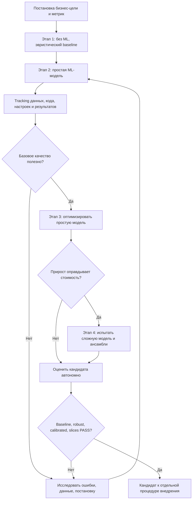
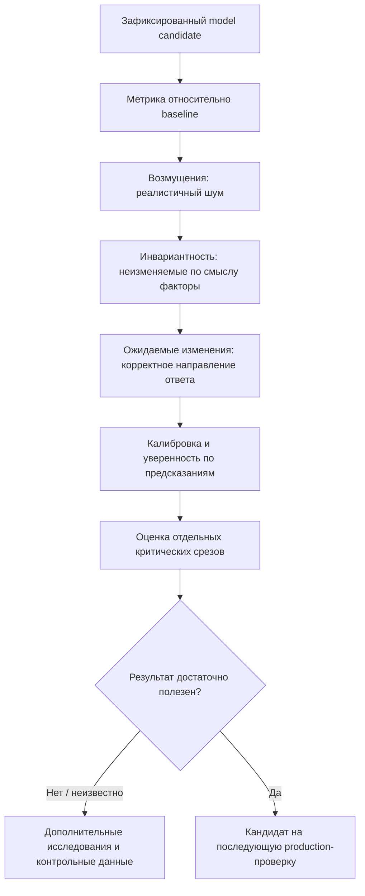

# Глава 6 — архитектурная схема разработки и offline evaluation

Canonical RAG only: `designing-machine-learning-systems-chip-huyen-ru`, source SHA-256 `0bcacadb4e1dc2235cb58f975111e1633527217127c5871edb894fe2b8f4c80c`; chapter 06 PDF **162–201** (printed **161–200**). TOC: `p0008-c02`; chapter opening `p0162-c01`, chapter 07 opens at `p0202-c01`. Addressable canonical chunks `books/designing-machine-learning-systems-chip-huyen-ru/rag/chunks/p0101-p0200/p0162-c01.md` through `p0200-c01.md` and bibliography `rag/chunks/p0201-p0300/p0201-c01.md`.

## Четыре этапа и контрольные решения

**Основание:** четыре этапа `p0187-c01`–`p0189-c01`, experiment tracking `p0174-c01`–`p0177-c01`, автономная оценка `p0189-c01`–`p0199-c01`. Диаграмма отражает идеи главы, не гарантирует PASS и не разрешает деплой автоматически.

## Проверка автономной оценки

**Основание:** `p0190-c01`–`p0198-c01`. Реальная оценка может требовать иной очередности и набора методов. Итоговый baseline, границы допустимых ошибок, пороги уверенности, данные и процедура изменения **[Needs confirmation]**. Рисунки 6.1–6.11 не реплицированы из оригинала.
