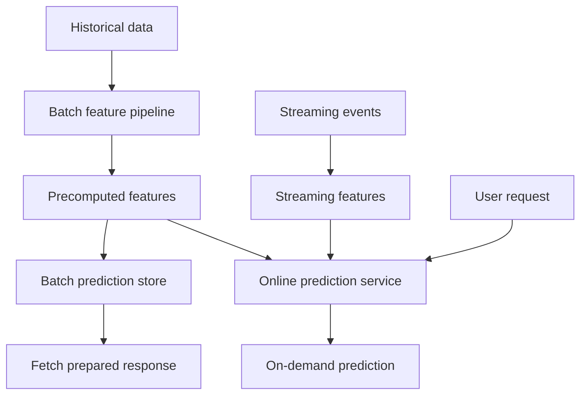
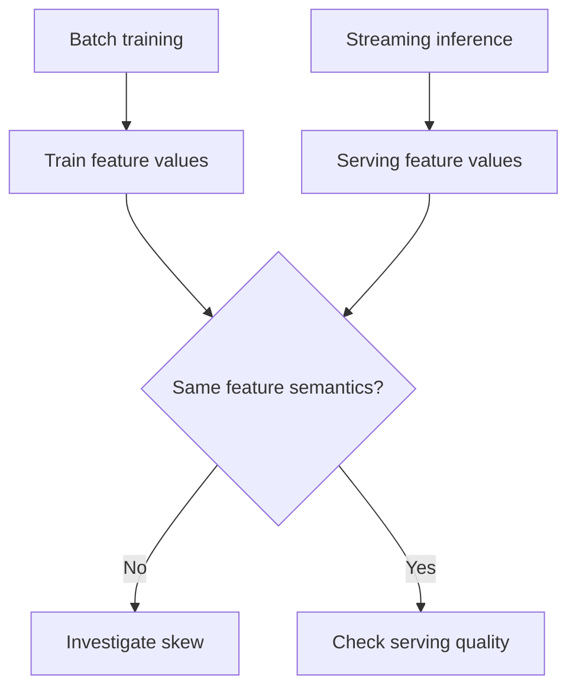
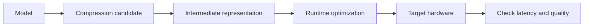

# Глава 7 — архитектура прогнозирования

Источник: канонический RAG, PDF p.202–232, chunks p0207-c01–p0229-c01. Диаграммы — логическое обобщение, не копии рисунков книги.

## Batch и online

Три режима: пакетное прогнозирование; онлайн-прогнозирование только с пакетными признаками; онлайн-прогнозирование с пакетными и потоковыми признаками. [p0207-c01–p0210-c01]

## Train-serving consistency

Различие вычисления скользящих признаков и риск ошибок — p0212-c01–p0213-c01.

## Optimization path

Сжатие, компиляция и проверка качества — p0214-c01–p0229-c01. Численные пороги PASS и rollback: [Needs confirmation].
