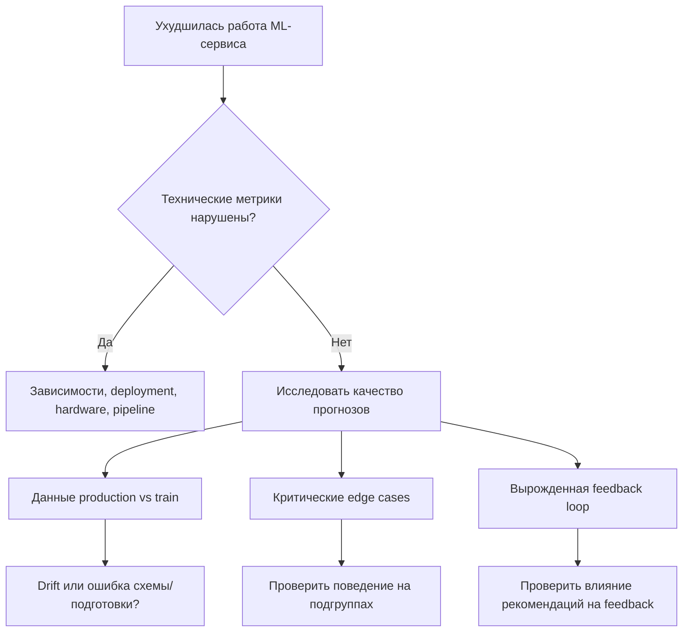
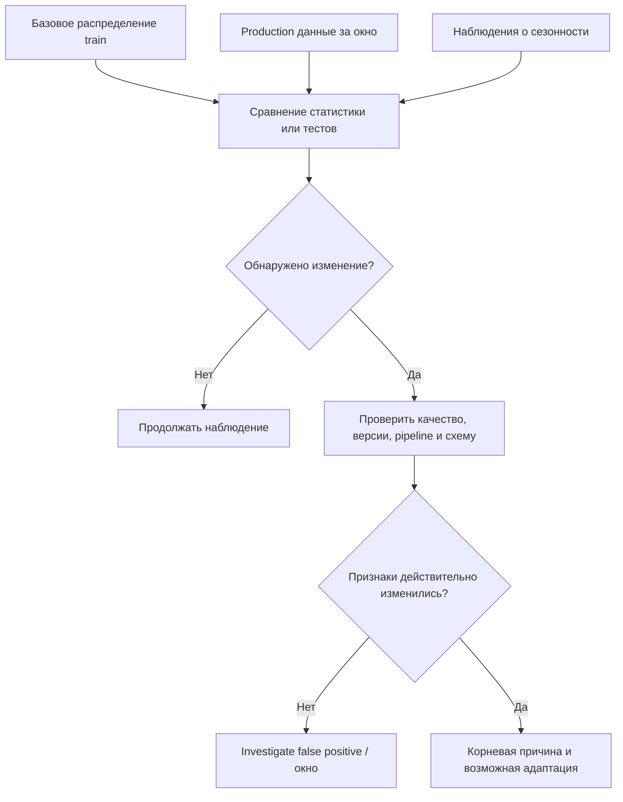
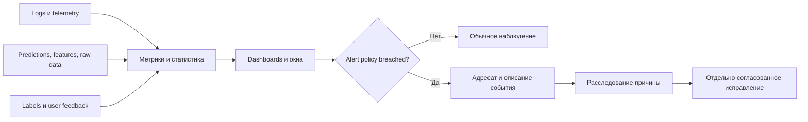

# Глава 8 — диагностика сдвигов и наблюдаемость

Канонический RAG PDF 233–268, SHA256 `0bcacadb4e1dc2235cb58f975111e1633527217127c5871edb894fe2b8f4c80c`. Диаграммы структурируют описание автора, а не копируют рисунки книги.

## Три семейства причин сбоев

Обоснование: p0234-c01–p0243-c01. Edge cases и outliers в главе разграничены; смешивать их нельзя [p0239-c01].

## Drift detection и объяснение сигнала

Обоснование: p0247-c01–p0255-c01. KS используется для одномерных данных; MMD — рассматриваемый в книге вариант проверки высокой размерности. Результат теста сам не доказывает снижение полезности модели. Конкретные пороги и выбор reference window: [Needs confirmation].

## Observability / alert lifecycle

Обоснование: p0255-c01–p0265-c01. Отдельная процедура remediation/rollback, фактический on-call и SLA не предоставлены: [Needs confirmation].
