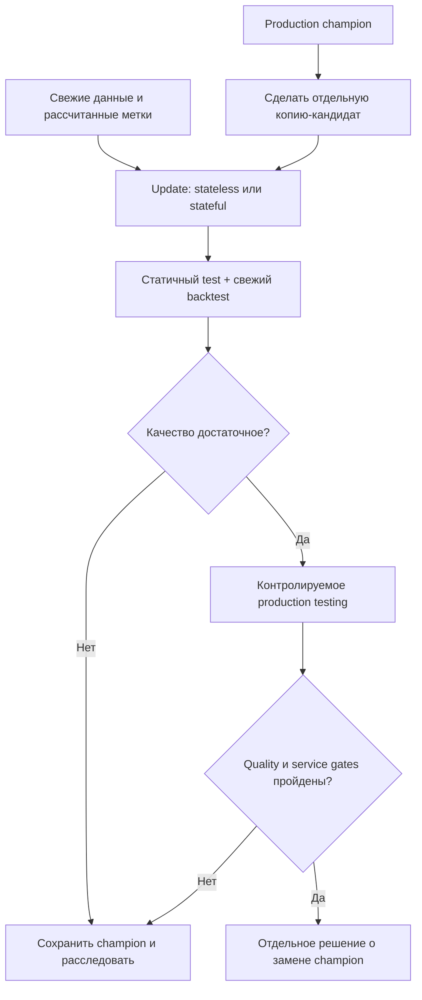
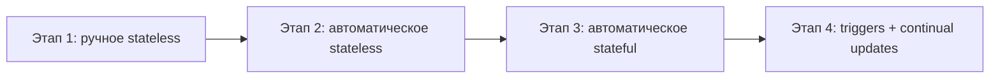
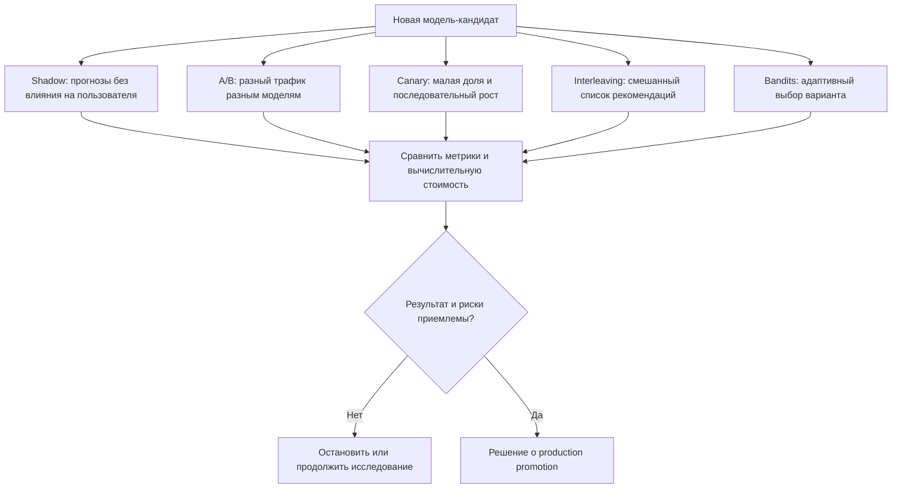

# Глава 9 — процессы обновления и проверки ML-моделей

Источник: RAG p0269-c01–p0295-c01, PDF p.269–295, SHA256 `0bcacadb4e1dc2235cb58f975111e1633527217127c5871edb894fe2b8f4c80c`. Схемы обобщают описанный текст, не воспроизводят отсутствующие графические оригиналы 9.1–9.7.

## Champion и challenger

Основание: p0270-c01, p0277-c01–p0278-c01, p0285-c01–p0289-c01. Это концептуальная логика главы, а не готовый deployment controller. Gate значения и rollback: [Needs confirmation].

## Четыре этапа внедрения

Основание: p0279-c01–p0283-c01. Обязательны доступ к свежим данным, версиям, оценке и мониторингу; не все задачи нуждаются в максимальной частоте.

## Способы production testing — раздельные механизмы

Основание: p0286-c01–p0293-c01. Методы не всегда подходят одной задаче и не обязаны применяться одновременно; интерливинг описан для ранжирования, бандиты — для exploration/exploitation. Разделение трафика и права на выпуск [Needs confirmation].
