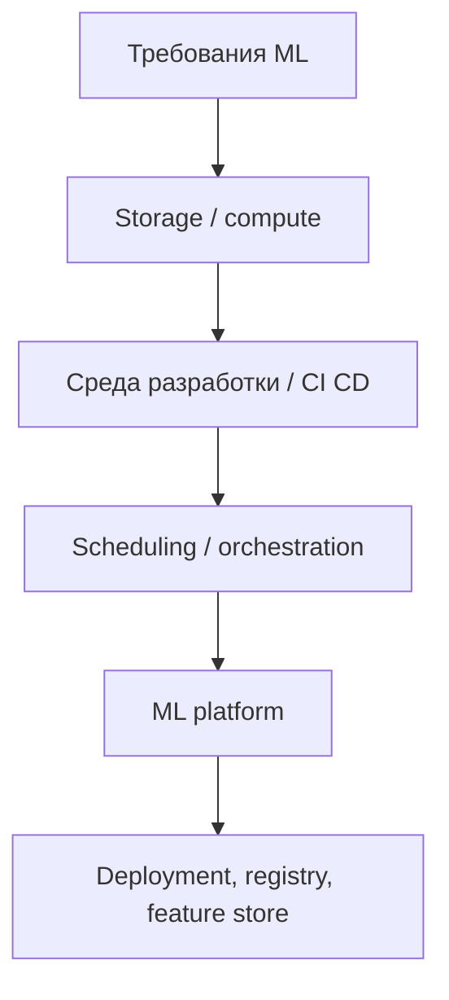
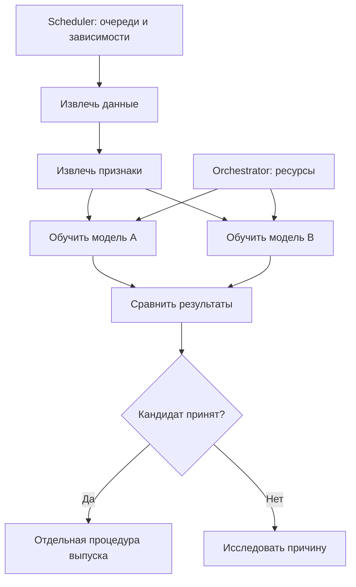
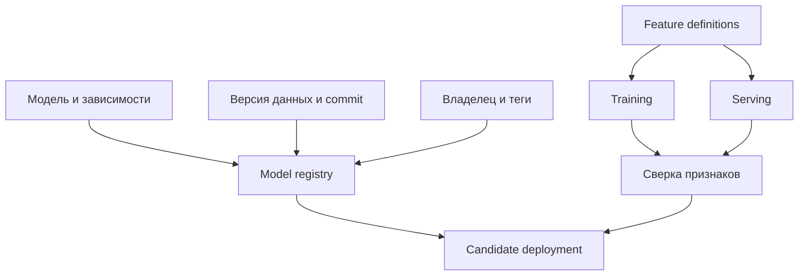

# Глава 10 — Mermaid-карта MLOps-инфраструктуры

RAG PDF 297–334, SHA256 `0bcacadb4e1dc2235cb58f975111e1633527217127c5871edb894fe2b8f4c80c`. Диаграммы — собственные схемы идей главы, а не копии рисунков 10.1–10.10.

## Четыре уровня

Классификация уровней: `p0298-c01`–`p0300-c01`. Это не обязательная последовательность внедрения, степень необходимой инфраструктуры зависит от задачи.

## DAG и разделение ролей

RAG `p0315-c01`–`p0318-c01`: Scheduler отвечает за DAG, очередь, ретраи; orchestrator — за размещение и доступные ресурсы. Продукты могут совмещать функции.

## Registry и feature parity

RAG `p0325-c01`–`p0330-c01`: registry и feature store решают разные задачи воспроизводимости, согласованности и обнаружения артефактов. Точные API, threshold PASS и rollback: **[Needs confirmation]**.
