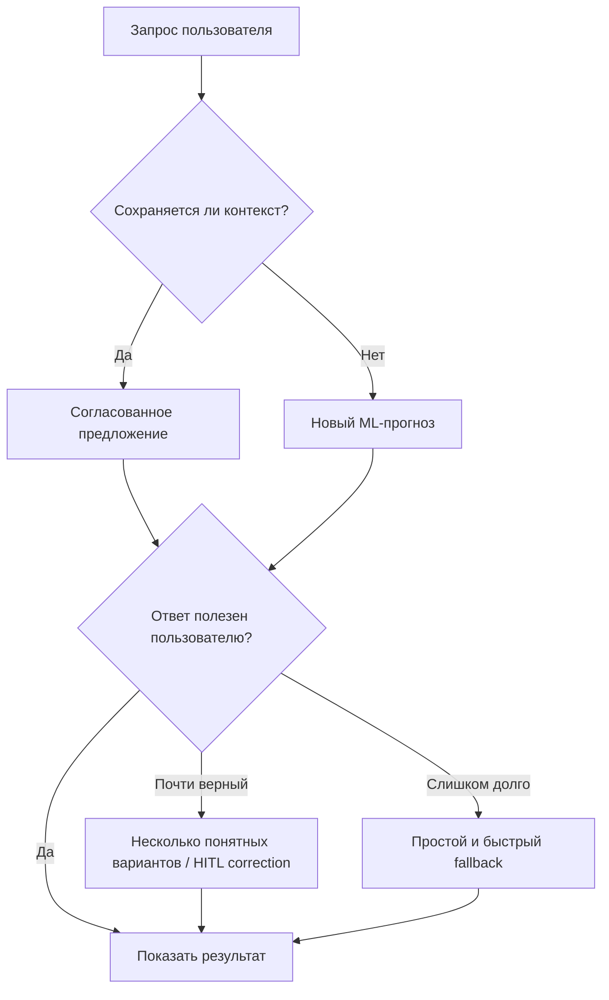
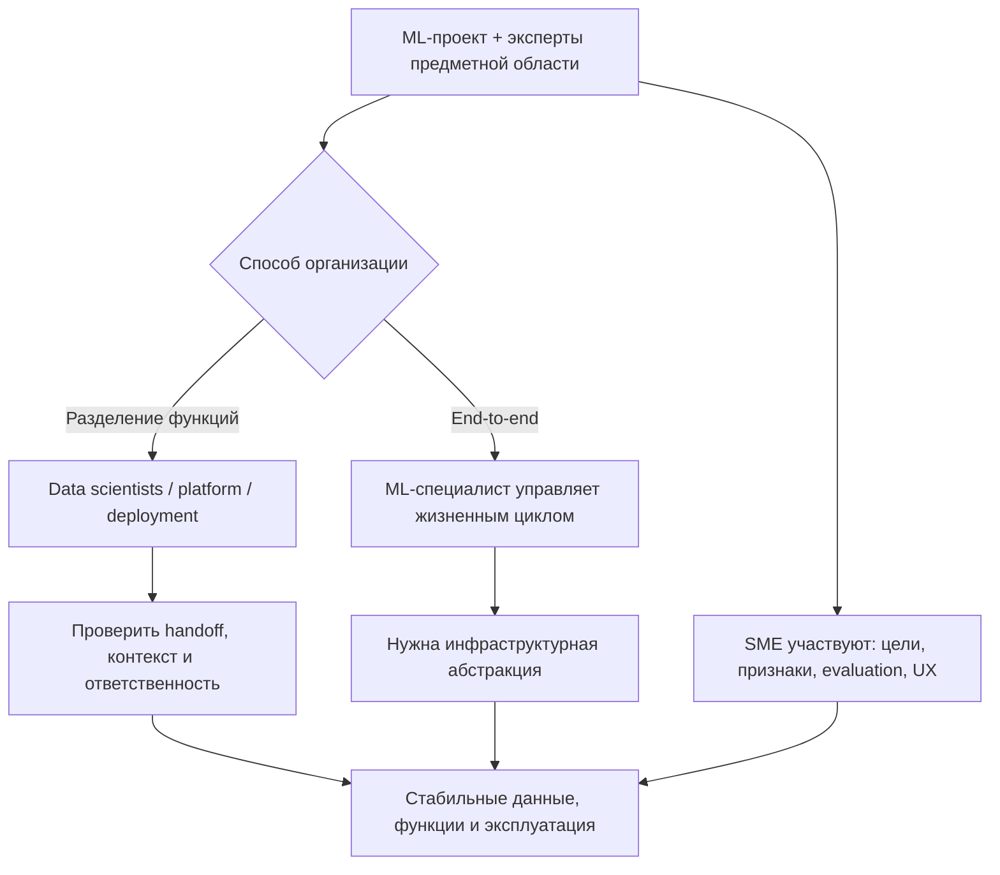
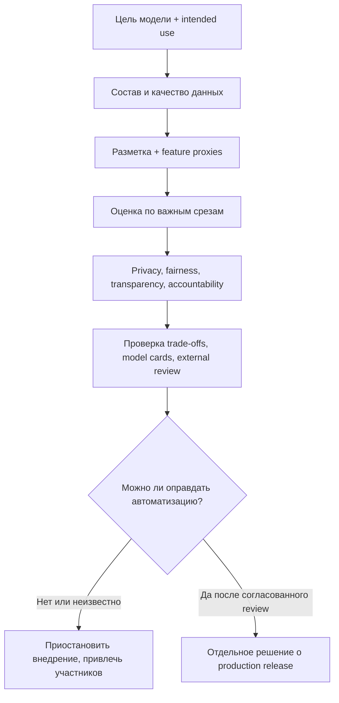

# Глава 11 — схемы UX, организации и ответственного ИИ

Источник: канонический RAG PDF p.335–358, source SHA256 `0bcacadb4e1dc2235cb58f975111e1633527217127c5871edb894fe2b8f4c80c`. Ниже — **наши логические схемы на основании текста**, не копии оригинальных рисунков 11.1–11.4.

## Пользовательский опыт: consistency, HITL и fallback

**RAG:** `p0335-c01`–`p0338-c01`. Различать user-correctable error и невозможность исправления. Latency-threshold, human review и fallback-quality должны быть подтверждены отдельно.

## Структура команд: ownership и доступ к SME

**RAG:** `p0339-c01`–`p0342-c01`. Автор не даёт универсально правильной оргструктуры; ожидание знаний всех технологий от одного человека критикуется.

## Ответственный ИИ: слои риска и аудит

**RAG:** `p0343-c01`–`p0357-c01`. Схема включает авторские уроки Ofqual и Strava, ограничения анонимизации и аудит model cards, не является юридическим соответствием или универсальной процедурой. SLO, правовая база, критерии PASS и rollback: **[Needs confirmation]**.
