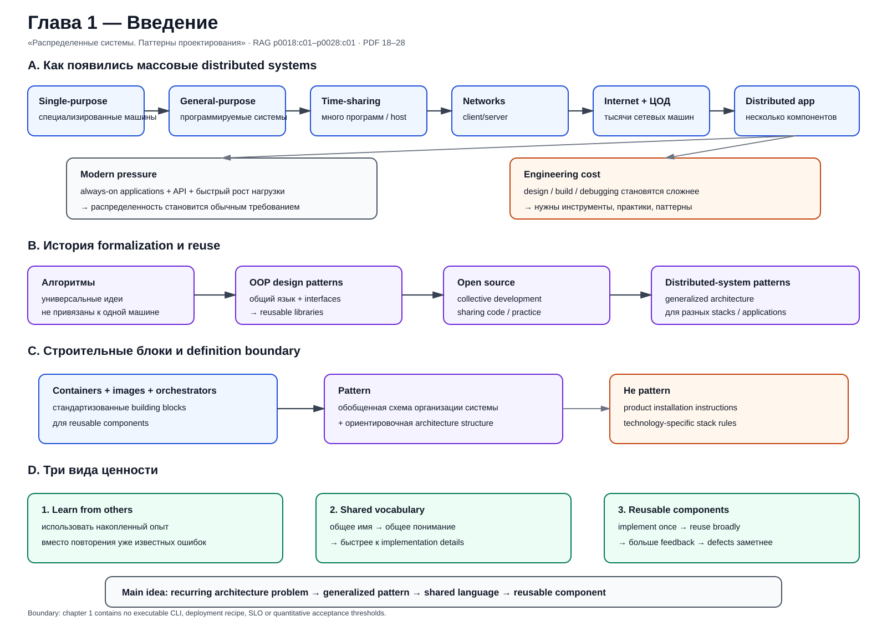
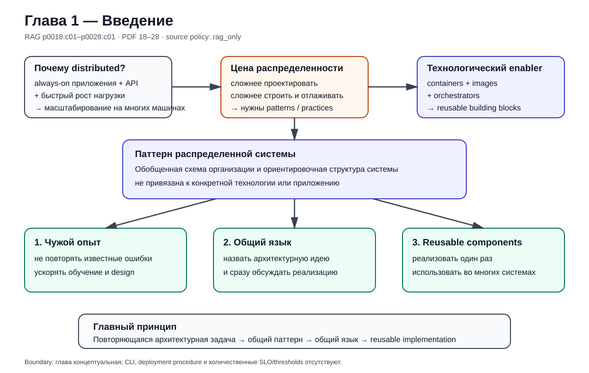

# Глава 1 — Введение

RAG-grounded разбор главы 1 книги «Распределенные системы. Паттерны проектирования».

## Идентификация

- Book ID: `distributed-systems-patterns-brendan-burns-ru`
- Chapter: 1
- Source title: «Введение»
- Slug: `introduction`
- Chapter contract: `BIBLIOTEKA-VSP-CHAPTER-ARTIFACT-COLLECTION v1.7`
- Source policy: `rag_only`
- External sources: запрещены
- Model memory for book content: запрещена
- Прямой доступ к `source/book.pdf`: не использовался
- Completion status: `RAG_GROUNDED`

## Provenance

- RAG scope: `p0018:c01–p0028:c01`
- PDF pages: `18–28`
- Printed pages: `18–28`
- Source format: PDF
- Source SHA-256: `d4529f6267d0fe16d411c912a1ecc7ab4924530c376103ce5f16067aca337aa5`
- Boundary evidence:
  - `p0018:c01` — начало «Введение»;
  - `p0027:c01` — начало явного раздела «Резюме»;
  - `p0028:c01` — продолжение и завершение резюме;
  - `p0029:c01` — уже «Часть I. Одноузловые паттерны проектирования», то есть вне главы 1.
- В chapter range пропусков RAG не обнаружено: `11/11` chunks.
- Boundary verified: yes.

## Артефакты

- [cheatsheet.md](cheatsheet.md)
- [commands.md](commands.md)
- [diagram.md](diagram.md)
- [summary.md](summary.md)
- [visual-cheatsheet.svg](visual-cheatsheet.svg)
- [visual-cheatsheet-detailed.svg](visual-cheatsheet-detailed.svg)

Review questions/exercises в chapter range не обнаружены, поэтому `review-questions.md` и `review-answers.md` не создаются.

Материальных source contradiction/code mismatch, требующих `source-findings.md`, не выявлено. Известные переносы слов и особенности text-layer extraction не меняют смысл главы.

## Что делает глава

Глава формирует мотивацию всей книги. Автор начинает с требования к современным приложениям: постоянная доступность и способность быстро масштабироваться делают распределенную архитектуру обычной, а не исключительной задачей.

Одновременно глава подчеркивает цену распределенности: проектировать, строить и отлаживать такие системы сложнее, чем локальные приложения. Поэтому центральный вопрос главы — как превратить разработку распределенных систем из набора единичных решений в дисциплину с повторно используемыми идеями и компонентами.

## 1. Почему распределенные системы стали обычной задачей

Source-grounded chain:

~~~text
always-on applications + API
+ потенциально быстрый рост нагрузки
→ необходимость масштабирования
→ распределенная система
~~~

Глава рассматривает распределенное приложение как несколько разных приложений либо несколько копий одного приложения, работающих на разных машинах и совместно реализующих сервис.

При грамотной структуризации распределенность может дать надежность, а грамотная архитектура — масштабируемость не только системы, но и команды. Но эти преимущества сопровождаются большей сложностью проектирования, построения и отладки.

## 2. Историческая линия разработки систем

~~~text
специализированная машина
→ программируемый компьютер общего назначения
→ time-sharing / много программ на одной машине
→ сети
→ client/server
→ крупные сетевые ЦОД
→ распределенные приложения
~~~

Рост Интернета и крупных центров обработки данных сделал распределенные системы массовыми. Это увеличило потребность в инструментах, практиках и паттернах, которые снижают стоимость их разработки.

## 3. Контейнеры и оркестраторы как строительные блоки

Глава связывает снижение трудоемкости распределенной разработки с распространением:

- контейнеров;
- образов контейнеров;
- инструментов оркестрации.

Автор проводит аналогию с объектами в объектно-ориентированном программировании: контейнеризованные блоки позволяют формировать повторно используемые компоненты и паттерны.

Это не утверждение, что контейнер сам по себе решает проблему распределенности. В логике главы он предоставляет стандартный строительный блок, на котором можно оформлять повторяемые решения.

## 4. История паттернов как инженерной дисциплины

Глава проводит три исторические параллели.

### Формализация алгоритмов

Алгоритмы ценны как универсальные идеи, не привязанные к одной машине или одной конкретной задаче. Формализация дает общий инструментарий и позволяет переносить решение между контекстами.

### Паттерны объектно-ориентированного проектирования

По мере роста программ и команд одних процедур и алгоритмов стало недостаточно. Объектно-ориентированные подходы усилили роль данных, повторного использования и расширяемости.

Design patterns дали:
- общую инфраструктуру идей;
- общий язык;
- основу для повторно используемых библиотек.

### Open source

Open-source сообщества показали коллективную природу разработки больших программных систем. В контексте книги это важно, потому что технологии контейнеров, на которых строятся последующие паттерны, развивались как открытое программное обеспечение.

## 5. Что автор называет паттерном распределенной системы

Паттерн — не инструкция по установке конкретной технологии и не рецепт для одного продукта.

Source-grounded definition:

~~~text
повторяющаяся архитектурная задача
→ обобщенная схема организации системы
→ ориентировочная структура
→ применение в разных технологиях и приложениях
~~~

То есть паттерн должен сохранять смысл при смене конкретного стека.

## 6. Три вида ценности паттернов

### 6.1. Учиться на чужом опыте

Паттерны позволяют использовать накопленный опыт вместо повторного прохождения тех же ошибок. Это особенно важно, когда у команды нет непосредственного опыта конкретного класса распределенных систем.

### 6.2. Общий язык

Именованный паттерн сокращает коммуникационные издержки. Вместо повторного объяснения базовой структуры команда может назвать паттерн и перейти к обсуждению конкретной реализации.

### 6.3. Повторно используемые компоненты

Именованные и формализованные паттерны помогают выделять компоненты, которые реализуются один раз и применяются многократно.

Глава приводит важную для дальнейшей книги идею: реализация паттернов в контейнерах с HTTP-интерфейсом позволяет использовать такие компоненты из разных языков программирования.

## 7. Почему повторное использование повышает качество

Общий компонент:

~~~text
используется многими
→ получает больше реального применения
→ ошибки и недостатки обнаруживаются чаще
→ компонент улучшается
~~~

В главе повторное использование рассматривается не только как экономия времени, но и как механизм повышения надежности.

## Главный принцип главы

~~~text
Не проектировать каждую распределенную систему как уникальный объект.
Искать повторяющиеся архитектурные задачи,
давать им общий язык,
оформлять их как паттерны
и по возможности реализовывать как повторно используемые компоненты.
~~~

## Практическая интерпретация

Глава концептуальная, а не operational runbook.

Ее полезно применять на design/review этапе:

1. Определить, какая проблема действительно повторяется.
2. Отделить архитектурную идею от конкретного продукта или стека.
3. Использовать единое название паттерна для обсуждения внутри команды.
4. Проверить, можно ли выделить повторно используемый компонент.
5. Не считать само наличие контейнеров доказательством надежности или масштабируемости — конкретные acceptance metrics глава не задает.

Точные SLO, fault model, capacity thresholds, benchmark criteria и deployment procedure: `[Needs confirmation]` — глава 1 их не определяет.

## Риски неправильной интерпретации

- воспринимать паттерн как vendor-specific installation recipe;
- считать конкретную технологию эквивалентом архитектурного паттерна;
- считать распределенность автоматически простой или дешевой;
- переносить преимущества паттернов без проверки соответствия конкретной задаче;
- добавлять в главу operational CLI, которого в source range нет;
- использовать семантику Sidecar из главы 2 при разборе главы 1 — здесь Sidecar только упоминается как пример общего словаря.

## Acceptance boundary

После чтения артефактов должно быть понятно:

- почему современные требования делают распределенные системы распространенными;
- чем distributed application отличается от простой client/server модели в framing главы;
- почему рост распределенности увеличивает инженерную сложность;
- как контейнеры и оркестраторы связаны с повторно используемыми строительными блоками;
- какую роль сыграли алгоритмы, OOP patterns и open source в аргументации автора;
- чем generalized pattern отличается от инструкции для конкретного продукта;
- какие три вида ценности паттернов выделяет глава;
- почему общий словарь и reusable components уменьшают повторную работу.

Конкретные operational commands, rollout/rollback procedure и количественные reliability/scalability thresholds в главе отсутствуют.
