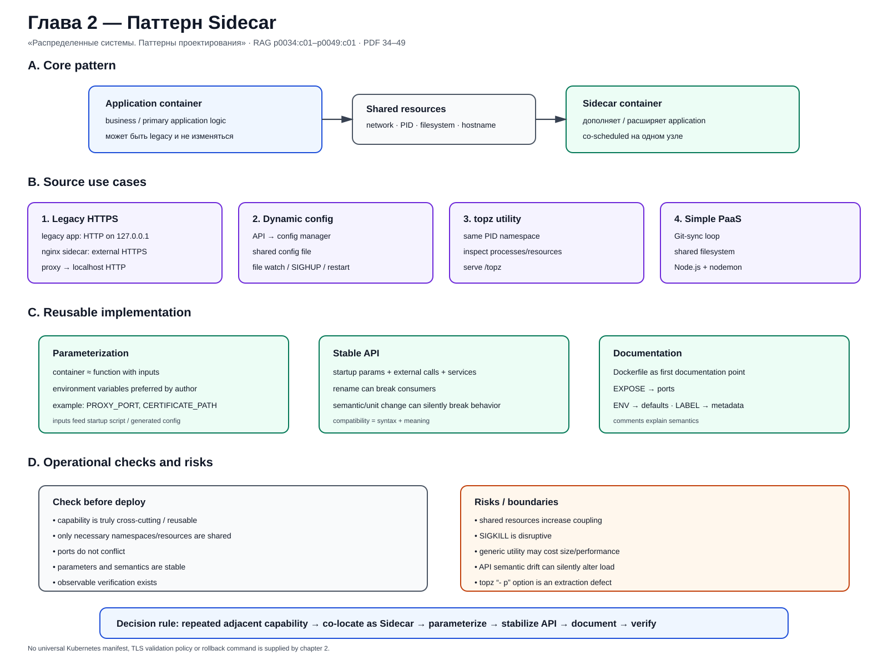
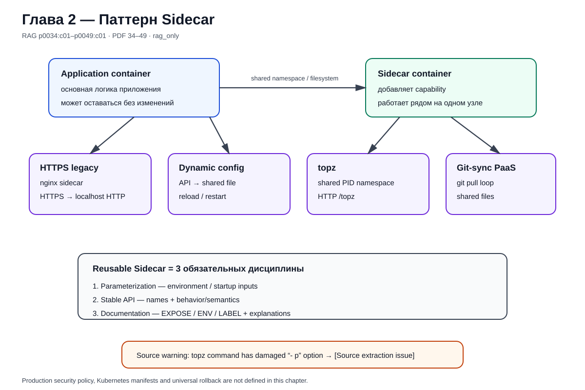

# Глава 2 — Паттерн Sidecar

RAG-grounded разбор главы 2 книги «Распределенные системы. Паттерны проектирования».

## Идентификация

- Book ID: `distributed-systems-patterns-brendan-burns-ru`
- Chapter: 2
- Source title: «Паттерн Sidecar»
- Slug: `sidecar-pattern`
- Chapter contract: `BIBLIOTEKA-VSP-CHAPTER-ARTIFACT-COLLECTION v1.7`
- Source policy: `rag_only`
- External sources: запрещены
- Model memory for book content: запрещена
- Прямой доступ к `source/book.pdf`: не использовался
- Completion status: `RAG_GROUNDED`

## Provenance

- RAG scope: `p0034:c01–p0049:c01`
- PDF pages: `34–49`
- Printed pages: `34–49`
- Source format: PDF
- Source SHA-256: `d4529f6267d0fe16d411c912a1ecc7ab4924530c376103ce5f16067aca337aa5`
- Boundary evidence:
  - `p0034:c01` — начало «Паттерн Sidecar»;
  - `p0049:c01` — явный раздел «Резюме»;
  - `p0050:c01` — уже «Паттерн Ambassador», глава 3.
- В chapter range пропусков RAG не обнаружено: `16/16` chunks.
- Boundary verified: yes.

## Артефакты

- [cheatsheet.md](cheatsheet.md)
- [commands.md](commands.md)
- [diagram.md](diagram.md)
- [summary.md](summary.md)
- [source-findings.md](source-findings.md)
- [visual-cheatsheet.svg](visual-cheatsheet.svg)
- [visual-cheatsheet-detailed.svg](visual-cheatsheet-detailed.svg)

Review questions/exercises в chapter range не обнаружены, поэтому `review-questions.md` и `review-answers.md` не создаются.

## 1. Что такое Sidecar

Глава определяет Sidecar как одноузловой паттерн из двух контейнеров:

~~~text
application container
+ sidecar container
→ совместное исполнение на одном узле
~~~

Контейнер приложения содержит основную логику. Sidecar дополняет или расширяет его функциональность, часто без необходимости менять само приложение.

Оба контейнера планируются как атомарная группа, например pod в Kubernetes, и могут совместно использовать:
- части файловой системы;
- hostname;
- сетевые пространства имен;
- PID namespace;
- другие ресурсы, необходимые конкретной реализации.

## 2. Legacy HTTPS modernization

Source scenario:

~~~text
legacy app
→ умеет только HTTP
→ менять/пересобирать дорого
→ bind на 127.0.0.1

nginx sidecar
→ совместное network namespace
→ принимает внешний HTTPS
→ proxy на localhost HTTP
~~~

В framing главы незашифрованный трафик остается внутри loopback-интерфейса группы контейнеров, а внешний трафик обслуживается через HTTPS.

Главный смысл примера: дополнительное требование можно вынести в sidecar, не меняя legacy application binary.

## 3. Dynamic configuration

Второй пример — адаптация file-based приложения к API-driven конфигурации.

~~~text
configuration API
→ configuration-manager sidecar
→ сравнение API-state и local file
→ обновление shared config file
→ уведомление application
→ reread / restart
~~~

Application и configuration manager совместно используют каталог.

Механизм reload зависит от приложения:
- наблюдение за изменением файла;
- сигнал `SIGHUP`;
- в крайнем случае — завершение приложения `SIGKILL`, после чего orchestrator перезапускает контейнер и приложение читает новую конфигурацию.

Exact signal command syntax глава не приводит.

## 4. Sidecar как reusable utility

Глава явно выводит Sidecar за пределы legacy modernization.

Основная идея:

~~~text
cross-cutting functionality
→ reusable utility container
→ deploy beside many applications
→ consistent implementation
~~~

Пример — `topz`: sidecar работает в том же PID namespace и предоставляет HTTP-интерфейс `/topz` для просмотра процессов и потребляемых ресурсов.

Преимущество относительно language-specific library:
- не нужно реализовывать функцию для каждого языка;
- orchestrator может автоматически добавлять один и тот же utility container к приложениям;
- интерфейс становится единообразнее.

Trade-off главы:
- generic component быстрее повторно использовать;
- application-specific implementation потенциально лучше адаптирована по размеру/производительности;
- выбор зависит от требований приложения.

## 5. Практикум topz

Глава показывает:

1. запуск application container;
2. получение container ID через `docker ps`;
3. сохранение ID в `APP_ID`;
4. запуск `topz` в PID namespace application container;
5. обращение к `http://localhost:8080/topz`.

В исходном RAG команда запуска topz содержит extraction defect в port flag: `-  p 8080:8080`. Она не исправляется молча. См. [source-findings.md](source-findings.md).

## 6. Простая PaaS-модель

Глава строит пример из:

~~~text
Node.js application
+ nodemon
+ shared filesystem
+ Git-sync sidecar
~~~

Sidecar выполняет цикл:

~~~bash
while true; do
  git pull
  sleep 10
done
~~~

При изменении репозитория sidecar обновляет shared filesystem; Node.js application настроено на restart при изменении файлов через nodemon.

Автор прямо отмечает, что пример намеренно упрощен.

## 7. Как сделать Sidecar reusable

Глава выделяет три обязательных аспекта:

1. parameterization;
2. clear container API;
3. documentation.

### 7.1. Parameterization

Контейнер предлагается мыслить как функцию с входными параметрами.

Для SSL-sidecar в качестве примера нужны как минимум:
- certificate path/name;
- application port.

Способы передачи:
- environment variables;
- command line.

Автор предпочитает environment variables.

### 7.2. Container API

API контейнера — не только HTTP endpoint.

Он включает все внешние взаимодействия:
- startup parameters;
- environment variables;
- external service calls;
- provided HTTP/other services;
- behavioral semantics параметров.

Глава показывает два вида breaking change:
- rename `UPDATE_FREQUENCY` → `UPDATE_PERIOD`;
- изменение единиц измерения/семантики значения.

Особенно важен второй случай: интерфейс может формально продолжить принимать значение, но изменить поведение и нагрузку.

### 7.3. Documentation

Глава рекомендует использовать Dockerfile как первую точку документации.

Source-supported directives:
- `EXPOSE` — объявить порт и пояснить его назначение;
- `ENV` — документировать/default-ировать параметры;
- `LABEL` — добавить metadata, например vendor/contact, URL, version.

В LABEL-примере есть namespace inconsistency, которая сохранена без исправления. См. [source-findings.md](source-findings.md).

## Главный принцип главы

~~~text
Не встраивать каждую cross-cutting функцию в каждое приложение.

Если функция:
- дополняет приложение,
- может жить рядом с ним на одном узле,
- использует четкий interface,
- пригодна для многих приложений,

то она является кандидатом на reusable Sidecar.
~~~

## Operational decision frame

### Хороший кандидат

- legacy app трудно менять;
- нужна дополнительная функция рядом с приложением;
- sidecar может использовать shared namespace/filesystem;
- функция повторяется между приложениями;
- interface можно стабилизировать и документировать.

### Требует осторожности

- sidecar меняет lifecycle application;
- shared resources создают coupling;
- PID/network namespace дают sidecar доступ к чувствительным runtime details;
- port conflicts возможны;
- generic component может проигрывать application-specific implementation по эффективности;
- breaking API change может нарушить множество consumers.

## Acceptance boundary

После чтения артефактов должно быть понятно:

- из каких двух ролей состоит Sidecar;
- почему совместное размещение и shared namespaces/resources важны;
- как Sidecar модернизирует legacy HTTPS без изменения application;
- как работает configuration-manager sidecar;
- что демонстрирует topz;
- как Git-sync sidecar формирует простой PaaS example;
- почему reusable Sidecar требует parameterization, API и documentation;
- чем явный breaking API change отличается от скрытого semantic change;
- какие source commands можно использовать, а какие строки повреждены extraction.

Production security validation, exact Kubernetes manifests, health probes, resource limits и universal rollback procedure в этой главе не определены и остаются `[Needs confirmation]`.
