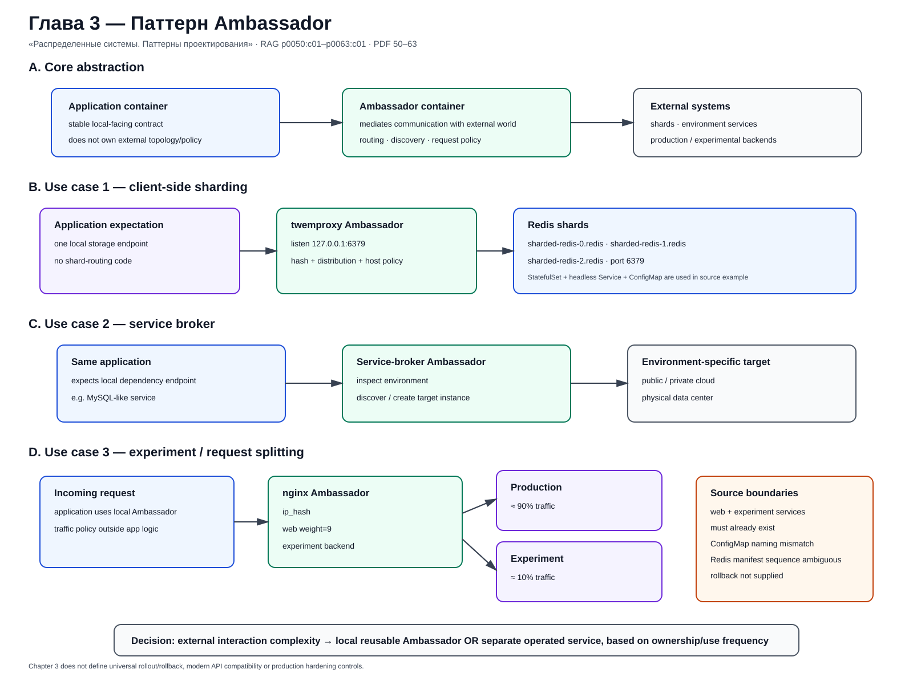
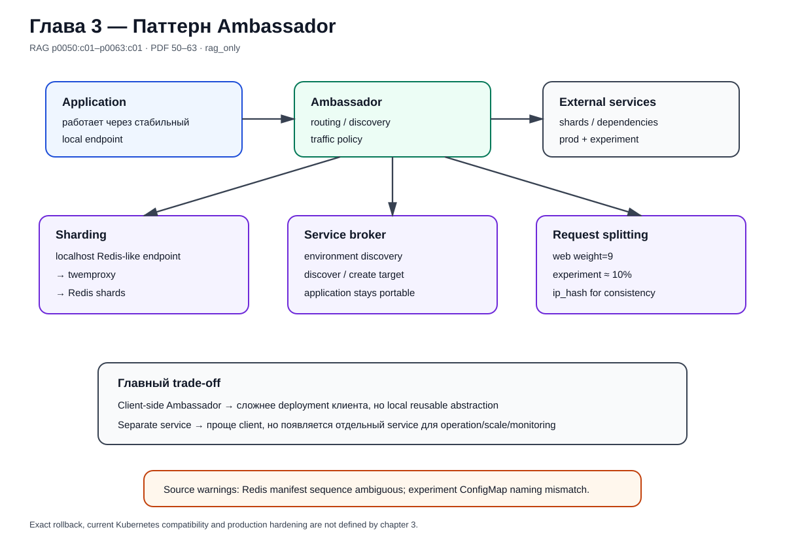

# Глава 3 — Паттерн Ambassador

RAG-grounded разбор главы 3 книги «Распределенные системы. Паттерны проектирования».

## Идентификация

- Book ID: `distributed-systems-patterns-brendan-burns-ru`
- Chapter: 3
- Source title: «Паттерн Ambassador»
- Slug: `ambassador-pattern`
- Chapter contract: `BIBLIOTEKA-VSP-CHAPTER-ARTIFACT-COLLECTION v1.7`
- Source policy: `rag_only`
- External sources: запрещены
- Model memory for book content: запрещена
- Прямой доступ к `source/book.pdf`: не использовался
- Completion status: `RAG_GROUNDED`

## Provenance

- RAG scope: `p0050:c01–p0063:c01`
- PDF pages: `50–63`
- Printed pages: `50–63`
- Source format: PDF
- Source SHA-256: `d4529f6267d0fe16d411c912a1ecc7ab4924530c376103ce5f16067aca337aa5`
- Boundary evidence:
  - `p0050:c01` — начало «Паттерн Ambassador»;
  - `p0063:c01` — завершение practical example;
  - `p0064:c01` — начало главы 4 «Адаптеры».
- В chapter range пропусков RAG не обнаружено: `14/14` chunks.
- Boundary verified: yes.

## Артефакты

- [cheatsheet.md](cheatsheet.md)
- [commands.md](commands.md)
- [diagram.md](diagram.md)
- [source-findings.md](source-findings.md)
- [visual-cheatsheet.svg](visual-cheatsheet.svg)
- [visual-cheatsheet-detailed.svg](visual-cheatsheet-detailed.svg)

Явного chapter-end «Резюме» в диапазоне главы 3 не обнаружено, поэтому `summary.md` не создаётся.

Review questions/exercises в chapter range не обнаружены, поэтому `review-questions.md` и `review-answers.md` не создаются.

## 1. Что такое Ambassador

Ambassador — одноузловой паттерн, в котором дополнительный контейнер становится посредником между application container и внешним миром.

~~~text
application container
→ localhost / local endpoint
→ ambassador container
→ external service(s)
~~~

Application не обязано знать детали удаленной topology, service discovery, sharding или traffic policy. Эти обязанности переносятся в Ambassador.

Глава подчеркивает две ценности:
- separation of concerns;
- reusable implementation, которую можно применять рядом с разными applications.

## 2. Ambassador и client-side sharding

Проблема:

~~~text
single-storage client
+ storage layer no longer fits on one machine
→ sharded storage
→ client needs shard-routing logic
~~~

Глава рассматривает два варианта:
1. встроить routing logic в сам distributed service;
2. вынести routing logic в одноузловой Ambassador на стороне клиента.

Во втором случае application продолжает подключаться к локальному endpoint, будто работает с одним хранилищем.

~~~text
application
→ localhost storage endpoint
→ sharding Ambassador
→ shard A / shard B / shard C
~~~

Ambassador:
- выбирает нужный shard;
- переадресует запрос;
- возвращает результат application.

Главный design benefit — application и sharding logic разделены.

## 3. Практикум: Redis + twemproxy

Source example использует:
- Kubernetes StatefulSet;
- три Redis replicas;
- headless Service для DNS names;
- twemproxy как sharding proxy;
- ConfigMap для `nutcracker.yaml`;
- Pod, содержащий Ambassador container.

Глава показывает, что twemproxy слушает `127.0.0.1:6379`, поэтому application может обращаться к локальному Redis-like endpoint, а Ambassador распределяет запросы между:
- `sharded-redis-0.redis`;
- `sharded-redis-1.redis`;
- `sharded-redis-2.redis`.

Используемая source configuration также задает hash/distribution и параметры обработки failed hosts.

Exact operational sequence имеет source ambiguity вокруг повторного использования файла `redis-shards.yaml`; она вынесена в [source-findings.md](source-findings.md).

## 4. Ambassador как service broker

Следующая задача — переносимость application между различными environments:
- public cloud;
- private cloud;
- physical data center.

Application может требовать, например, MySQL, но способ получения конкретного MySQL instance различается по environment.

Глава выносит эту разницу в Ambassador service broker:

~~~text
application
→ local MySQL-like endpoint
→ Ambassador / service broker
→ discover or create target service
→ connect application to it
~~~

Application не занимается environment-specific discovery/provisioning logic.

## 5. Ambassador для экспериментов и request splitting

Третий вариант — traffic splitting.

Цель:
- направить часть запросов на experimental implementation;
- сравнить новую версию с production;
- либо продублировать реальную workload на новый service, не используя его response для пользователя.

В основной схеме:

~~~text
application request
→ local Ambassador
→ production service
→ experimental service

user response ← production result
~~~

Таким образом, traffic policy отделяется от application logic.

## 6. Практикум: 10% experiment через nginx

Source nginx configuration задает:
- backend `web` с weight `9`;
- backend `experiment` без дополнительного weight;
- `ip_hash`;
- local listener;
- proxy to backend.

Chapter interpretation:
- около 90% трафика направляется в production;
- около 10% — в experiment;
- IP hashing используется, чтобы один пользователь не переключался постоянно между двумя версиями.

Перед запуском Ambassador source требует существования сервисов `web` и `experiment`.

Команда создания ConfigMap в RAG внутренне не согласована с именем ConfigMap, которое позже ожидает Pod. Это не исправляется молча; см. [source-findings.md](source-findings.md).

## 7. Client-side Ambassador или отдельный service

Глава несколько раз поднимает один и тот же trade-off.

### Client-side Ambassador

Плюсы в framing главы:
- colocated с application;
- локальный endpoint для application;
- reusable container;
- application не знает external topology/policy.

Цена:
- deployment client-side становится сложнее.

### Central/distributed service

Плюсы:
- client проще;
- логика вынесена в отдельный service.

Цена:
- отдельный service нужно поддерживать, масштабировать, мониторить и развертывать.

Глава не объявляет один вариант универсально правильным. Выбор зависит от ownership, deployment model, frequency of use и того, новый это код или existing system.

## 8. Что Ambassador абстрагирует

| Problem | Ambassador responsibility |
|---|---|
| sharded storage | shard routing |
| environment-specific dependency | service discovery / brokering |
| production vs experiment | request splitting / proxying |

Повторяющийся принцип:

~~~text
application talks to stable local interface
Ambassador absorbs external variability
~~~

## Главный принцип главы

~~~text
Если сложность относится не к business logic application,
а к способу его взаимодействия с внешними сервисами,
эту сложность можно вынести в colocated Ambassador.

Application получает стабильный локальный interface.
Ambassador берет на себя routing, discovery или traffic policy.
~~~

## Риски и ограничения

- Ambassador становится частью request/data path;
- misconfiguration routing logic может направлять запросы не туда;
- client-side deployment становится сложнее;
- external services remain prerequisites;
- experiment traffic требует корректной backend configuration;
- chapter не дает универсальных health/readiness probes;
- rollback commands для Kubernetes resources не приводятся;
- source examples содержат operational ambiguities, зафиксированные отдельно.

## Acceptance boundary

После чтения артефактов должно быть понятно:

- чем Ambassador отличается от Sidecar по роли;
- зачем application подключается к local endpoint;
- как sharding proxy скрывает shard topology;
- как Redis/twemproxy practical example реализует эту идею;
- что делает service broker;
- как Ambassador реализует request splitting;
- зачем в nginx experiment используется IP hashing;
- какой trade-off существует между client-side Ambassador и отдельным service;
- какие Kubernetes команды подтверждены source RAG;
- какие source fragments нельзя считать copy/paste-safe без дополнительной проверки.

Exact current Kubernetes API compatibility, production security controls, resource limits, rollback commands и current twemproxy status: `[Needs confirmation]` в рамках rag_only главы.
