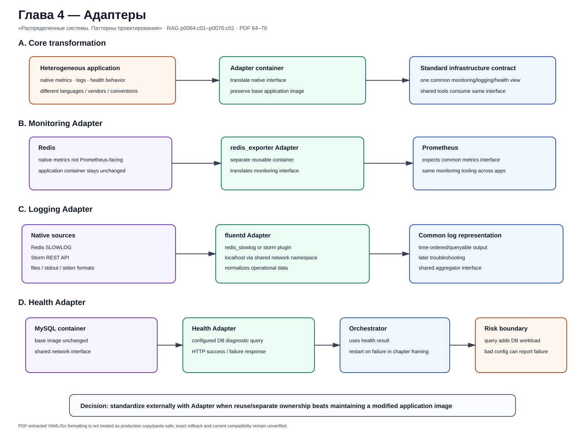
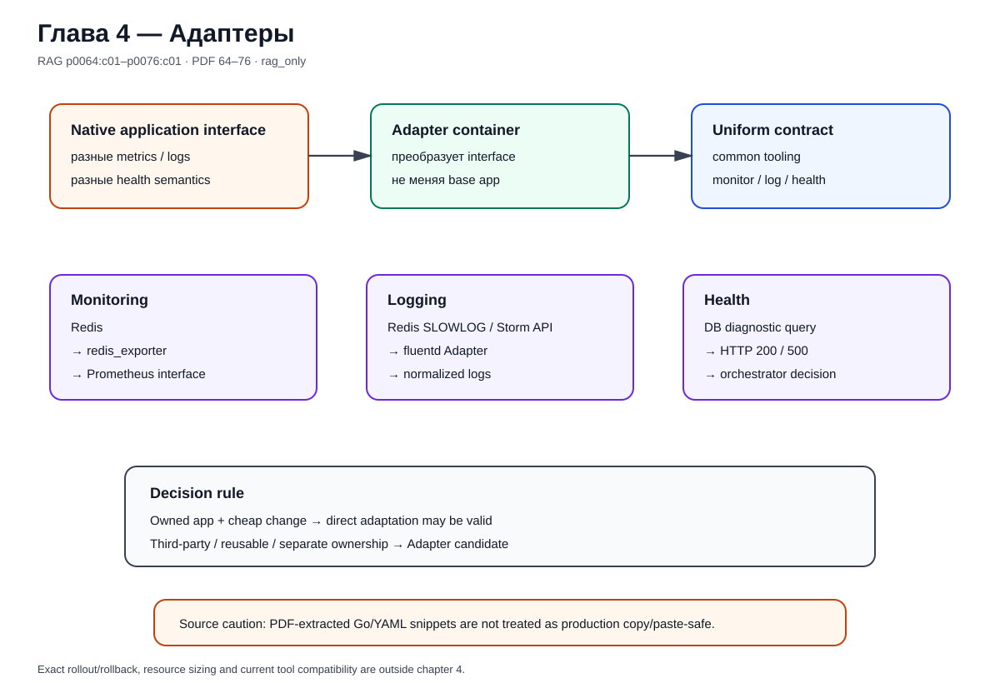

# Глава 4 — Адаптеры

RAG-grounded разбор главы 4 книги «Распределенные системы. Паттерны проектирования».

## Идентификация

- Book ID: `distributed-systems-patterns-brendan-burns-ru`
- Chapter: 4
- Source title: «Адаптеры»
- Slug: `adapter-pattern`
- Chapter contract: `BIBLIOTEKA-VSP-CHAPTER-ARTIFACT-COLLECTION v1.7`
- Source policy: `rag_only`
- Completion status: `RAG_GROUNDED`

## Provenance

- RAG scope: `p0064:c01–p0076:c01`
- PDF pages: `64–76`
- Printed pages: `64–76`
- Source format: PDF
- Source SHA-256: `d4529f6267d0fe16d411c912a1ecc7ab4924530c376103ce5f16067aca337aa5`
- Boundary evidence:
  - `p0064:c01` — начало главы «Адаптеры»;
  - `p0076:c01` — завершение рассуждения о reusable health-check adapter;
  - `p0077:c01` — начало части II, вне главы 4.
- Chapter range: `13/13` addressable chunks.
- Boundary verified: yes.

## Артефакты

- [cheatsheet.md](cheatsheet.md)
- [commands.md](commands.md)
- [diagram.md](diagram.md)
- [source-findings.md](source-findings.md)
- [visual-cheatsheet.svg](visual-cheatsheet.svg)
- [visual-cheatsheet-detailed.svg](visual-cheatsheet-detailed.svg)

Явного chapter-end «Резюме» и review questions в диапазоне главы нет; соответствующие conditional artifacts не создаются.

## 1. Что делает Adapter

Adapter — последний одноузловой паттерн в этой части книги.

Его задача:

~~~text
heterogeneous application interface
→ Adapter
→ predefined uniform interface
→ common monitoring/logging/health tooling
~~~

Контейнер-адаптер не столько добавляет произвольную capability, сколько преобразует интерфейс приложения в стандартный интерфейс, ожидаемый инфраструктурой.

Глава рассматривает heterogeneous reality как норму:
- разные языки;
- сторонние/open-source/proprietary components;
- разные logging conventions;
- разные monitoring interfaces.

Adapter позволяет поверх этого разнообразия построить единообразный operational contract.

## 2. Monitoring Adapter

Проблема:

~~~text
application A → monitoring format A
application B → monitoring format B
application C → monitoring format C
→ hard to aggregate and alert
~~~

Adapter преобразует application-specific monitoring interface в интерфейс, который понимает единая monitoring system.

Глава перечисляет heterogeneous monitoring mechanisms, включая syslog, ETW и JMX, а также различия push/pull.

Design benefit:
- application может оставаться неизменным;
- monitoring adapter можно обновлять независимо;
- adapter reusable между applications;
- monitoring team может владеть adapter отдельно от application team;
- отдельный container получает собственные CPU/memory resources.

## 3. Практикум: Redis → Prometheus

Source example начинает с Pod, содержащего только Redis.

Затем добавляется отдельный adapter container:

~~~text
Redis
+ redis_exporter Adapter
→ Prometheus-compatible metrics interface
~~~

Source image:
- `redis`;
- `oliver006/redis_exporter`.

Главная идея — не переписывать Redis и не собирать modified Redis image ради Prometheus-facing interface.

## 4. Logging Adapter

Logging heterogeneity:

- разные log levels;
- разные files;
- stdout/stderr;
- разные structured formats;
- разные timestamp conventions.

В container environment глава отмечает ожидание вывода в stdout, который затем доступен через `docker logs` или `kubectl logs`.

Adapter может:

~~~text
application-specific logs/files
→ logging Adapter
→ stdout / common structured representation
→ log aggregator
~~~

Это позволяет унифицировать не application internals, а operational output.

## 5. Почему не всегда менять application image

Глава делает важное разграничение.

Если команда владеет application/container и может безопасно внедрить standard interface непосредственно туда — это допустимый вариант.

Но если используется чужой container, modified fork/image создает дополнительную ownership burden:
- свои fixes;
- отслеживание upstream fixes;
- собственный release/update path.

Отдельный Adapter сохраняет upstream application image неизменным и потенциально reusable.

## 6. Практикум: fluentd + Redis SLOWLOG

Source example:

~~~text
Redis application container
+ fluentd Adapter
+ fluent-plugin-redis-slowlog
→ time-ordered slow-query log
~~~

Adapter использует shared network namespace и подключается к:
- `localhost`;
- Redis port `6379`.

Source configuration:

~~~text
type redis_slowlog
host localhost
port 6379
tag redis.slowlog
~~~

Смысл — превратить ephemeral/current Redis SLOWLOG information в журнал, доступный позднее для troubleshooting.

## 7. fluentd + Apache Storm

Аналогичный Adapter использует `fluent-plugin-storm`.

Source configuration указывает:
- `url http://localhost:8080`;
- `window 600`;
- `sys 0`.

И снова local endpoint возможен благодаря общему network namespace.

## 8. Health-check Adapter

Для сложного health check недостаточно только проверить, что process существует или port принимает connection.

Chapter case:

~~~text
database container
+ Adapter with diagnostic logic
→ HTTP health interface
→ orchestrator health check
→ restart if health check fails
~~~

Adapter содержит application-specific diagnostic knowledge, но base database image остается неизменным.

Это особенно полезно, если проверка должна выполнять запросы, похожие на реальную workload.

## 9. Практикум: MySQL health Adapter

Глава показывает Go implementation, которая:
- принимает DB user/password/database/query/address как parameters;
- открывает DB connection;
- по HTTP request выполняет configured query;
- возвращает HTTP 500 при ошибке;
- возвращает HTTP 200 и `OK` при успехе.

Далее MySQL container объединяется с `brendanburns/mysql-adapter`.

Source example credentials в chapter artifacts заменены placeholders по security policy; исходный смысл не меняется.

Точный Go source из RAG нельзя считать copy/paste-safe из-за line wrapping text extraction; это зафиксировано в [source-findings.md](source-findings.md).

## 10. Reuse и организационная ценность

Финальный тезис главы выходит за пределы технической композиции:

~~~text
modular Adapter
→ reusable component
→ reuse of code
+ reuse of other people's expertise
→ community collaboration
~~~

Если каждый developer встраивает собственный health check в собственный modified image, reuse теряется.

Если health logic оформлена отдельным Adapter container, ею могут пользоваться разные teams и applications.

## Главный принцип главы

~~~text
Не заставлять всю heterogeneous систему говорить на одном
нативном интерфейсе.

Преобразовывать разные application-facing interfaces
в один operational contract с помощью Adapter.
~~~

## Отличие от Sidecar и Ambassador

В framing этих глав:

| Pattern | Primary role |
|---|---|
| Sidecar | дополняет application новой capability |
| Ambassador | посредник между application и external world |
| Adapter | преобразует application interface к standardized interface |

Границы могут пересекаться на уровне mechanics, но архитектурный intent различается.

## Риски и ограничения

- Adapter становится дополнительным container/runtime component;
- shared namespace/resource coupling остается;
- неверное преобразование может искажать monitoring/log data;
- health Adapter может инициировать restart через orchestrator policy;
- custom fork application image иногда проще, если team полностью владеет им;
- exact resource sizing, retries, security policy и rollback procedures глава не задает;
- YAML/Go snippets из PDF extraction требуют осторожности перед реальным execution.

## Acceptance boundary

После чтения должно быть понятно:

- какую heterogeneous проблему решает Adapter;
- как monitoring adapter унифицирует metrics;
- зачем Redis exporter вынесен отдельно;
- как logging adapter нормализует output;
- почему fluentd рядом с Redis/Storm является Adapter;
- зачем complex DB health logic выносить из base image;
- когда изменение application/container может быть разумнее Adapter;
- как modular Adapter поддерживает code/expertise reuse.

Current Prometheus/fluentd/Kubernetes compatibility и production-ready manifests: `[Needs confirmation]`.
