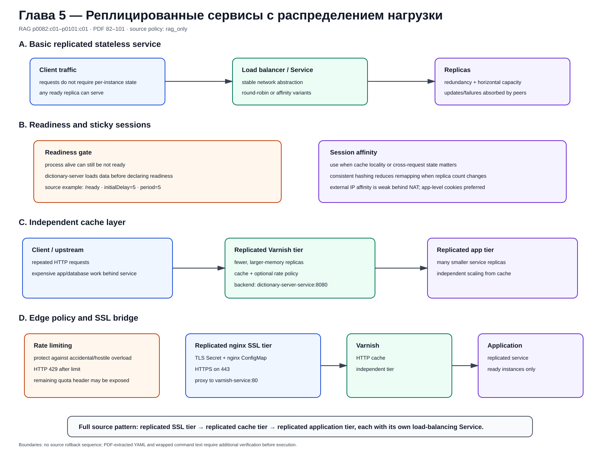
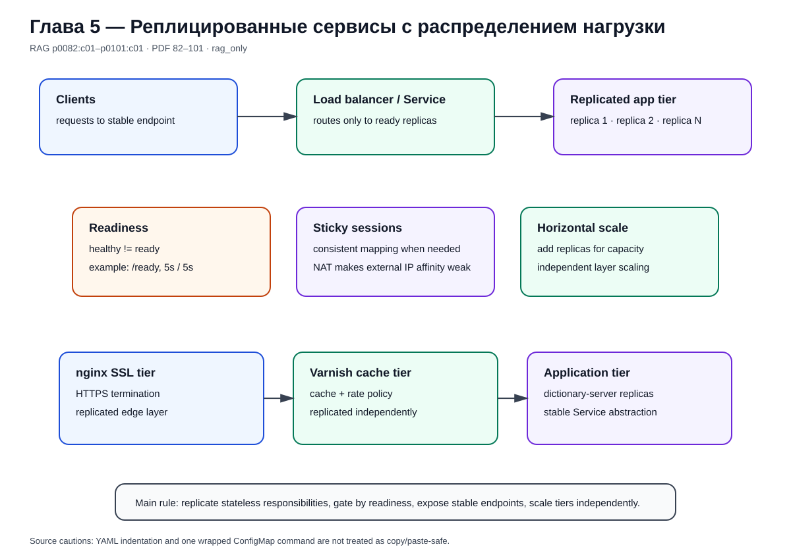

# Глава 5 — Реплицированные сервисы с распределением нагрузки

RAG-grounded разбор главы 5 книги «Распределенные системы. Паттерны проектирования».

## Идентификация

- Book ID: `distributed-systems-patterns-brendan-burns-ru`
- Chapter: 5
- Source title: «Реплицированные сервисы с распределением нагрузки»
- Slug: `load-balanced-replicated-services`
- Chapter contract: `BIBLIOTEKA-VSP-CHAPTER-ARTIFACT-COLLECTION v1.7`
- Source policy: `rag_only`
- Completion status: `RAG_GROUNDED`

## Provenance

- RAG scope: `p0082:c01–p0101:c01`
- PDF pages: `82–101`
- Printed pages: `82–101`
- Source format: PDF
- Source SHA-256: `d4529f6267d0fe16d411c912a1ecc7ab4924530c376103ce5f16067aca337aa5`
- Boundary evidence:
  - `p0082:c01` — начало главы 5;
  - `p0101:c01` — явный раздел «Резюме»;
  - `p0102:c01` — начало главы 6 «Шардированные сервисы».
- Chapter range: `20/20` addressable chunks.
- Boundary verified: yes.

## Артефакты

- [cheatsheet.md](cheatsheet.md)
- [commands.md](commands.md)
- [diagram.md](diagram.md)
- [summary.md](summary.md)
- [source-findings.md](source-findings.md)
- [visual-cheatsheet.svg](visual-cheatsheet.svg)
- [visual-cheatsheet-detailed.svg](visual-cheatsheet-detailed.svg)

Review questions/exercises в диапазоне главы не обнаружены.

## 1. Core pattern

Реплицированный сервис с распределением нагрузки состоит из масштабируемого набора эквивалентных server instances за load balancer.

~~~text
client requests
→ load balancer
→ replica A / replica B / replica C
~~~

Для stateless service любой healthy/ready экземпляр может обслужить запрос.

Глава связывает replication с двумя задачами:
- redundancy / availability;
- horizontal scalability.

## 2. Почему одной копии недостаточно

Source example использует SLA 99,9 %.

При одном instance дневной downtime budget — примерно 1,4 минуты. Если новая версия выпускается каждый час, допустимое среднее окно недоступности одного instance становится около 3,6 секунды.

Chapter conclusion: вторая replica позволяет обновлять или восстанавливать один instance, пока другой продолжает обслуживать пользователей.

Это иллюстрация source chapter, а не универсальный SLO calculation для всех систем.

## 3. Readiness ≠ health

Глава проводит важную границу:

~~~text
process/container healthy
!=
application ready to serve user traffic
~~~

Приложение может быть живо, но еще:
- подключается к БД;
- загружает plugins;
- загружает data/files из сети.

Поэтому load balancer должен учитывать readiness endpoint.

В dictionary-server example:
- endpoint: `/ready`;
- initial delay: 5 seconds;
- period: 5 seconds.

## 4. Kubernetes practical: dictionary-server

Source deployment:
- `replicas: 3`;
- image `brendanburns/dictionary-server`;
- port `8080`;
- readinessProbe на `/ready`.

Source Service предоставляет:
- stable network name;
- selector `app: dictionary-server`;
- service port `8080`;
- targetPort `8080`.

Глава показывает:
- local Docker test;
- Kubernetes Deployment;
- Kubernetes Service.

## 5. Sticky sessions

Иногда равномерное распределение между replicas нежелательно.

Причины в chapter:
- user-specific cache locality;
- long-lived interaction;
- state between requests.

Sticky sessions направляют запросы конкретного пользователя одному instance.

Source framing:
- IP-based hashing может работать внутри cluster/local addressing;
- внешний IP affinity часто плохо работает из-за NAT;
- для внешних sessions автор предпочитает application-level affinity, например cookies;
- consistent hashing уменьшает количество remappings при изменении replica count.

## 6. Application-level replication and cache tier

HTTP awareness позволяет добавить application-level layers.

Chapter introduces Varnish cache:

~~~text
client
→ replicated cache tier
→ replicated dictionary/web service
~~~

Автор аргументирует, что cache и application layer часто должны масштабироваться независимо:
- cache — меньше крупных instances с большей memory;
- web service — больше небольших instances.

Если поставить Sidecar cache у каждой application replica, одинаковые pages могут дублироваться во многих independent caches и снижать aggregate hit ratio.

## 7. Cache vs sticky sessions

Source warning:

~~~text
IP affinity
+ proxy/cache layer
→ backend sees cache IP, not end-user IP
→ skewed affinity / some replicas may receive little traffic
~~~

Chapter recommendation:
- использовать cookie или HTTP-header based affinity вместо backend IP affinity, если cache/proxy скрывает client IP.

## 8. Varnish practical

Varnish backend:
- host `dictionary-server-service`;
- port `8080`.

Source then creates:
- ConfigMap with `default.vcl`;
- replicated Varnish Deployment;
- `replicas: 2`;
- memory reservation/source cache allocation around 2 GiB/2G;
- Service `varnish-service`.

Architecture:

~~~text
client
→ varnish-service
→ Varnish replicas
→ dictionary-server-service
→ dictionary replicas
~~~

## 9. Rate limiting / DoS protection

Reverse proxy layer can do more than cache.

Chapter discusses rate limiting for:
- accidental client overload;
- accidental internal load tests;
- hostile traffic.

Source behavior:
- rate limits may vary for anonymous vs authenticated users;
- exceeding limit returns HTTP `429`;
- API may expose remaining request count in a header such as `X-RateLimit-Remaining`.

Exact Varnish throttle configuration is not provided in retrieved chapter range.

## 10. SSL bridge layer

Varnish in chapter cannot provide SSL bridge functionality, so another replicated layer is added using nginx.

~~~text
HTTPS client
→ replicated nginx SSL layer
→ HTTP
→ replicated Varnish cache layer
→ replicated application layer
~~~

The chapter emphasizes separate certificates for independently deployable layers/services.

Source practical:
- Kubernetes TLS Secret;
- nginx ConfigMap;
- replicated nginx Deployment with 4 replicas;
- nginx Service of type `LoadBalancer`;
- `kubectl get services` to discover external address.

## 11. Complete three-layer pattern

Chapter-end architecture contains three replicated layers:
1. application service;
2. cache/proxy service;
3. SSL bridge service.

Each layer gets its own Deployment and load-balancing Service.

This separation permits each layer to:
- scale independently;
- have a specialized responsibility;
- remain replaceable/versionable without collapsing everything into one process.

## Главный принцип главы

~~~text
stateless capability
→ replicate
→ expose through stable load-balancing interface
→ exclude not-ready instances
→ scale replicas horizontally

additional HTTP concerns
→ add independent replicated layers
→ cache / rate policy / SSL bridge
~~~

## Риски и ограничения

- load balancing without readiness can route traffic to initialized-but-not-ready instances;
- session affinity creates coupling between user and replica;
- proxy/cache can invalidate naive IP affinity assumptions;
- cache tier sizing differs from application tier sizing;
- more layers mean more operational components;
- rate limiting can reject legitimate traffic if policy is wrong;
- TLS private key handling is security-sensitive;
- source Kubernetes YAML is PDF-extracted and not treated as current production-ready manifest;
- rollback procedures are not supplied.

## Acceptance boundary

После чтения должно быть понятно:
- зачем stateless services replicate;
- почему readiness отличается от liveness/health;
- как Deployment + Service реализуют basic pattern;
- когда нужны sticky sessions;
- почему caching tier лучше масштабировать независимо;
- как proxy affects IP-based session affinity;
- какие функции кроме cache может выполнять reverse-proxy layer;
- зачем нужен отдельный nginx SSL tier;
- какие source commands подтверждены;
- какие snippets требуют additional verification.

Current Kubernetes API compatibility, certificate lifecycle, current Varnish/nginx configuration best practices и exact rollback: `[Needs confirmation]`.
