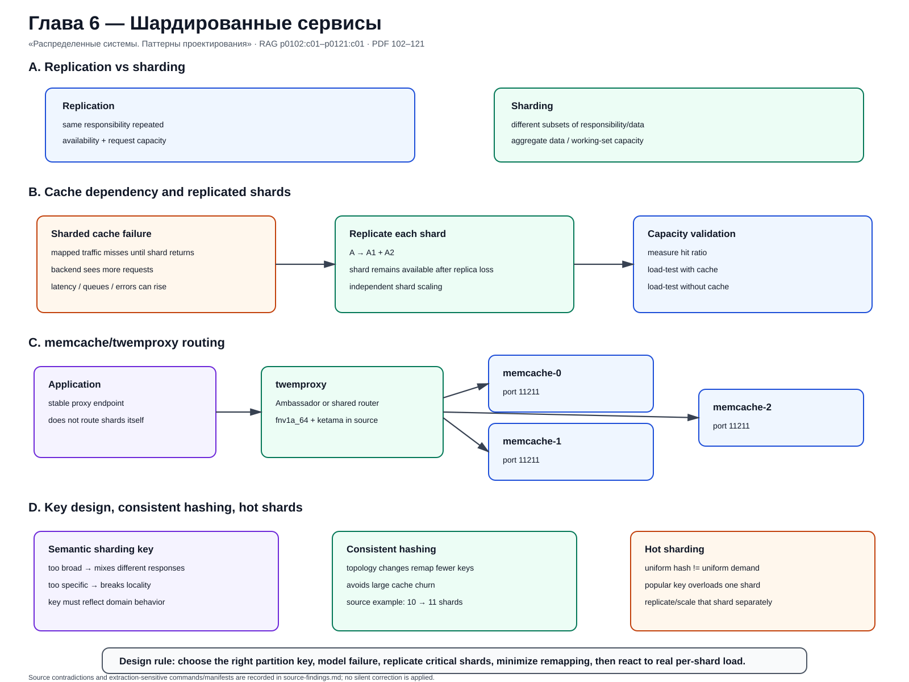
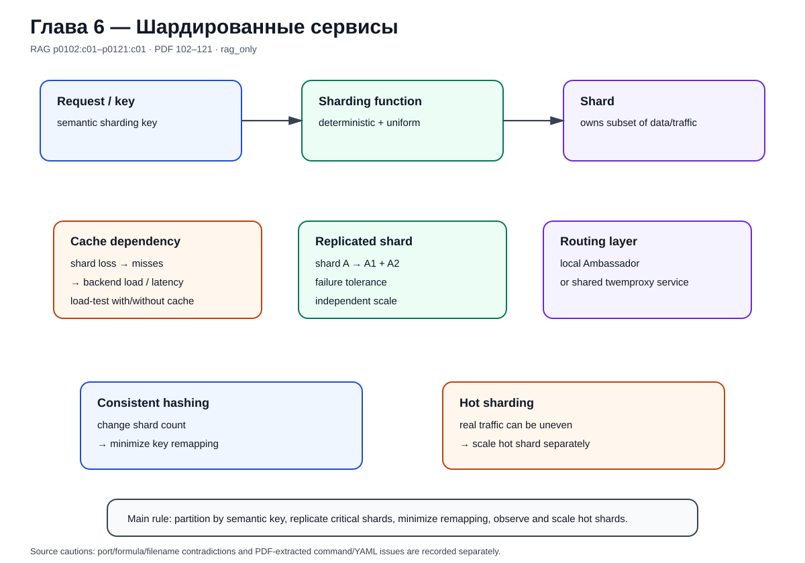

# Глава 6 — Шардированные сервисы

RAG-grounded разбор главы 6 книги «Распределенные системы. Паттерны проектирования».

## Идентификация

- Book ID: `distributed-systems-patterns-brendan-burns-ru`
- Chapter: 6
- Source title: «Шардированные сервисы»
- Slug: `sharded-services`
- Chapter contract: `BIBLIOTEKA-VSP-CHAPTER-ARTIFACT-COLLECTION v1.7`
- Source policy: `rag_only`
- Completion status: `RAG_GROUNDED`

## Provenance

- RAG scope: `p0102:c01–p0121:c01`
- PDF pages: `102–121`
- Printed pages: `102–121`
- Source format: PDF
- Source SHA-256: `d4529f6267d0fe16d411c912a1ecc7ab4924530c376103ce5f16067aca337aa5`
- Boundary evidence:
  - `p0102:c01` — начало главы 6;
  - `p0121:c01` — завершение примера hot sharding;
  - `p0122:c01` — начало главы 7 «Паттерн Scatter/Gather».
- Chapter range: `20/20` addressable chunks.
- Boundary verified: yes.

## Артефакты

- [cheatsheet.md](cheatsheet.md)
- [commands.md](commands.md)
- [diagram.md](diagram.md)
- [source-findings.md](source-findings.md)
- [visual-cheatsheet.svg](visual-cheatsheet.svg)
- [visual-cheatsheet-detailed.svg](visual-cheatsheet-detailed.svg)

Явного chapter-end «Резюме» и review questions в диапазоне главы 6 не обнаружено; соответствующие conditional artifacts не создаются.

## 1. Репликация и шардирование решают разные задачи

В replicated service каждая replica эквивалентна и может обслужить любой запрос.

В sharded service каждый shard отвечает только за часть запросов или данных.

~~~text
replication
→ copies of same service
→ availability / request capacity

sharding
→ partitioned responsibility/data
→ data capacity
~~~

Глава связывает replication в первую очередь со stateless services, а sharding — со stateful services, где данные перестают помещаться на одну машину.

## 2. Почему sharded cache хранит больше разных данных

Source example:

- один cache instance: 10 GiB;
- один instance: 100 RPS;
- dataset: 200 GiB;
- expected load: 1000 RPS;
- instances: 10.

Если 10 instances используются как independent replicated caches, каждый хранит примерно одинаковый набор hot data, поэтому совокупно cache покрывает около 10 GiB уникальных данных — 5% dataset.

Если те же 10 instances являются shards, каждый хранит собственную часть, поэтому можно держать около 100 GiB уникальных данных — 50% dataset.

Главный смысл:
- replication расходует память на redundancy;
- sharding расходует память на расширение working set.

## 3. Cache failure — вопрос capacity, а не только miss rate

Глава требует оценивать, что произойдет с backend при частичном или полном cache failure.

Source example:
- backend capacity: 1000 RPS;
- cache hit ratio: 50%;
- total traffic with cache: 2000 RPS.

Если cache исчезнет, backend получит все 2000 RPS и начнет возвращать errors сверх своей capacity.

Поэтому автор предлагает не считать полные 2000 RPS безопасной service capacity и показывает более консервативную оценку 1500 RPS, чтобы пережить потерю половины cache instances.

Это конкретный chapter example, а не универсальная capacity formula.

## 4. Cache влияет и на latency

Source example:
- uncached request: 100 ms;
- cache hit: 10 ms;
- hit ratio: 25%;
- average latency: 77.5 ms.

Глава подчеркивает: cache повышает throughput и снижает latency. Поэтому failure/deployment cache может вызвать не просто дополнительные misses, но очереди, timeouts и rejected requests.

Source recommendation:
- load-test систему с cache;
- load-test систему без cache;
- измерить dependency system performance on cache.

Точных команд нагрузочного теста глава не предоставляет.

## 5. Replicated + sharded cache

Если потеря одного shard неприемлема, каждый shard превращается в replicated service:

~~~text
shard A → replica A1 + A2
shard B → replica B1 + B2
shard C → replica C1 + C2
~~~

Преимущества в chapter framing:
- shard survives replica failure;
- rolling replacement одного replica не уничтожает shard;
- каждый shard можно масштабировать независимо;
- появляется возможность hot-shard scaling.

Цена:
- больше deployment complexity;
- больше reserved compute capacity.

## 6. Практикум: memcache + Ambassador/twemproxy

Source example строит:
1. memcached StatefulSet на 3 replicas;
2. headless Service `memcache`;
3. DNS names вида `memcache-0.memcache`;
4. twemproxy configuration;
5. ConfigMap;
6. Ambassador Pod с twemproxy.

twemproxy routing config включает:
- `fnv1a_64`;
- `ketama`;
- auto-eject failed hosts;
- retry/failure parameters;
- три memcache backends.

Application может работать с local proxy interface, а twemproxy выбирает shard.

В source есть внутренние несоответствия port/filename/command syntax; они зафиксированы в [source-findings.md](source-findings.md).

## 7. Ambassador или shared shard router

Глава сравнивает два варианта.

### Ambassador

~~~text
application pod
+ local twemproxy
→ direct route to shards
~~~

Плюс:
- нет дополнительного remote routing hop.

Минус:
- twemproxy нужно развертывать рядом с каждым consumer pod.

### Shared routing service

~~~text
application
→ load-balanced shared twemproxy service
→ memcache shards
~~~

Плюс:
- consumers используют один named service;
- меньше client-side deployment complexity.

Минусы:
- shared router нужно масштабировать с нагрузкой;
- появляется дополнительный network hop, latency и bandwidth consumption.

Глава не объявляет один вариант универсально правильным.

## 8. Sharding function

Задача функции:

~~~text
request/key
→ ShardingFunction
→ shard
~~~

Source prose выделяет два свойства underlying hash:
- determinism — одинаковый input дает тот же result;
- uniformity — values распределяются равномерно.

Это нужно для:
- стабильного routing;
- равномерной нагрузки.

В source формула и prose вокруг modulo расходятся; точная запись зафиксирована в `source-findings.md`.

## 9. Выбор sharding key

Ключ должен группировать requests, которые действительно могут использовать один и тот же data/result shard.

Source example с HTTP request:
- timestamp;
- client IP;
- request path.

Хешировать весь request слишком специфично: одинаковый resource path может попасть на разные shards из-за времени/IP.

Использовать только path иногда слишком широко: если response зависит от country, запросы разных стран нельзя смешивать.

Source refinement:

~~~text
country(request.ip) + request.path
→ better semantic key when response depends on country
~~~

Главный design rule:
- слишком общий key смешивает requests с разными responses;
- слишком специфичный key разбивает эквивалентные requests по разным shards.

## 10. Consistent hashing

Проблема обычного reshaping shard count:

~~~text
hash(key) modulo N
→ change N
→ many keys remap
→ cache miss spike / expensive reshuffle
~~~

Source example:
- 10 → 11 shards;
- conventional modulo mapping может переназначить очень большую часть keys;
- consistent hashing ограничивает масштаб remapping;
- chapter приводит оценку менее 10% для примера 10 → 11.

Главный смысл — изменение shard count должно минимально нарушать существующее mapping.

## 11. Практикум: nginx consistent sharding proxy

Source nginx example:
- `hash $request_uri consistent`;
- backends `web-shard-1.web`, `web-shard-2.web`, `web-shard-3.web`;
- local listener;
- proxy to named backend.

В PDF-extracted fragment есть punctuation/formatting uncertainty, поэтому snippet не объявляется production-copy-safe.

## 12. Sharding beyond caches

Chapter example — large multiplayer game.

Если world слишком велик для одной машины, shard key может быть связан с player location.

Идея:
- users in same region need to interact;
- distant users likely do not;
- location becomes semantically meaningful partition key.

То есть sharding key определяется domain behavior, а не только техническим identifier.

## 13. Hot sharding

Равномерное hash distribution не гарантирует равномерную real workload.

Некоторые keys становятся disproportionately popular — hot shards.

Source example:
- viral photo;
- shard A получает примерно в четыре раза больше traffic;
- replicated sharded architecture позволяет дать shard A дополнительную replica;
- менее нагруженные shards могут быть уплотнены на другой machine.

Если orchestrator поддерживает autoscaling, resources для replicated shards можно динамически выделять и освобождать по нагрузке.

## Главный принцип главы

~~~text
data/request space too large for one node
→ choose semantic sharding key
→ deterministic and balanced routing
→ observe cache/capacity dependency
→ replicate shards when shard loss is unacceptable
→ use consistent hashing when shard count changes
→ scale hot shards independently
~~~

## Риски и ограничения

- wrong sharding key creates poor locality or incorrect cache reuse;
- one failed non-replicated shard affects its mapped traffic;
- cache failure can overload backend;
- changing shard count can cause massive remapping;
- shared router adds latency/bandwidth cost;
- hot shards break assumptions of uniform load;
- replicated shards cost extra compute;
- source practical examples contain command/text mismatches;
- exact current Kubernetes/twemproxy/nginx compatibility is outside rag_only scope.

## Acceptance boundary

После чтения должно быть понятно:
- чем sharding отличается от replication;
- почему sharding увеличивает unique data capacity;
- почему cache failure надо моделировать по backend capacity;
- зачем сочетать replication и sharding;
- как memcache/twemproxy example реализует routing;
- trade-off Ambassador vs shared router;
- свойства sharding function;
- как выбирать semantic key;
- зачем consistent hashing;
- что такое hot shard и почему его масштабируют отдельно.

Exact production resharding procedure, current API compatibility, autoscaler configuration and rollback commands: `[Needs confirmation]`.
