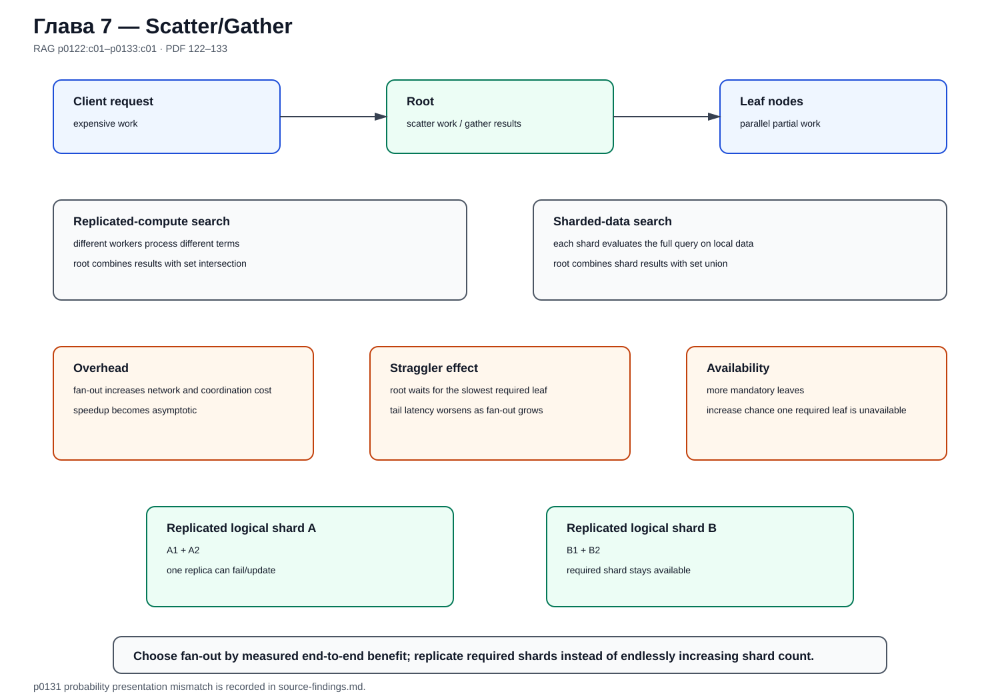
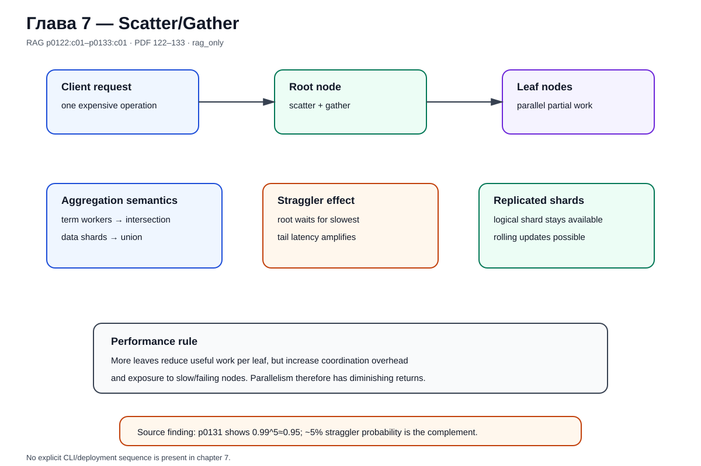

# Глава 7 — Паттерн Scatter/Gather

RAG-grounded разбор главы 7 книги «Распределенные системы. Паттерны проектирования».

## Идентификация

- Book ID: `distributed-systems-patterns-brendan-burns-ru`
- Chapter: 7
- Source title: «Паттерн Scatter/Gather»
- Slug: `scatter-gather`
- Chapter contract: `BIBLIOTEKA-VSP-CHAPTER-ARTIFACT-COLLECTION v1.7`
- Source policy: `rag_only`
- Completion status: `RAG_GROUNDED`

## Provenance

- RAG scope: `p0122:c01–p0133:c01`
- PDF pages: `122–133`
- Printed pages: `122–133`
- Source format: PDF
- Source SHA-256: `d4529f6267d0fe16d411c912a1ecc7ab4924530c376103ce5f16067aca337aa5`
- Boundary evidence:
  - `p0122:c01` — начало главы 7;
  - `p0133:c01` — завершение discussion о replicated shards;
  - `p0134:c01` — начало главы 8.
- Chapter range: `12/12` addressable chunks.
- Boundary verified: yes.

## Артефакты

- [cheatsheet.md](cheatsheet.md)
- [commands.md](commands.md)
- [diagram.md](diagram.md)
- [source-findings.md](source-findings.md)
- [visual-cheatsheet.svg](visual-cheatsheet.svg)
- [visual-cheatsheet-detailed.svg](visual-cheatsheet-detailed.svg)

Явного chapter-end «Резюме» и review questions в диапазоне главы 7 не обнаружено.

## 1. Что такое Scatter/Gather

Scatter/Gather масштабирует обработку запроса по времени.

~~~text
client request
→ root node
→ scatter work to many leaf nodes
→ each leaf returns partial result
→ root gathers partial results
→ one combined response
~~~

В отличие от обычного replicated service, где один request обслуживает одна из replicas, Scatter/Gather fan-out отправляет части одного logical request нескольким leaf nodes.

Главная цель:
- уменьшить latency тяжелой задачи за счет parallel execution.

## 2. Load-balanced Scatter/Gather

В простейшем варианте все leaf nodes идентичны и способны выполнять одну и ту же работу.

Root:
- разбивает request на независимые work units;
- распределяет их между leaves;
- может динамически учитывать response time узлов;
- собирает partial responses.

Source example:
- sequential work: 60 seconds CPU time;
- 30-way parallelism: idealized 2 seconds;
- multi-machine fan-out снимает single-host limits по CPU/memory/network/disk aggregate resources.

Ключевой caveat:
- parallelism не бесплатен;
- network/request/coordination overhead растет с количеством leaf nodes.

## 3. Distributed document search

Source practical использует поиск документов с двумя terms:
- «кот»;
- «собака».

Каждый term обрабатывается отдельно.

Example:
- term A returns `{doc1, doc2, doc4}`;
- term B returns `{doc1, doc3, doc4}`.

Root делает set intersection:

~~~text
{doc1, doc2, doc4}
∩
{doc1, doc3, doc4}
=
{doc1, doc4}
~~~

Это replicated-compute вариант: все participating workers имеют доступ к нужному corpus/index.

## 4. Sharded Scatter/Gather

Когда весь dataset не помещается на один node, data itself shards.

Тогда один request отправляется всем shards:

~~~text
request
→ shard 1 → partial result
→ shard 2 → partial result
→ shard 3 → partial result
→ root
→ union of partial results
~~~

Для sharded document search root уже не intersect-ит term results между replicated term workers, а объединяет results, полученные от разных data shards.

Source example:
- shard 1 → `{doc1, doc5}`;
- shard 2 → `{doc15}`;
- shard 3 → `{doc22, doc28}`;
- root → union всех sets.

## 5. Intersection vs union — важная граница

В chapter два разных aggregation semantics.

### Replicated term workers

Каждый worker отвечает за отдельный term.

Root:
- ищет intersection.

### Data-sharded workers

Каждый shard ищет полный predicate внутри своего data subset.

Root:
- делает union.

Ошибочная агрегация изменяет semantics ответа.

## 6. Сколько leaf nodes использовать

Больше parallelism не означает бесконечное ускорение.

Chapter reasons:
- per-node request overhead;
- network transport;
- root coordination;
- gather cost;
- straggler effect.

Поэтому speedup асимптотический.

На некотором point дополнительный node дает меньше benefit, чем overhead.

## 7. Straggler effect

Root не может завершить request раньше самого медленного required leaf.

~~~text
overall latency
≈
max(leaf latency)
~~~

Это делает tail latency особенно важной.

Source example:
- one leaf has 99th-percentile latency 2 seconds;
- fan-out across 5 leaves means chance that at least one leaf is in slow tail becomes about 5%;
- therefore a per-node p99-like event can become approximately system p95 behavior.

Для fan-out на очень много leaves вероятность столкнуться с slow node резко растет.

Mathematical wording detail in source is recorded in `source-findings.md`.

## 8. Availability amplification

Fan-out amplifies not only latency tails but failure probability.

If every request requires success from every leaf:

~~~text
more required leaves
→ more chances one leaf fails
→ lower end-to-end request success
~~~

Source emphasizes extreme case with 100 leaf nodes and 1% node failure probability: a request is very likely to encounter at least one failure.

## 9. Reliability through replicated shards

Single-copy shard is unsafe in Scatter/Gather because every request depends on all shards.

Therefore leaf node should itself become a replicated service:

~~~text
root
→ shard A service → A1 / A2
→ shard B service → B1 / B2
→ shard C service → C1 / C2
~~~

Benefits:
- replica failure inside shard can be absorbed by another replica;
- shard updates can roll one replica at a time;
- multiple shards may update in parallel depending on rollout needs;
- leaf compute capacity can scale without increasing logical shard count.

## 10. Why not just add more shards

Chapter explicitly separates:
- increasing parallelism;
- improving shard capacity/reliability.

Adding shards also increases:
- fan-out width;
- coordination overhead;
- straggler exposure;
- end-to-end failure exposure.

Therefore scaling compute by more replicas within each shard can be safer than endlessly increasing shard count.

## Главный принцип главы

~~~text
expensive request
→ split independent work
→ scatter to leaves
→ gather partial responses
→ combine with correct semantics

then:
measure overhead + tail latency + availability
→ choose leaf count deliberately
→ replicate each shard when all shards are required
~~~

## Риски и ограничения

- root becomes coordination point;
- wrong aggregation operation changes result correctness;
- too many leaves increase overhead;
- end-to-end latency follows slowest required leaf;
- failure probability compounds across required leaves;
- sharded Scatter/Gather needs all logical shards;
- replicated shards cost additional capacity;
- exact retry/timeout/hedging strategies are not defined in chapter;
- no concrete orchestration manifests or CLI commands are provided.

## Acceptance boundary

После чтения должно быть понятно:
- чем Scatter/Gather отличается от ordinary replication/sharding;
- зачем root scatters one request to many workers;
- когда root uses intersection vs union;
- почему more parallelism has diminishing returns;
- что такое straggler effect;
- почему tail latency worsens with fan-out;
- почему availability degrades when all leaves are mandatory;
- зачем replicate each shard;
- почему compute scaling replicas внутри shard отличается от увеличения logical shard count.

Exact timeout policy, retry policy, partial-result semantics, hedged requests and production sizing formulas: `[Needs confirmation]`.
