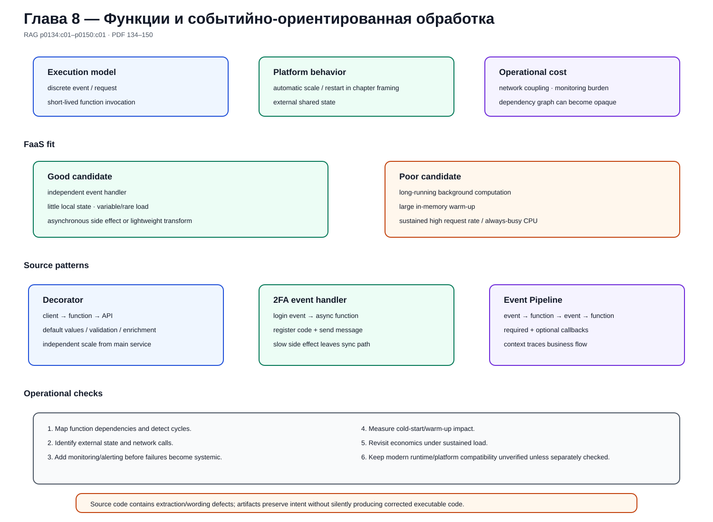
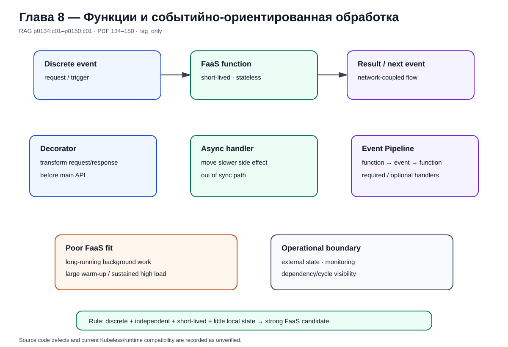

# Глава 8 — Функции и событийно-ориентированная обработка

RAG-grounded разбор главы 8 книги «Распределенные системы. Паттерны проектирования».

## Идентификация

- Book ID: `distributed-systems-patterns-brendan-burns-ru`
- Chapter: 8
- Source title: «Функции и событийно-ориентированная обработка»
- Slug: `functions-event-driven-processing`
- Chapter contract: `BIBLIOTEKA-VSP-CHAPTER-ARTIFACT-COLLECTION v1.7`
- Source policy: `rag_only`
- Completion status: `RAG_GROUNDED`

## Provenance

- RAG scope: `p0134:c01–p0150:c01`
- PDF pages: `134–150`
- Printed pages: `134–150`
- Source SHA-256: `d4529f6267d0fe16d411c912a1ecc7ab4924530c376103ce5f16067aca337aa5`
- Boundary evidence:
  - `p0134:c01` — начало главы 8;
  - `p0150:c01` — завершение Event Pipeline example;
  - `p0151:c01` — начало главы 9.
- Chapter range: `17/17` addressable chunks.
- Boundary verified: yes.

## Артефакты

- [cheatsheet.md](cheatsheet.md)
- [commands.md](commands.md)
- [diagram.md](diagram.md)
- [source-findings.md](source-findings.md)
- [visual-cheatsheet.svg](visual-cheatsheet.svg)
- [visual-cheatsheet-detailed.svg](visual-cheatsheet-detailed.svg)

Явного chapter-end «Резюме» и review questions в диапазоне главы 8 не обнаружено.

## 1. FaaS и event-driven processing

Глава противопоставляет постоянно работающие services короткоживущим functions, запускаемым в ответ на request/event.

~~~text
event/request
→ function instance
→ short-lived processing
→ result / next event
~~~

FaaS рассматривается как component более крупной architecture, а не как универсальная замена всем services.

## 2. FaaS ≠ serverless

Source делает явное различие:

- FaaS может быть event-driven, но работать на собственном physical cluster;
- serverless platform может скрывать servers, но не быть event-driven.

То есть:
- event-driven — про execution model;
- serverless — про operational/ownership abstraction.

Эти признаки могут совпадать, но не обязаны.

## 3. Где FaaS полезен

Преимущества по главе:

- короткий путь от source code до deployed service;
- automatic scaling при росте traffic;
- automatic restart/replacement при failure;
- small stateless components;
- слабая связность;
- удобство для независимых event handlers;
- простота экспериментов с небольшими transformations.

## 4. Ограничения FaaS

### Distributed complexity

Functions independent by definition, communication идет по network, state требует shared storage.

Следствия:
- dependency graph хуже виден;
- harder debugging;
- harder incident localization;
- возможны циклы вызовов между functions;
- monitoring/alerting становится обязательной частью эксплуатации.

### Long-running background work

FaaS instance обычно ограничен по runtime и лучше соответствует discrete events.

Chapter examples задач, которым может требоваться long-running process:
- video transcoding;
- log-file compression;
- длительные low-priority computations.

### Large in-memory state

Если function перед serving request должна загрузить большой dataset в RAM, cold initialization может заметно увеличить latency.

### Cost at sustained high load

Per-request economics выгодна при редких events, но при постоянно занятом processor модель long-running VM/container может стать экономически выгоднее.

Глава рекомендует рассматривать open-source FaaS поверх container orchestrator как способ сочетать function model с resource-based infrastructure economics.

## 5. Decorator pattern

Decorator function изменяет request/response между caller и main service.

~~~text
client
→ FaaS Decorator
→ normalized/enriched request
→ API service
~~~

Source example:
- если отсутствует `name`, генерируется default/random value;
- если отсутствует `color`, подставляется `blue`;
- затем вызывается underlying API.

Преимущество:
- transformation отделена от application business logic;
- lightweight function можно масштабировать независимо от main API.

## 6. Kubeless practical

Chapter uses Kubeless on top of Kubernetes.

Source workflow:
1. install Kubeless;
2. inspect functions through Kubernetes API;
3. deploy `add-defaults`;
4. invoke function with JSON;
5. deploy `add-two-factor`.

Commands are preserved in [commands.md](commands.md).

Current Kubeless/Kubernetes compatibility is not checked under `rag_only`: `[Needs confirmation]`.

## 7. Event handling

Event отличается от session-oriented request тем, что event:
- более автономен;
- может быть asynchronous;
- часто не требует immediate response;
- может инициировать independent handler.

Chapter examples:
- new service subscription;
- file upload;
- impending machine reboot;
- user login triggering 2FA.

## 8. Two-factor authentication example

Instead of embedding SMS/code-generation path into login server:

~~~text
successful password login
→ async FaaS event
→ generate code
→ register code in login service
→ send SMS
→ UI can immediately show code-entry page
~~~

Это уменьшает synchronous latency login flow и отделяет slower side effect.

Source code содержит credential-like placeholders и extraction-sensitive formatting; reusable artifact не переносит их как реальные credentials. См. [source-findings.md](source-findings.md).

## 9. Event Pipeline

Event Pipeline представлен как directed graph:

~~~text
event
→ function
→ event/network call
→ function
→ ...
~~~

Nodes:
- functions.

Edges:
- HTTP/network calls or events.

Example CI/CD-style pipeline:
- source-code upload;
- build;
- test;
- manual approval ticket;
- deployment;
- failure path → Jira issue.

## 10. User-registration pipeline

Monolithic user-registration service decomposes into:
- required handlers;
- optional handlers;
- independent FaaS functions.

Example:
- required: welcome email;
- optional: product/news mailing subscription.

Create-user function owns callback lists rather than implementation details of every action.

Result:
- smaller units of code;
- easier independent change;
- event flow can be understood by tracing context across functions.

## Главный принцип главы

~~~text
discrete, independent event
+ short-lived processing
+ little local state
→ strong FaaS candidate

continuous/high-load/background/in-memory-heavy work
→ evaluate long-running service instead

multi-step event flow
→ compose functions into explicit Event Pipeline
~~~

## Риски и ограничения

- function dependency graph can become opaque;
- cycles between functions can produce runaway invocation;
- shared state becomes external distributed dependency;
- observability burden increases;
- cold initialization can add latency;
- long-running background work is a poor fit;
- high sustained request rate can change cost trade-off;
- source examples rely on old Kubeless/Python runtime identifiers;
- code snippets contain extraction/source defects;
- exact rollback and modern deployment procedure are not supplied.

## Acceptance boundary

После чтения должно быть понятно:

- почему FaaS и serverless — не одно и то же;
- когда FaaS подходит и когда нет;
- какие operational risks возникают from weak coupling;
- как Decorator transforms request/response;
- как event handler removes slow side effects from synchronous path;
- что представляет Event Pipeline;
- чем event pipeline отличается от always-running microservices;
- зачем required/optional callbacks decouple user registration;
- какие commands source-confirmed, а какие code fragments требуют проверки.

Current Kubeless viability, supported Python runtimes, modern FaaS platforms, production secrets handling and rollback commands: `[Needs confirmation]`.
