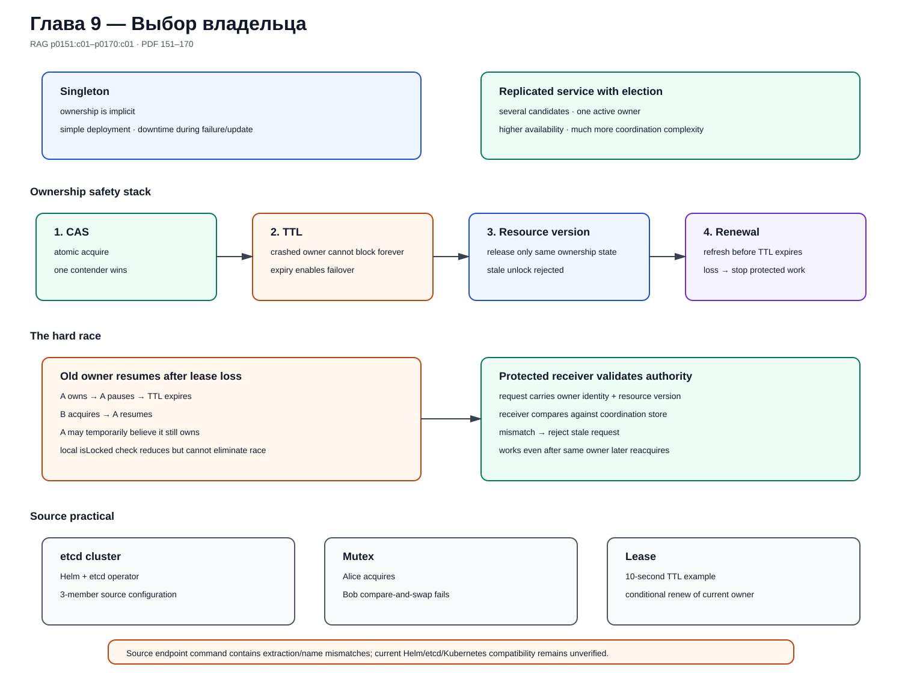
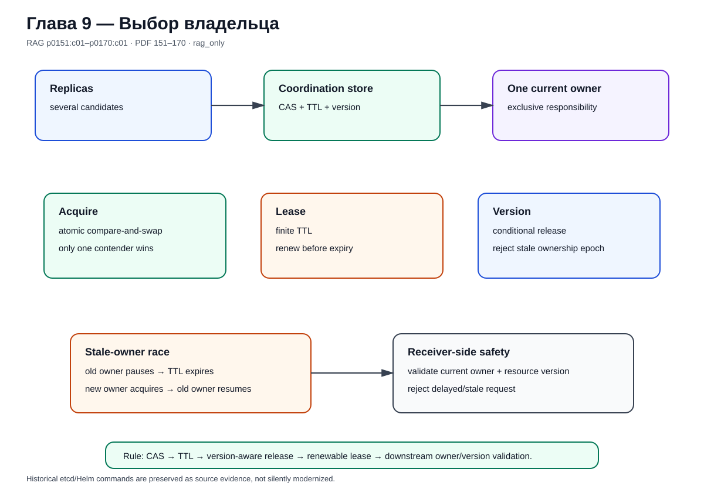

# Глава 9 — Выбор владельца

RAG-grounded разбор главы 9 книги «Распределенные системы. Паттерны проектирования».

## Идентификация

- Book ID: `distributed-systems-patterns-brendan-burns-ru`
- Chapter: 9
- Source title: «Выбор владельца»
- Slug: `owner-election`
- Chapter contract: `BIBLIOTEKA-VSP-CHAPTER-ARTIFACT-COLLECTION v1.7`
- Source policy: `rag_only`
- Completion status: `RAG_GROUNDED`

## Provenance

- RAG scope: `p0151:c01–p0170:c01`
- PDF pages: `151–170`
- Printed pages: `151–170`
- Source format: PDF
- Source SHA-256: `d4529f6267d0fe16d411c912a1ecc7ab4924530c376103ce5f16067aca337aa5`
- Boundary evidence:
  - `p0151:c01` — начало главы 9;
  - `p0170:c01` — завершение discussion о проверке owner/resource version;
  - `p0171:c01` — начало части III;
  - `p0173:c01` — начало главы 10.
- Chapter range: `20/20` addressable chunks.
- Boundary verified: yes.

## Артефакты

- [cheatsheet.md](cheatsheet.md)
- [commands.md](commands.md)
- [diagram.md](diagram.md)
- [source-findings.md](source-findings.md)
- [visual-cheatsheet.svg](visual-cheatsheet.svg)
- [visual-cheatsheet-detailed.svg](visual-cheatsheet-detailed.svg)

Явного chapter-end «Резюме» и review questions в диапазоне главы 9 не обнаружено.

## 1. Зачем нужен выбор владельца

В некоторых distributed systems конкретным resource/task одновременно должен владеть только один process.

Single-instance service решает это автоматически:

~~~text
one process
→ implicit ownership
~~~

Но платой являются:
- невозможность active replication;
- downtime при failure;
- downtime при update.

Если availability критична, запускается несколько instances, но active owner должен быть один.

~~~text
replica A
replica B
replica C
→ owner election
→ exactly one current owner
~~~

## 2. Когда single-instance достаточно

Глава прямо говорит, что distributed ownership не всегда оправдан.

Orchestrator already provides:
- process restart;
- health-based restart;
- rescheduling after machine failure.

Для background/asynchronous workloads простота singleton может быть лучше complexity owner election.

Если же требуются четыре девятки и выше или failover без продолжительного downtime, нужен replicated service с election mechanism.

Source availability calculations are illustrative; arithmetic caveat recorded in `source-findings.md`.

## 3. Не реализовывать consensus самостоятельно

Глава упоминает Paxos и RAFT как underlying consensus algorithms, но рекомендует не реализовывать их самостоятельно в application.

Вместо этого использовать distributed key-value store, уже предоставляющий:
- replication;
- reliability;
- compare-and-swap;
- TTL;
- resource versioning / watch-like primitives.

Source examples:
- etcd;
- ZooKeeper;
- consul.

## 4. Compare-and-swap как базовый primitive

Concept:

~~~text
current value == expected?
    yes → atomically write new value
    no  → reject
~~~

CAS позволяет нескольким contenders одновременно пытаться стать owner, но только один successful atomic update выигрывает.

## 5. TTL нужен из-за crashed owner

Без TTL:

~~~text
owner acquires lock
→ owner crashes
→ nobody releases lock
→ system stuck
~~~

С TTL:

~~~text
owner acquires lock with expiry
→ owner crashes
→ TTL expires
→ another contender may acquire
~~~

Но TTL вводит новую race: старый owner может завершить work после expiry и случайно снять уже чужую lock.

## 6. Resource version защищает unlock

Chapter fix:
- lock acquisition remembers resource version;
- unlock succeeds only if both lock state and version still match.

~~~text
old owner
→ TTL expired
→ new owner writes new version
→ stale unlock with old version
→ rejected
~~~

Это не позволяет process 1 снять lock process 2 после истечения TTL.

## 7. Temporary lock vs long-lived ownership

Short lock:
- acquired;
- work;
- released.

Long-lived owner:
- должен владеть resource пока process healthy;
- огромный TTL даёт слишком медленный failover.

Решение главы — renewable lock/lease.

~~~text
acquire
→ renew every TTL/2
→ continue while renewal succeeds
→ if renewal fails: stop protected activity
~~~

Source framing: в container orchestrator простая реакция на loss of ownership — завершить application и позволить orchestrator restart it.

Exact termination command не приводится.

## 8. Practical: etcd operator

Source practical deploys etcd through:
- Helm;
- etcd operator;
- custom Kubernetes Cluster resource;
- 3-member etcd cluster.

Commands include:
- `helm init`;
- `helm install stable/etcd-operator`;
- `kubectl create -f etcd-cluster.yaml`;
- `kubectl get pods`;
- endpoint discovery;
- `etcdctl` write.

Source commands reflect the book-era toolchain; current compatibility is `[Needs confirmation]`.

## 9. Practical: mutual-exclusion lock in etcd

Source uses key `my-lock`:
- initial value `unlocked`;
- Alice CAS-writes `alice`;
- Bob's CAS from `unlocked` fails;
- Alice CAS-writes `unlocked` only if current value is `alice`.

This demonstrates one-owner-at-a-time lock semantics.

## 10. Practical: renewable lease in etcd

For long-lived ownership source switches to absence-of-key semantics:

~~~text
key absent
→ mk with TTL
→ current owner renews same value before expiry
→ if renewals stop, key disappears
→ another contender may acquire
~~~

Example TTL: 10 seconds.

The chapter recommends renewal well before expiry; pseudocode uses `TTL / 2`.

## 11. Why local owner belief is insufficient

Even with leases, a process can be paused long enough for its lease to expire.

Then:
1. owner A pauses;
2. lease expires;
3. owner B acquires;
4. A resumes;
5. for a short time A may still believe it is owner.

Therefore application-local `isLocked()` reduces risk but cannot eliminate it.

## 12. Receiver-side ownership validation

Protected downstream system should verify that requester is actually current owner.

Source model:

~~~text
request from shard2
→ worker asks lock server
→ is shard2 current owner?
    yes → process
    no  → reject
~~~

This moves safety enforcement to the system that performs the protected action.

## 13. Stale request after reacquisition

Harder case:

1. shard1 owns resource and sends R1;
2. R1 is delayed in network;
3. shard1 loses ownership;
4. shard2 becomes owner and sends R2;
5. R2 executes;
6. ownership later returns to shard1;
7. old R1 finally arrives.

Checking owner name alone is insufficient because shard1 is owner again when R1 arrives.

Chapter solution:
- include resource version with request;
- receiver validates both owner identity and version;
- stale request from earlier ownership epoch is rejected.

~~~text
(request, owner, version)
→ validate against current lock state
→ execute only on full match
~~~

## Главный принцип главы

~~~text
exclusive distributed ownership
→ use reliable shared coordination store
→ atomic compare-and-swap
→ finite TTL
→ version-aware unlock
→ renewable lease for long-lived ownership
→ receiver validates current owner + resource version
~~~

## Риски и ограничения

- distributed ownership adds significant complexity;
- singleton may be sufficient when downtime tolerance permits it;
- polling locks adds delay/load; watch/event support is preferable in source framing;
- TTL too short risks accidental expiry;
- TTL too long delays failover;
- process pause can create temporary dual-owner belief;
- owner-name check alone cannot reject delayed requests from an earlier ownership epoch;
- coordination store becomes critical infrastructure;
- source etcd/Helm/Kubernetes commands are historically scoped and may not work on current platforms;
- exact production quorum sizing, network partition policy and rollback procedures are not supplied.

## Acceptance boundary

После чтения должно быть понятно:

- when owner election is justified versus singleton simplicity;
- why CAS is foundational;
- why lock without TTL can deadlock after process failure;
- why TTL alone creates stale-owner races;
- why resource version protects unlock;
- how renewable lease supports long-lived ownership;
- why local owner state is insufficient;
- why downstream system must validate owner;
- why owner identity plus resource version is needed for delayed requests;
- what source etcd practical demonstrates;
- which commands are not safe to modernize silently.

Current etcd/Helm/Kubernetes APIs, production fencing implementation, quorum tuning, partition handling and rollback commands: `[Needs confirmation]`.
