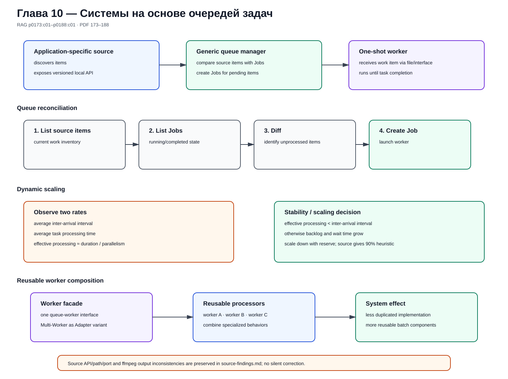
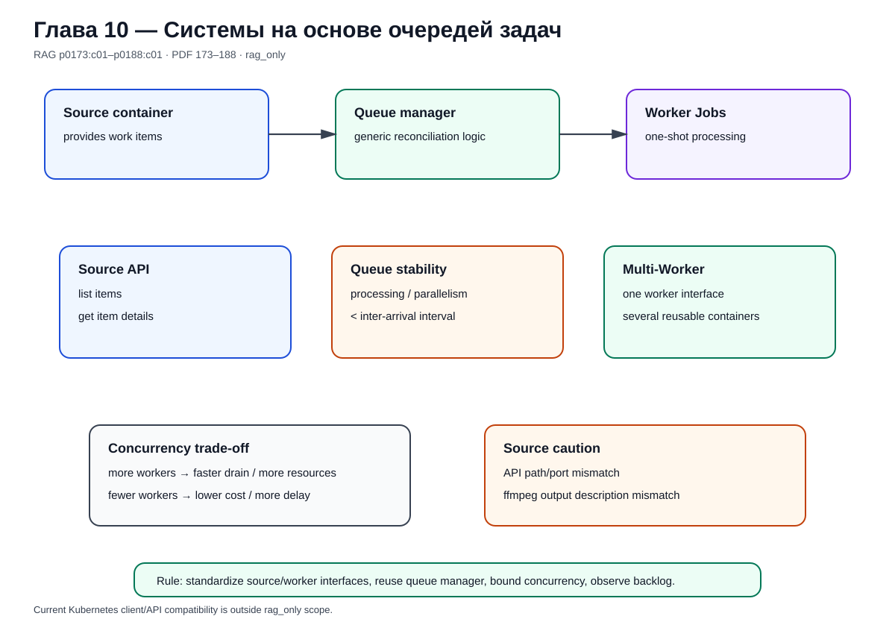

# Глава 10 — Системы на основе очередей задач

RAG-grounded разбор главы 10 книги «Распределенные системы. Паттерны проектирования».

## Идентификация

- Book ID: `distributed-systems-patterns-brendan-burns-ru`
- Chapter: 10
- Source title: «Системы на основе очередей задач»
- Slug: `task-queue-systems`
- Chapter contract: `BIBLIOTEKA-VSP-CHAPTER-ARTIFACT-COLLECTION v1.7`
- Source policy: `rag_only`
- Completion status: `RAG_GROUNDED`

## Provenance

- RAG scope: `p0173:c01–p0188:c01`
- PDF pages: `173–188`
- Printed pages: `173–188`
- Source format: PDF
- Source SHA-256: `d4529f6267d0fe16d411c912a1ecc7ab4924530c376103ce5f16067aca337aa5`
- Boundary evidence:
  - `p0173:c01` — начало главы 10;
  - `p0188:c01` — завершение раздела Multi-Worker;
  - `p0189:c01` — начало главы 11.
- Chapter range: `16/16` addressable chunks.
- Boundary verified: yes.

## Артефакты

- [cheatsheet.md](cheatsheet.md)
- [commands.md](commands.md)
- [diagram.md](diagram.md)
- [source-findings.md](source-findings.md)
- [visual-cheatsheet.svg](visual-cheatsheet.svg)
- [visual-cheatsheet-detailed.svg](visual-cheatsheet-detailed.svg)

Явного chapter-end «Резюме» и review questions в диапазоне главы 10 не обнаружено.

## 1. Базовая идея task queue

Глава рассматривает batch workload, состоящую из независимых tasks.

~~~text
task source
→ queue manager
→ worker containers
→ completed work
~~~

Каждая task должна быть обработана независимо от остальных. Queue manager отвечает за orchestration, а application-specific logic выносится в source/worker containers.

## 2. Separation of generic and application-specific logic

Chapter выделяет два интерфейса.

### Source container

Source container знает, откуда брать work items.

Examples:
- cloud storage objects;
- network filesystem;
- publish/subscribe queue.

Queue manager должен видеть единый source API независимо от backend.

### Worker container

Worker знает, как обработать один work item.

Queue manager:
- discovers pending item;
- launches worker;
- tracks execution;
- marks item completed after successful execution.

Главная design цель — сосредоточить generic queue logic в reusable manager.

## 3. Source API

Глава задает REST-like API:

~~~text
GET http://localhost/api/v1/items
GET http://localhost/api/v1/items/<item-name>
~~~

Первый endpoint возвращает список work items.

Второй — details конкретного item, включая `data`.

Source container работает рядом с queue manager и может использовать localhost.

Chapter explicitly recommends versioning APIs from the beginning.

## 4. Worker API

Worker container рассматривается как one-shot component.

Ему не нужен полноценный HTTP server. Work item передается через file-based interface:
- environment variable `WORK_ITEM_FILE`;
- file mounted into worker container;
- source proposes Kubernetes ConfigMap as transport mechanism.

Это уменьшает interface surface и снижает риск внешнего добавления arbitrary work.

## 5. Kubernetes Job как execution substrate

Queue manager может использовать Kubernetes `Job` вместо собственного execution state store.

Source reasoning:
- Job can run worker until success;
- orchestrator handles machine/container failure;
- Job metadata/annotations can identify processed item;
- current and completed Jobs can serve as queue state.

Result:

~~~text
source items
+
Kubernetes Jobs
→ infer pending work
→ create worker Jobs
~~~

## 6. Generic queue algorithm

Source algorithm:

1. Получить current items от source container.
2. Получить existing Jobs for this queue.
3. Compute unprocessed items.
4. Create one Job per unprocessed item.
5. Repeat periodically.

Chapter Python example polls every 10 seconds.

## 7. Practical: video thumbnails

Example pipeline:
- source container scans shared/NFS media location;
- source returns video-file items;
- worker invokes `ffmpeg`;
- output thumbnails become processing result.

Source command:

~~~text
ffmpeg -i ${INPUT_FILE} -frames:v 100 thumb.png
~~~

Exact semantics of the command versus prose have an internal mismatch; see `source-findings.md`.

## 8. Dynamic worker scaling

Unbounded worker creation can create bursty cluster load.

Chapter therefore separates:
- backlog;
- service rate;
- concurrency;
- resource usage.

Limiting concurrent Jobs:
- caps resource consumption;
- increases queueing delay under load.

If sustained arrival rate exceeds effective processing rate, queue length and wait time grow indefinitely.

## 9. Queue stability condition

Chapter tracks two metrics:
- average inter-arrival interval;
- average task processing time.

For parallel workers:

~~~text
effective processing time
≈
average task duration / parallelism
~~~

Stable queue condition in source framing:

~~~text
effective processing time
<
average inter-arrival interval
~~~

Example:
- task duration: 60 s;
- parallelism: 4;
- effective time: 15 s;
- inter-arrival should be greater than about 15 s; source uses 16 s as illustrative margin.

## 10. Scale-up vs scale-down

Scale-up:
- increase concurrent workers when service rate is insufficient.

Scale-down:
- harder because too aggressive reduction removes reserve capacity.

Source heuristic:
- reduce concurrency while effective processing time remains around 90% or less of inter-arrival interval.

This is an illustrative heuristic, not universal autoscaling policy.

## 11. Multi-Worker pattern

Some tasks need several reusable processing stages.

Instead of one large specialized worker:

~~~text
one task
→ worker facade
→ reusable worker A
→ reusable worker B
→ reusable worker C
~~~

Chapter describes Multi-Worker as a special case of Adapter.

Purpose:
- expose one worker interface;
- delegate internal processing to several reusable containers;
- reduce duplicated application-specific implementation.

## Главный принцип главы

~~~text
independent batch items
→ standard source interface
→ reusable queue manager
→ one-shot workers
→ orchestrator-backed execution state
→ control concurrency from arrival/service rates
→ compose reusable workers when processing has multiple stages
~~~

## Риски и ограничения

- queue source and manager need a stable API contract;
- worker-launch interface is a security boundary;
- unbounded Job creation can exhaust cluster capacity;
- too-low concurrency creates growing backlog;
- queue stability depends on real arrival/service distributions, not only averages;
- Kubernetes/Python examples are book-era and not verified against current APIs;
- source practical contains API/code mismatches;
- exact retry policy, failure classification, deduplication, idempotency and rollback are not fully defined.

## Acceptance boundary

После чтения должно быть понятно:

- зачем отделять source, queue manager и worker;
- почему source API versioned;
- почему worker interface can be file-based;
- how Kubernetes Jobs replace part of queue-state machinery;
- how queue manager discovers pending work;
- why worker concurrency must be bounded;
- how arrival interval and processing time determine stability;
- what Multi-Worker adds to worker composition;
- which practical/code fragments are source-defective or unverified.

Current Kubernetes Python client APIs, production queue durability, retries, deduplication, idempotency, autoscaling policy and rollback commands: `[Needs confirmation]`.
