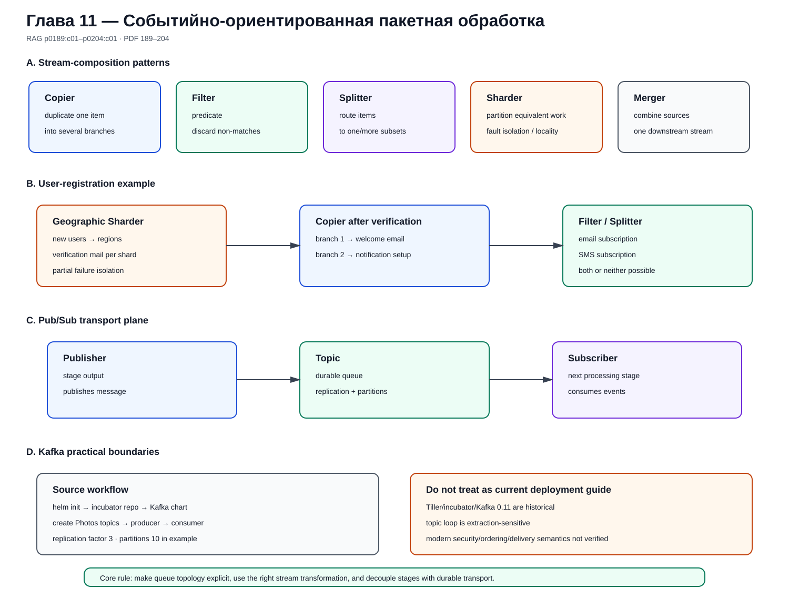
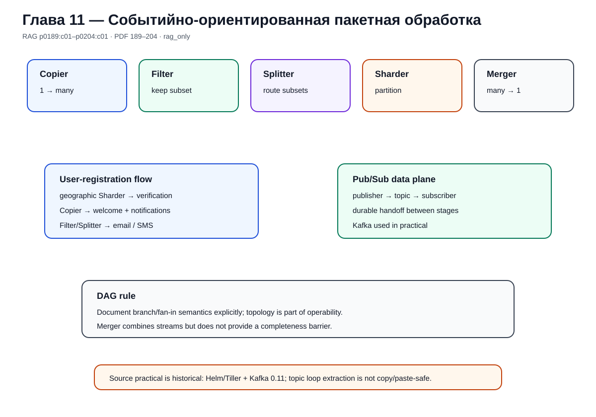

# Глава 11 — Событийно-ориентированная пакетная обработка

RAG-grounded разбор главы 11 книги «Распределенные системы. Паттерны проектирования».

## Идентификация

- Book ID: `distributed-systems-patterns-brendan-burns-ru`
- Chapter: 11
- Source title: «Событийно-ориентированная пакетная обработка»
- Slug: `event-driven-batch-processing`
- Chapter contract: `BIBLIOTEKA-VSP-CHAPTER-ARTIFACT-COLLECTION v1.7`
- Source policy: `rag_only`
- Completion status: `RAG_GROUNDED`

## Provenance

- RAG scope: `p0189:c01–p0204:c01`
- PDF pages: `189–204`
- Printed pages: `189–204`
- Source format: PDF
- Source SHA-256: `d4529f6267d0fe16d411c912a1ecc7ab4924530c376103ce5f16067aca337aa5`
- Boundary evidence:
  - `p0189:c01` — начало главы 11;
  - `p0204:c01` — завершение Kafka practical;
  - `p0205:c01` — начало главы 12.
- Chapter range: `16/16` addressable chunks.
- Boundary verified: yes.

## Артефакты

- [cheatsheet.md](cheatsheet.md)
- [commands.md](commands.md)
- [diagram.md](diagram.md)
- [source-findings.md](source-findings.md)
- [visual-cheatsheet.svg](visual-cheatsheet.svg)
- [visual-cheatsheet-detailed.svg](visual-cheatsheet-detailed.svg)

Явного chapter-end «Резюме» и review questions в диапазоне главы 11 не обнаружено.

## 1. От очереди задач к потоку задач

Глава 10 рассматривала one-step batch transform.

Глава 11 соединяет несколько task queues:

~~~text
queue A
→ event/output
→ queue B
→ event/output
→ queue C
~~~

Когда flow ветвится и снова объединяется, система становится directed acyclic graph (DAG) взаимосвязанных processing stages.

Главная operational потребность — видеть общую topology, иначе отдельные queues понятны, но system behavior становится непрозрачным.

## 2. Copier

Copier размножает один input stream в несколько идентичных streams.

~~~text
input
→ Copier
→ queue A
→ queue B
→ queue C
~~~

Use case source:
- video input;
- separate rendering queues for 4K, 1080p, low-bandwidth variant, GIF preview.

Один item попадает во все нужные downstream branches.

## 3. Filter

Filter уменьшает поток.

~~~text
input items
→ predicate
→ matching items only
~~~

Source example:
- registration events;
- пропускать только users, явно согласившихся на marketing email.

Глава предлагает реализовывать Filter как Ambassador/Adapter-like wrapper around existing source:
- upstream source остается неизменным;
- filter presents reduced source interface downstream.

## 4. Splitter

Splitter направляет items в разные queues по criterion.

~~~text
item
→ predicate/routing
├→ queue A
└→ queue B
~~~

Source example:
- shipping notifications;
- email queue;
- SMS queue.

Если user выбрал оба channels, Splitter может также копировать event в обе queues.

Глава отмечает, что Splitter можно собрать из Copier + two Filters, но dedicated Splitter компактнее.

## 5. Sharder

Sharder — generalized Splitter, который распределяет task stream по нескольким shards с помощью sharding function.

Purpose in chapter:
- fault isolation;
- staged rollout;
- distribution across datacenters/regions;
- load balancing.

Source example:
- 4 queue shards;
- failure during first rollout stage affects about one quarter of users rather than all users.

Если часть shards unavailable, sharding algorithm должен перераспределить работу на remaining healthy shards.

## 6. Merger

Merger выполняет обратную Copier operation:

~~~text
queue A
queue B
queue C
→ Merger
→ one combined stream
~~~

Source use case:
- many source-code repositories;
- each repository produces commit tasks;
- one combined build system consumes integrated commit stream.

Merger описывается как Multi-Adapter:
- several source containers;
- one unified source interface.

## 7. Практикум: user-registration workflow

Chapter composes the patterns into a registration pipeline.

### Stage 1 — verification

New users are sharded geographically.

Each shard sends verification email.

Benefit:
- partial failure of registration subsystem affects only subset of users;
- new registrations can continue elsewhere.

### Stage 2 — confirmation + notification setup

After verification event:
- Copier creates two branches:
  - welcome-email queue;
  - notification-settings queue.

Welcome-email branch ends after sending confirmation/welcome message.

Notification branch continues.

### Stage 3 — Filter / Splitter-like notification selection

User preferences determine:
- email subscription;
- SMS subscription;
- both;
- neither.

The flow can therefore branch based on user data while preserving independent queues.

## 8. Why event-driven batch resembles FaaS pipelines

Глава explicitly compares task-flow systems to event-driven FaaS.

Common structure:

~~~text
event completion
→ next independent processing stage
→ next event
~~~

Difference in chapter framing:
- here the nodes are durable batch queues/workers rather than short-lived function handlers.

The need to visualize dependencies is shared by both styles.

## 9. Data plane between queues

A pipeline needs not only control-flow topology but also data transport between stages.

Simple option:
- local filesystem.

Limitation:
- single-node scope.

Network filesystem:
- distributed files;
- more deployment/application complexity.

Chapter's preferred general mechanism:
- pub/sub API/service.

## 10. Pub/sub abstraction

Pub/sub introduces topics/queues.

~~~text
publisher(s)
→ topic
→ subscriber(s)
~~~

Source claims:
- published messages are durably stored;
- delivered reliably to subscribers.

Examples named by chapter:
- Azure EventGrid;
- Amazon Simple Queue;
- Apache Kafka.

Kafka is then used for practical examples.

## 11. Kafka mapping to task-flow patterns

A topic corresponds to output of one pipeline module and commonly becomes input for another.

For Sharder:

~~~text
sharding function
→ Photos-1
→ Photos-2
→ Photos-3
~~~

Each output shard gets its own Kafka topic.

The source practical also exposes:
- topic replication factor;
- partitions.

Chapter interpretation:
- replication factor controls topic redundancy;
- partition count bounds how many machines can share topic load.

## 12. Kafka practical

Source workflow:
1. initialize Helm;
2. add incubator chart repository;
3. install Kafka;
4. create several topics;
5. publish messages;
6. consume messages.

Commands are preserved in [commands.md](commands.md).

They are book-era examples and contain line-wrap/extraction issues. Current Helm/Kafka/Kubernetes compatibility is `[Needs confirmation]`.

## Главный принцип главы

~~~text
complex batch workflow
→ connect independent task queues as DAG
→ use explicit stream-composition patterns

Copier  → duplicate stream
Filter  → remove unmatched items
Splitter→ route items to subsets
Sharder → partition for scale/fault isolation
Merger  → combine streams

then:
use durable pub/sub transport
→ decouple stages
→ preserve event-driven flow
~~~

## Риски и ограничения

- DAG can become hard to understand without explicit topology;
- duplicated streams multiply downstream workload;
- bad filter predicates silently remove intended work;
- bad splitter/sharder logic routes tasks incorrectly;
- sharding requires remapping when a shard fails;
- merger combines streams but does not imply coordinated completeness;
- pub/sub infrastructure becomes a critical dependency;
- partition/replication settings affect availability/capacity;
- source Helm/Kafka examples are historical;
- topic-creation command is extraction-sensitive;
- exact delivery semantics, ordering, retry, deduplication and rollback are not fully defined.

## Acceptance boundary

После чтения должно быть понятно:

- why multiple task queues form a DAG;
- semantics of Copier, Filter, Splitter, Sharder and Merger;
- how patterns compose in user-registration flow;
- why sharding improves failure isolation;
- why Merger is not the same as coordinated Join;
- why pipeline requires a data transport plane;
- how pub/sub topics map to pipeline stages;
- what Kafka replication factor and partitions mean in source framing;
- which commands are historical/extraction-sensitive.

Current Kafka/Helm deployment, delivery guarantees, consumer groups, ordering semantics, production topic sizing and rollback commands: `[Needs confirmation]`.
