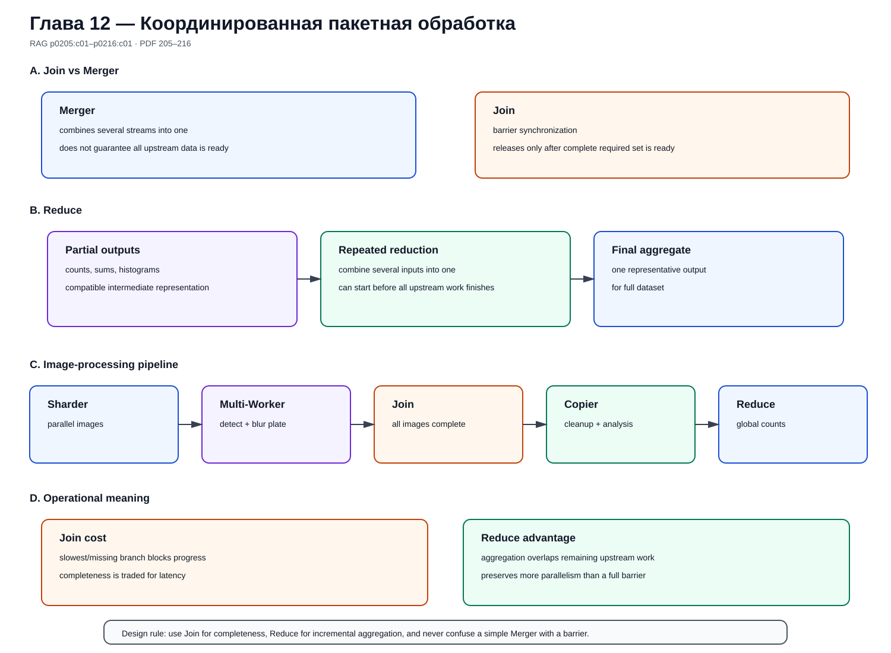
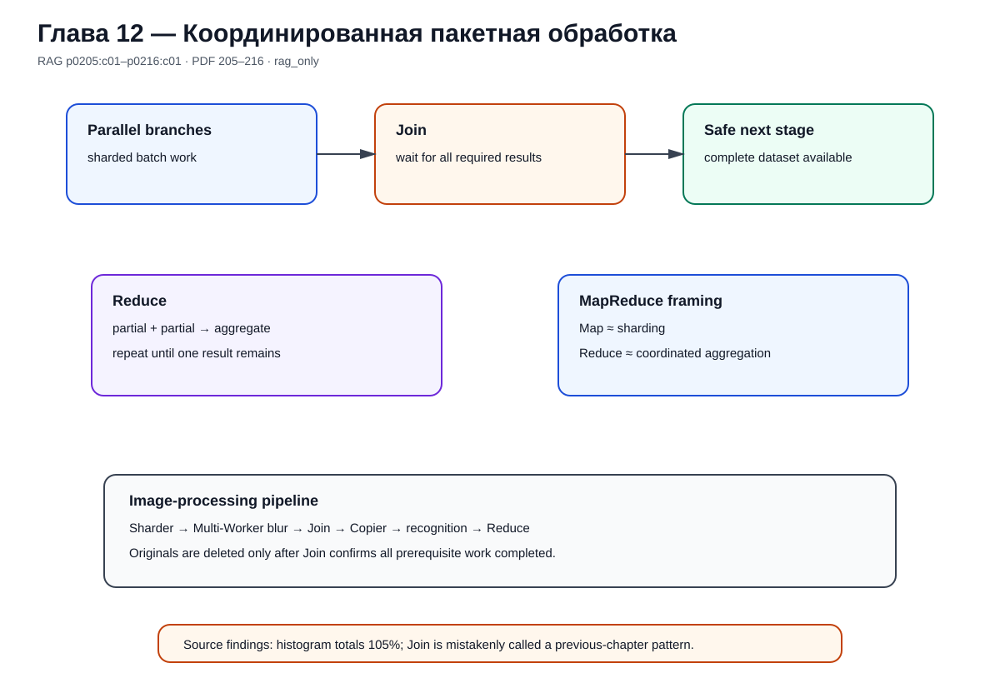

# Глава 12 — Координированная пакетная обработка

RAG-grounded разбор главы 12 книги «Распределенные системы. Паттерны проектирования».

## Идентификация

- Book ID: `distributed-systems-patterns-brendan-burns-ru`
- Chapter: 12
- Source title: «Координированная пакетная обработка»
- Slug: `coordinated-batch-processing`
- Chapter contract: `BIBLIOTEKA-VSP-CHAPTER-ARTIFACT-COLLECTION v1.7`
- Source policy: `rag_only`
- Completion status: `RAG_GROUNDED`

## Provenance

- RAG scope: `p0205:c01–p0216:c01`
- PDF pages: `205–216`
- Printed pages: `205–216`
- Source SHA-256: `d4529f6267d0fe16d411c912a1ecc7ab4924530c376103ce5f16067aca337aa5`
- Boundary evidence:
  - `p0205:c01` — начало главы 12;
  - `p0216:c01` — завершение image-processing pipeline и Reduce;
  - `p0217:c01` — начало главы 13.
- Chapter range: `12/12` addressable chunks.
- Boundary verified: yes.

## Артефакты

- [cheatsheet.md](cheatsheet.md)
- [commands.md](commands.md)
- [diagram.md](diagram.md)
- [source-findings.md](source-findings.md)
- [visual-cheatsheet.svg](visual-cheatsheet.svg)
- [visual-cheatsheet-detailed.svg](visual-cheatsheet-detailed.svg)

Явного chapter-end «Резюме» и review questions в диапазоне главы 12 не обнаружено.

## 1. От слияния потоков к координации

Глава 11 дала Merger, который объединяет несколько streams.

Но Merger сам по себе не гарантирует:
- что все upstream work завершено;
- что aggregate видит полный dataset.

Для coordinated aggregation нужен более строгий primitive.

## 2. Join — barrier synchronization

Join блокирует downstream processing, пока не готовы все required parallel results.

~~~text
parallel shards
→ Join barrier
→ only after all complete
→ next stage
~~~

Benefit:
- гарантирует completeness.

Cost:
- снижает parallelism;
- downstream ждёт slowest branch;
- увеличивается pipeline latency.

## 3. Reduce

Reduce агрегирует несколько partial outputs в меньшее число outputs, сохраняя возможность повторять свёртку.

~~~text
partial A + partial B
→ reduced result AB

AB + partial C
→ reduced result ABC
~~~

В отличие от Join, Reduce может начинаться раньше — как только доступна часть результатов.

Это позволяет перекрывать aggregation с продолжающейся upstream processing.

## 4. MapReduce framing

Глава связывает уже известные patterns:

~~~text
Map ≈ sharding/distribution
Reduce ≈ coordinated aggregation
~~~

Reduce не обязан знать, как именно upstream data была sharded.

Ему нужен только compatible reducible representation.

## 5. Практикум: подсчёт слов

Book pages sharded across queues.

Каждый worker emits word counts.

Reduce складывает counts одинаковых keys.

Пример:

~~~text
a: 50 + 30 → 80
the: 17 + 25 → 42
~~~

Repeated reductions continue until one aggregate result remains.

## 6. Суммирование

Для population example each shard outputs pairs like:

~~~text
(city, population)
~~~

Reduce combines pairs by summing population.

Multi-level sharding by state/county does not need to be understood by Reduce itself.

## 7. Histogram reduction

Chapter extends Reduce to histograms.

To combine regional percentage distributions:
- convert percentages to weighted counts using population;
- combine counts;
- divide by combined population;
- repeat until one histogram remains.

Source histogram example sums to 105%; this is recorded in `source-findings.md` and not corrected silently.

## 8. Image-processing pipeline

Practical composes many earlier patterns.

Input:
- HTTPS URLs of traffic photos.

Goal:
- blur license plates;
- count cars/trucks/motorcycles;
- aggregate vehicle colors.

### Plate anonymization

Uses Multi-Worker:
- detector;
- blur worker.

Images are also sharded across queues for parallelism/reliability.

### Join before destructive cleanup

Original images must not be deleted until all processed copies are complete.

Therefore:

~~~text
all blur shards
→ Join
→ only then allow original deletion
~~~

This is a concrete example of barrier semantics protecting irreversible/destructive next action.

### Copier after Join

After safe completion, pipeline branches:
- delete originals;
- continue object/color recognition.

### Vehicle recognition

Each shard uses Multi-Worker:
- vehicle type/location recognition;
- color recognition.

Each image emits structured counts.

### Final Reduce

Per-image JSON-like counts are summed across the entire dataset:

~~~text
all per-image counts
→ repeated Reduce
→ global totals
~~~

## 9. Join vs Reduce

| Pattern | Main property | Trade-off |
|---|---|---|
| Join | wait for complete parallel set | completeness, but blocks downstream |
| Reduce | incrementally aggregate partial results | starts earlier, more parallelism |

Join is synchronization.

Reduce is aggregation.

They can appear in the same pipeline for different reasons.

## Главный принцип главы

~~~text
parallel batch work
→ choose coordination semantics deliberately

need complete upstream set before proceeding?
→ Join

need aggregate result that can be combined incrementally?
→ Reduce

complex pipeline
→ compose Sharder + Multi-Worker + Join + Copier + Reduce
~~~

## Риски и ограничения

- Join inherits slowest-branch latency;
- missing/stuck shard blocks the barrier;
- Reduce requires composable aggregation semantics;
- incorrect reduction function can corrupt aggregate result;
- destructive actions before Join completion can lose recoverability;
- source numerical example contains an inconsistent histogram;
- source wording about where Join was introduced is inconsistent;
- exact persistence/checkpoint/retry semantics are not defined;
- no executable deployment commands are supplied.

## Acceptance boundary

После чтения должно быть понятно:

- why Merger is insufficient for completeness;
- how Join acts as a barrier;
- latency trade-off of Join;
- how Reduce differs from Join;
- why Reduce can overlap upstream processing;
- how counting/summing/histogram examples implement reduction;
- why destructive cleanup waits behind Join;
- how earlier patterns compose into one image-processing pipeline.

Exact distributed barrier implementation, checkpointing, retry/idempotency, partial-failure policy and rollback commands: `[Needs confirmation]`.
