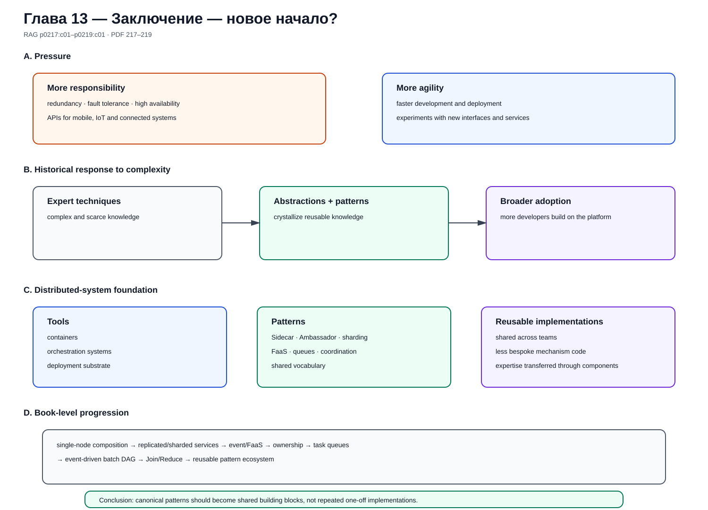
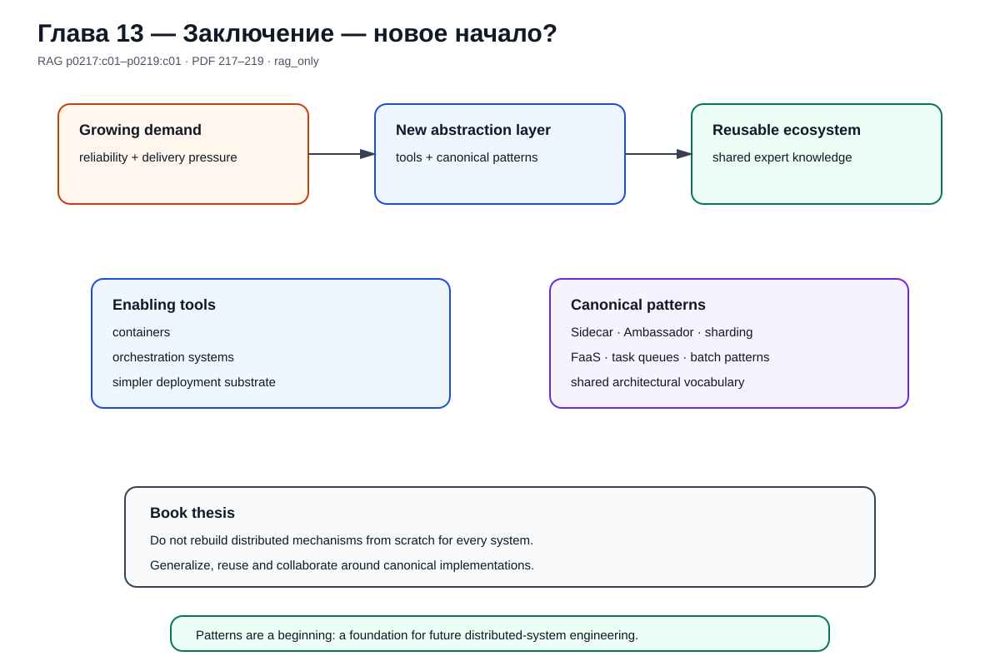

# Глава 13 — Заключение — новое начало?

RAG-grounded разбор главы 13 книги «Распределенные системы. Паттерны проектирования».

## Идентификация

- Book ID: distributed-systems-patterns-brendan-burns-ru
- Chapter: 13
- Source title: «Заключение — новое начало?»
- Slug: conclusion-new-beginning
- Chapter contract: BIBLIOTEKA-VSP-CHAPTER-ARTIFACT-COLLECTION v1.7
- Source policy: rag_only
- Completion status: RAG_GROUNDED

## Provenance

- RAG scope: p0217:c01–p0219:c01
- PDF pages: 217–219
- Printed pages: 217–219
- Source SHA-256: d4529f6267d0fe16d411c912a1ecc7ab4924530c376103ce5f16067aca337aa5
- p0217:c01 — начало главы 13;
- p0219:c01 — завершение заключения;
- p0220:c01 — «Об авторе», вне главы.
- Chapter range: 3/3 addressable chunks.
- Boundary verified: yes.

## Артефакты

- [cheatsheet.md](cheatsheet.md)
- [commands.md](commands.md)
- [diagram.md](diagram.md)
- [source-findings.md](source-findings.md)
- [visual-cheatsheet.svg](visual-cheatsheet.svg)
- [visual-cheatsheet-detailed.svg](visual-cheatsheet-detailed.svg)

Отдельного chapter-end раздела «Резюме» и review questions нет; conditional artifacts не создаются.

## 1. Почему распределенные системы становятся базовой потребностью

Source связывает рост распределенных систем с цифровизацией компаний и ростом числа API/services для mobile applications, IoT, autonomous systems и других connected products.

Одновременно растут требования к redundancy, fault tolerance, high availability и скорости изменений.

~~~text
higher reliability requirements
+
higher delivery/agility requirements
→ more distributed systems
~~~

## 2. Главная проблема — стоимость сложности

Distributed systems по-прежнему дороги в разработке, обновлении и сопровождении. При этом специалистов, способных строить их надежно, недостаточно относительно спроса.

Глава рассматривает это как повторяющийся исторический pattern: когда technical complexity становится bottleneck, появляются новые levels of abstraction.

## 3. Историческая аналогия

Source приводит последовательность: ранние компиляторы и языки программирования, object-oriented languages, managed intermediate-code environments и накопление reusable algorithms/patterns.

Каждый новый уровень абстракции crystallizes expert knowledge, снижает entry cost и позволяет более широкой аудитории разработчиков использовать техники экспертов.

## 4. Containers + orchestration как новый foundation

Containers и orchestration systems рассматриваются как toolkit, упрощающий deployment distributed systems. Но tools сами по себе недостаточны: второй слой — canonical design patterns.

~~~text
containers + orchestration
+
reusable distributed-system patterns
→ lower implementation complexity
~~~

## 5. Паттерны как перенос экспертного знания

Автор перечисляет как foundation Ambassador, Sidecar, sharding, FaaS, task queues и другие patterns книги.

Ценность — в repeatable abstractions и reusable implementations: следующая команда не начинает с нуля, expertise переносится между projects, implementation cost снижается, architecture становится понятнее другим инженерам.

## 6. От индивидуального решения к community implementation

Финальный тезис главы:

~~~text
do not rebuild distributed mechanisms alone from scratch
→ collaborate on generalized reusable implementations
→ form a shared foundation
~~~

## 7. Почему это «новое начало»

Заключение не утверждает, что distributed systems уже стали простыми. Complexity остается высокой, demand растет, а abstractions/tools лишь создают основу следующего этапа.

«Новое начало» — переход от bespoke distributed systems к ecosystem of reusable canonical building blocks.

## 8. Связь со всей книгой

~~~text
single-node composition
→ replicated/sharded services
→ event/function workflows
→ ownership coordination
→ task queues
→ event-driven batch DAG
→ coordinated Join/Reduce
→ reusable pattern ecosystem
~~~

## Главный принцип главы

~~~text
distributed systems are too complex to rebuild from scratch repeatedly

expert knowledge
→ canonical patterns
→ reusable implementations
→ shared ecosystem
→ more reliable and scalable systems
~~~

## Риски и ограничения

- patterns do not remove intrinsic distributed-system complexity;
- reusable abstraction can still be misapplied;
- book tooling can age even when architectural patterns remain useful;
- source does not define a universal pattern-selection framework;
- containers/orchestration alone are not claimed to solve reliability;
- implementation quality, testing and operations remain necessary.

## Acceptance boundary

После чтения должно быть понятно:

- why demand for distributed systems keeps increasing;
- why complexity is the limiting factor;
- how software history motivates new abstraction layers;
- why containers/orchestration are enabling tools rather than complete solutions;
- why canonical patterns transfer expert knowledge;
- why reusable implementations matter more than bespoke mechanisms;
- how chapters 1–12 form a shared vocabulary;
- why the conclusion frames this as a beginning rather than an endpoint.

Current ecosystem maturity, modern platform choices and maintained implementations: [Needs confirmation].
