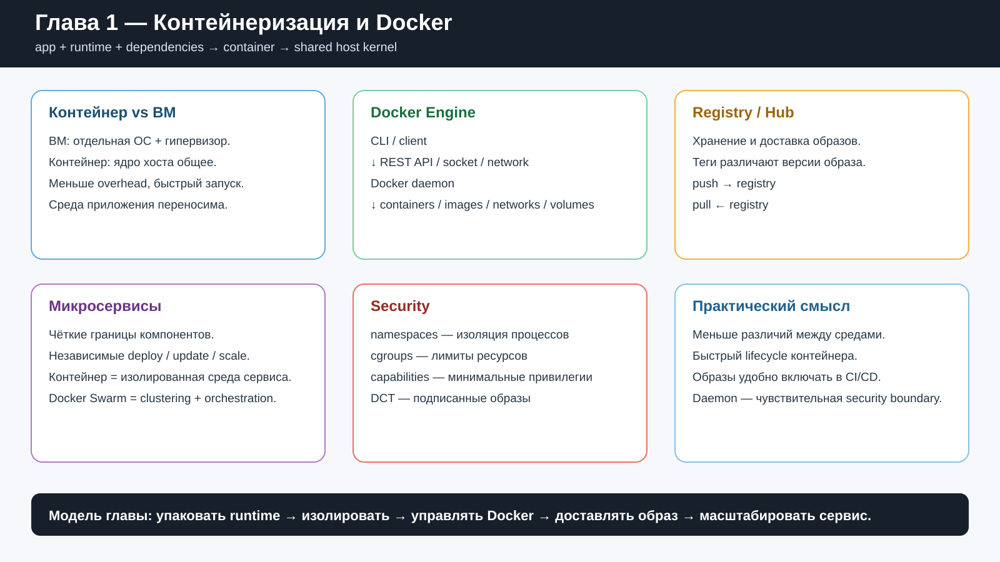
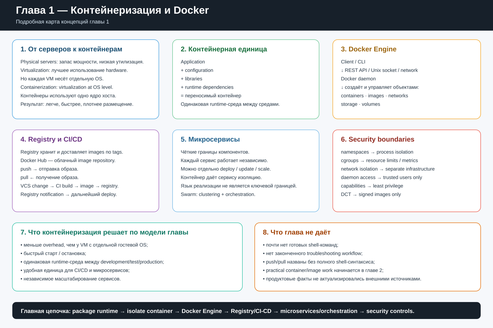

# Глава 1 — Контейнеризация и Docker

Практические и концептуальные материалы по главе 1 книги «Docker без секретов».





## Идентификация

- Book ID: `docker-demystified-saibal-ghosh-ru-2023`
- Глава: 1
- Название: «Контейнеризация и Docker»
- Slug: `containerization-and-docker`
- Source policy: `rag_only`
- External sources: запрещены
- Model memory: запрещена
- Прямой доступ к PDF: не использовался

## Provenance

- RAG chunks: `p0014:c01`–`p0026:c01`
- PDF pages: 14–26
- Printed pages: 17–29
- Оглавление в `p0005:c01` указывает начало главы 1 на печатной странице 17 и главы 2 на странице 31.
- `p0014:c01` начинается заголовком «ГЛАВА 1 — Контейнеризация и Docker».
- Следующий чанк `p0027:c01` начинается заголовком «ГЛАВА 2 — Контейнеры и образы».
- Chapter boundary verified: yes
- Source SHA-256: `7a52f7d947347a470790c7d384390f60bf49fe5426827f5829a75757b50faaa8`

## Содержимое

- [cheatsheet.md](cheatsheet.md) — рабочая концептуальная шпаргалка по контейнеризации, Docker Engine, Registry, микросервисам и безопасности.
- [commands.md](commands.md) — интерфейсы и операции, явно названные в главе.
- [diagram.md](diagram.md) — Mermaid-карта контейнеризации, Docker Engine, Registry/CI/CD и security boundaries.
- [visual-cheatsheet.svg](visual-cheatsheet.svg) — компактный визуальный обзор.
- [visual-cheatsheet-detailed.svg](visual-cheatsheet-detailed.svg) — подробный визуальный обзор.
- [summary.md](summary.md) — структурированный итог главы и основные тезисы.
- [review-questions.md](review-questions.md) — контрольный тест и вопросы главы.
- [review-answers.md](review-answers.md) — ключ теста из источника и RAG-grounded ответы на открытые вопросы.

## Карта главы

1. Введение: контейнеризация как упаковка приложения, зависимостей и runtime-среды.
2. Жизнь до контейнеризации: физические серверы, избыточный запас ресурсов и переход к виртуализации.
3. Концепция контейнеризации: LXC и виртуализация на уровне ОС.
4. Преимущества контейнеров относительно ВМ: меньше накладных расходов, быстрый запуск, переносимость и одинаковая среда.
5. Docker как платформа создания, управления и оркестрации контейнеров.
6. Docker Engine: клиент-серверная архитектура, демон, REST API и CLI.
7. Docker Hub и Docker Registry: хранение и доставка образов с тегами.
8. Контейнеры Linux и Windows.
9. Микросервисы и контейнеризация.
10. Базовая модель безопасности Docker.
11. Заключение, основные тезисы, контрольный тест, вопросы и ключевые термины.

## Краткий анализ главы

Глава вводит контейнеризацию через сравнение с двумя предыдущими моделями эксплуатации приложений. Сначала описывается эпоха выделенных физических серверов, где компании часто закладывали большой запас вычислительной мощности и использовали оборудование неэффективно. Затем виртуализация улучшила утилизацию ресурсов, но сохранила отдельную операционную систему для каждой виртуальной машины, а вместе с ней — накладные расходы на ресурсы, обслуживание и лицензирование.

Контейнеризация представлена как виртуализация на уровне операционной системы. Контейнер не получает отдельную ОС: несколько контейнеров используют ядро хоста. За счёт этого контейнеры легче ВМ, быстрее запускаются и позволяют разместить на одном хосте больше изолированных рабочих нагрузок.

Вторая ключевая идея главы — переносимость среды выполнения. В контейнер вместе с приложением помещаются конфигурация, библиотеки и другие зависимости, поэтому книга связывает контейнеризацию с уменьшением различий между development, test и production. Эта же изоляция делает контейнер естественной единицей для CI/CD и независимого масштабирования сервисов.

Docker описывается как набор компонентов и инструментов для создания, контроля, администрирования и оркестрации контейнеров. Docker Engine представлен как клиент-серверная система из демона, REST API и CLI. Клиент обращается к демону, а демон выполняет работу с контейнерами, образами, сетями, томами и другими объектами Docker.

Отдельный слой — хранение и распространение образов. Docker Registry определяется как система хранения и доставки образов по тегам; Docker Hub — облачный репозиторий такого назначения. Глава связывает registry с CI/CD: успешная сборка может публиковать новый образ, а уведомление от registry — инициировать дальнейшее развёртывание.

Микросервисы сопоставляются с контейнерами по принципу независимости. Каждый микросервис имеет чёткие границы и может отдельно развёртываться, масштабироваться и обновляться; контейнер предоставляет ему изолированную среду выполнения.

Базовая security-модель главы состоит из нескольких слоёв: namespaces для изоляции процессов, cgroups для ограничения ресурсов, сетевой изоляции, контроля доступа к Docker daemon, ограничения capabilities по принципу минимальных привилегий и Docker Content Trust для проверки подписанных образов. При этом глава отдельно подчёркивает риск доступа к демону Docker и опасность общих каталогов хоста и контейнера.

## Основной принцип

Контейнеризация в логике главы — это:

```text
application + runtime + dependencies
                ↓
             container
                ↓
 shared host OS / kernel + isolation
```

Docker добавляет к этой модели инструменты создания, управления, доставки и оркестрации контейнеров.

## Ограничения

- Глава вводная: она почти не содержит готовых shell-команд и не является пошаговым эксплуатационным руководством.
- Упоминания вариантов Docker Engine, версий ОС и состояния продуктовой линейки отражают контекст книги; внешняя актуализация в режиме `rag_only` не выполнялась.
- Рисунки 1.1 и 1.2 в RAG представлены главным образом окружающим текстом и заголовками; визуальные детали исходных иллюстраций отдельно не кодированы.
- Для углублённой работы с контейнерами и образами источник переходит к главе 2.
