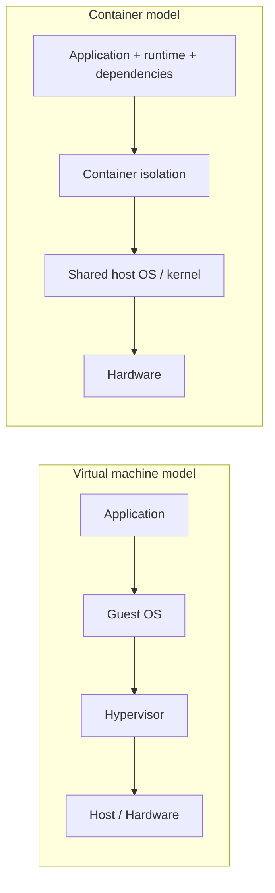
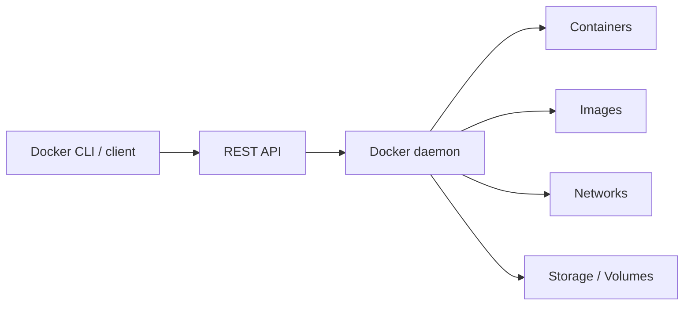
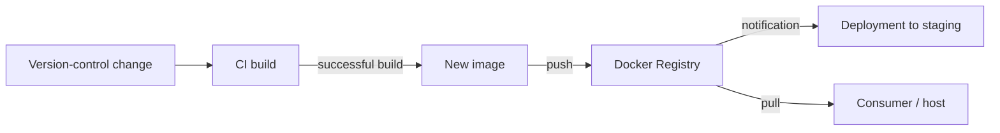
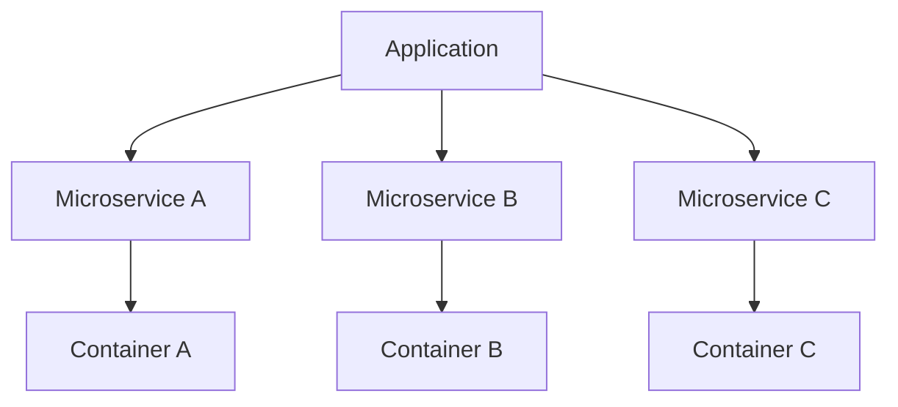
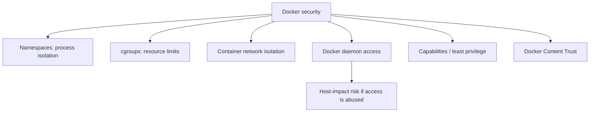

# Диаграммы: контейнеризация и Docker

## Контейнер против виртуальной машины

Глава объясняет лёгкость контейнера отсутствием отдельной гостевой ОС для каждого экземпляра и совместным использованием ядра хоста.

## Docker Engine

Docker Engine представлен как клиент-серверное приложение: клиент взаимодействует с демоном, а демон управляет объектами Docker.

## Registry и CI/CD

Это схема процесса, описанного в главе: успешная сборка может отправить новый образ в registry, а уведомление от registry — запустить дальнейшее развёртывание.

## Микросервисы и контейнеры

Граница каждого микросервиса позволяет независимо развёртывать, изменять, обновлять и масштабировать компоненты.

## Security boundaries

Глава отдельно подчёркивает, что доступ к Docker daemon и совместно используемым каталогам контейнера/хоста требует особого контроля.
