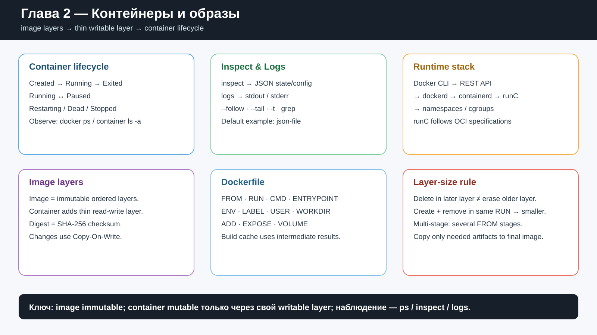
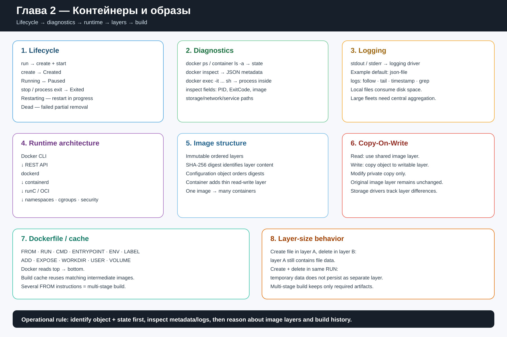

# Глава 2 — Контейнеры и образы

Практические и концептуальные материалы по главе 2 книги «Docker без секретов».





## Идентификация

- Book ID: `docker-demystified-saibal-ghosh-ru-2023`
- Глава: 2
- Название: «Контейнеры и образы»
- Slug: `containers-and-images`
- Source policy: `rag_only`
- External sources: запрещены
- Model memory: запрещена
- Прямой доступ к PDF: не использовался

## Provenance

- RAG chunks: `p0027:c01`–`p0058:c01`, включая `p0036:c02`
- PDF pages: 27–58
- Printed pages: 31–62
- `p0027:c01` начинается заголовком «ГЛАВА 2 — Контейнеры и образы».
- `p0058:c01` содержит ответы, вопросы и ключевые термины главы 2.
- Следующий чанк `p0059:c01` начинается заголовком «ГЛАВА 3 — Драйверы хранилища и тома».
- Chapter boundary verified: yes
- Source SHA-256: `7a52f7d947347a470790c7d384390f60bf49fe5426827f5829a75757b50faaa8`

## Содержимое

- [cheatsheet.md](cheatsheet.md) — lifecycle контейнера, inspect/logs, слои образа, COW и Dockerfile.
- [commands.md](commands.md) — команды главы с effect/risk, verification и rollback.
- [diagram.md](diagram.md) — Mermaid-карты lifecycle, runtime-стека, слоёв, COW и сборки.
- [visual-cheatsheet.svg](visual-cheatsheet.svg) — компактный визуальный обзор.
- [visual-cheatsheet-detailed.svg](visual-cheatsheet-detailed.svg) — подробный визуальный обзор.
- [summary.md](summary.md) — структурированный итог и основные тезисы.
- [review-questions.md](review-questions.md) — контрольный тест и вопросы главы.
- [review-answers.md](review-answers.md) — ключ теста и RAG-grounded ответы.

## Карта главы

1. Контейнер как динамический экземпляр образа.
2. Запуск контейнера: `docker run`, имя, image/tag и флаги `-d/-i/-t`.
3. Состояния: Running, Paused, Exited, Restarting, Dead, Stopped, Created.
4. Выполнение процессов внутри контейнера через `docker exec`.
5. Исследование контейнера через `docker inspect`.
6. Журналирование: logging drivers, `json-file`, `docker logs`, tail/follow/timestamps и централизованный сбор.
7. Архитектура: Docker CLI → REST API → dockerd → containerd → runC → Linux mechanisms.
8. Image как read-only template из immutable layers.
9. Thin read-write layer и Copy-On-Write.
10. Digest/SHA-256, image ID, configuration object и image history.
11. Хранение образов в `/var/lib/docker/<storage-driver>`.
12. Исследование и сохранение images.
13. Создание image через `docker commit`.
14. Dockerfile: `FROM`, `LABEL`, `ENV`, `RUN`, `CMD`, `ENTRYPOINT`, `ADD`, `EXPOSE`, `WORKDIR`, `USER`, `VOLUME`.
15. Build cache и intermediate images.
16. Multi-stage builds.
17. Влияние границ слоёв на размер image.

## Краткий анализ главы

Глава переводит материал от общей концепции контейнеризации к практической модели Docker. Главная связь задаётся сразу: image — статический шаблон файловой системы, container — его динамический экземпляр. При создании container поверх неизменяемых слоёв image добавляется thin read-write layer.

Первая практическая часть посвящена lifecycle контейнера. Источник демонстрирует запуск BusyBox и Alpine, именование container и режимы detached/interactive/TTY. Затем разбираются состояния Running, Paused, Exited, Restarting, Dead, Stopped и Created, а также переходы между ними через pause, unpause, stop и create. `docker ps` / `docker container ls -a` выступают способом наблюдения за состоянием.

Для работы внутри container используется `docker exec`, а для получения детальной информации — `docker inspect`. Inspect возвращает JSON с State, image, PID, ExitCode, storage/network fields и служебными путями.

Большой operational-блок посвящён журналам. Docker связывает container logs с stdout/stderr; для `json-file` журналы хранятся в каталоге контейнера на хосте. Источник показывает `docker logs` с `--follow`, `--details`, `--tail` и `-t`, а также фильтрацию через `grep`. Для большого числа containers книга подчёркивает необходимость централизованного сбора/агрегации журналов.

Архитектурно глава раскрывает стек Docker глубже: CLI и REST API взаимодействуют с Docker server/dockerd; далее участвует containerd, а низкоуровневое создание/запуск контейнера связано с runC и OCI. runC использует namespaces, cgroups и Linux security mechanisms.

Вторая половина главы посвящена images. Image состоит из упорядоченных immutable layers. Layer идентифицируется digest, вычисляемым SHA-256; configuration object содержит упорядоченный список digest-значений. Container изменяет данные через Copy-On-Write: данные копируются в верхний writable layer, исходные image layers остаются неизменными.

Dockerfile рассматривается как текстовое описание build image. Глава отдельно объясняет build cache, intermediate images и влияние границ layers на итоговый размер. Пример с 100-MB файлом показывает: удаление файла в следующем layer не устраняет данные из предыдущего immutable layer; создание и удаление в рамках одного `RUN` не оставляет отдельный большой layer.

## Основной принцип

```text
image = immutable ordered layers
                 ↓
container = image + thin read-write layer
                 ↓
changes use Copy-On-Write
```

Operational-модель:

```text
CLI → REST API → dockerd → containerd → runC → Linux isolation
```

## Ограничения

- Команды и примеры отражают версию/эпоху Docker из книги; внешняя актуализация не выполнялась.
- OCR источника искажает отдельные символы и пробелы. Команды нормализованы только там, где смысл однозначно подтверждён соседним текстом; семантические изменения не вносились.
- Пути под `/var/lib/docker`, logging/storage-driver behavior и product details приведены как материал книги, без проверки на современных версиях Docker.
- Пример `docker commit` сохранён как материал источника; предпочтительность подхода относительно Dockerfile внешними знаниями не переоценивается.
