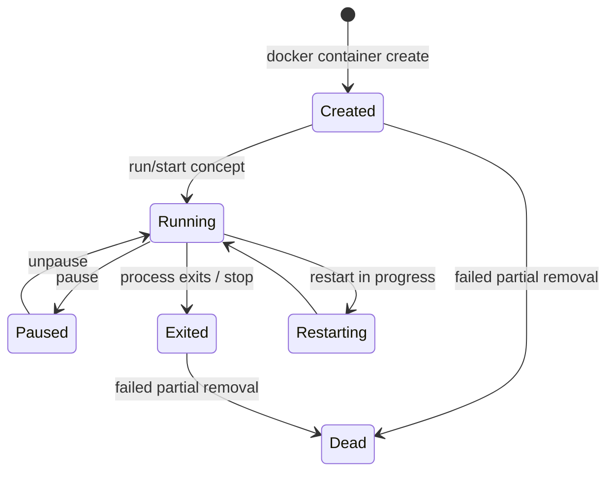
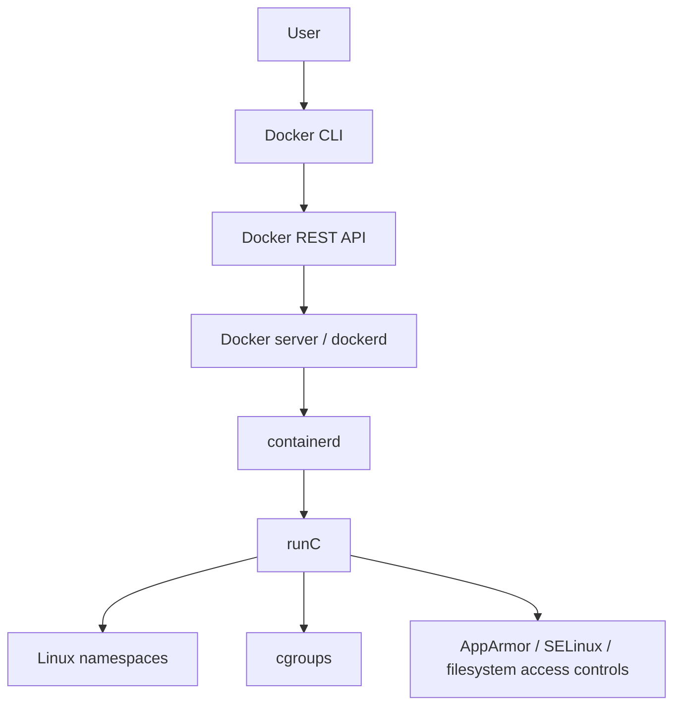
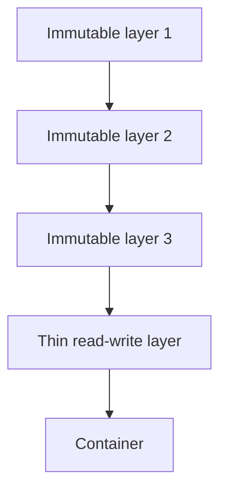
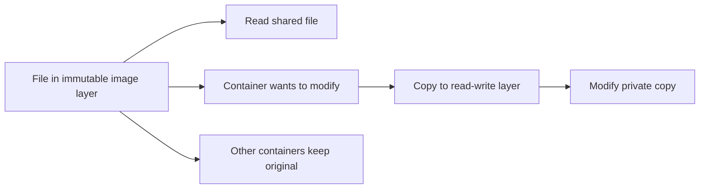
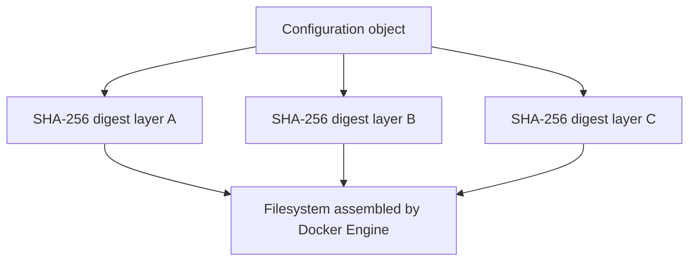
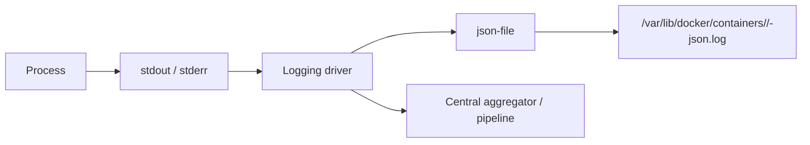
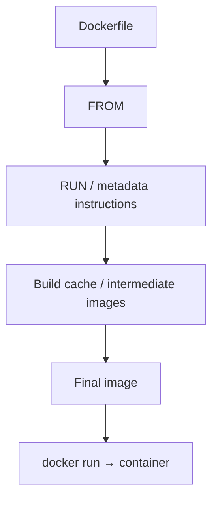
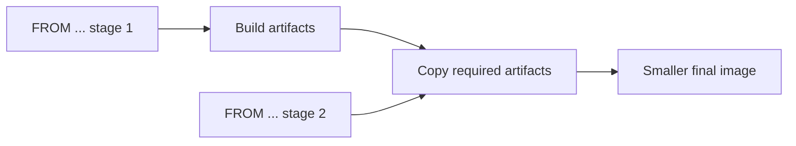

# Диаграммы: контейнеры и образы

## Lifecycle container

Точная команда `start` в главе не демонстрируется, поэтому переход из Created к Running отмечен как concept.

## Docker runtime stack

## Image → container

## Copy-On-Write

## Image identity

## Logging

## Dockerfile build

## Multi-stage build

