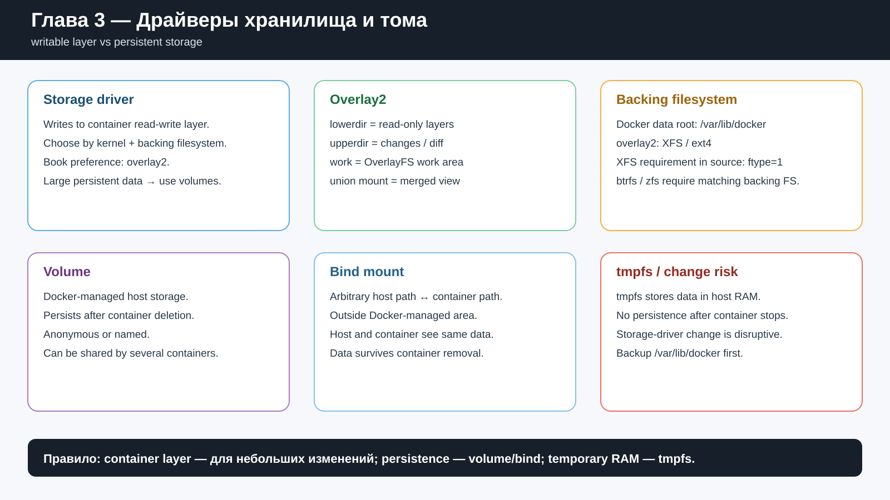
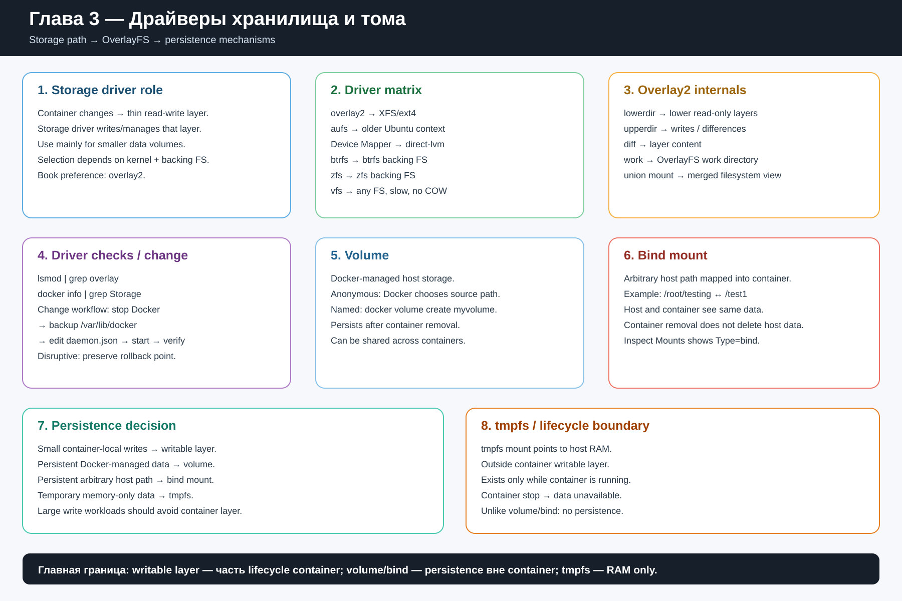

# Глава 3 — Драйверы хранилища и тома

Практические и концептуальные материалы по главе 3 книги «Docker без секретов».





## Идентификация

- Book ID: `docker-demystified-saibal-ghosh-ru-2023`
- Глава: 3
- Название: «Драйверы хранилища и тома»
- Slug: `storage-drivers-and-volumes`
- Source policy: `rag_only`
- External sources: запрещены
- Model memory: запрещена
- Прямой доступ к PDF: не использовался

## Provenance

- RAG chunks: `p0059:c01`–`p0075:c01`
- PDF pages: 59–75
- Printed pages: 63–79
- `p0059:c01` начинается заголовком «ГЛАВА 3 — Драйверы хранилища и тома».
- `p0075:c01` содержит вопросы и ключевые термины главы 3.
- Следующий чанк `p0076:c01` начинается заголовком «ГЛАВА 4 — Модель Container Network и сетевой мост Docker».
- Chapter boundary verified: yes
- Source SHA-256: `7a52f7d947347a470790c7d384390f60bf49fe5426827f5829a75757b50faaa8`

## Содержимое

- [cheatsheet.md](cheatsheet.md) — storage driver, overlay2, persistence, volume/bind/tmpfs.
- [commands.md](commands.md) — команды главы с risk/effect, verification и rollback.
- [diagram.md](diagram.md) — Mermaid-карты storage path, OverlayFS и типов persistent storage.
- [visual-cheatsheet.svg](visual-cheatsheet.svg) — компактный визуальный обзор.
- [visual-cheatsheet-detailed.svg](visual-cheatsheet-detailed.svg) — подробная шпаргалка.
- [summary.md](summary.md) — структурированный итог и основные тезисы.
- [review-questions.md](review-questions.md) — контрольный тест и вопросы главы.
- [review-answers.md](review-answers.md) — ключ теста и RAG-grounded ответы.

## Карта главы

1. Storage driver как механизм записи на read-write layer контейнера.
2. Выбор драйвера по стабильности, производительности и backing filesystem.
3. Поддерживаемые драйверы: overlay2, aufs, Device Mapper, btrfs, zfs, vfs.
4. Backing filesystem и требования к XFS/ext4/btrfs/zfs/direct-lvm.
5. OverlayFS: lowerdir, upperdir, diff, work и union mount.
6. Проверка OverlayFS и текущего Docker storage driver.
7. Пример смены `overlay2` → `overlay` с backup `/var/lib/docker` и `daemon.json`.
8. Исследование структуры `/var/lib/docker/overlay2`.
9. Почему writable layer не подходит для больших write-intensive workloads.
10. Data persistence: Docker volumes, bind mounts и tmpfs.
11. Bind mount: arbitrary host path ↔ container path.
12. Anonymous volume и Docker-managed source path.
13. Named volume, `docker volume create/inspect` и shared volume.
14. `--mount` как способ задания volume.
15. tmpfs: данные в памяти хоста, без persistence после остановки container.

## Краткий анализ главы

Глава разделяет два разных слоя хранения. Storage driver обслуживает writable layer контейнера и подходит для сравнительно небольшого объёма данных. Для постоянных и более интенсивных данных источник рекомендует выносить данные за пределы writable layer — в volume или bind mount; tmpfs используется для временных данных в памяти хоста.

При выборе storage driver автор делает акцент не на универсальном рейтинге, а на совместимости ядра и backing filesystem, стабильности и производительности. В контексте книги предпочтительным вариантом выступает `overlay2`. Для XFS отдельно указано требование `ftype=1`; btrfs/zfs требуют соответствующего backing filesystem; Device Mapper — отдельной LVM-конфигурации; vfs описан как медленный вариант без Copy-On-Write.

Overlay2 объясняется через OverlayFS и union mount. Нижние immutable layers представлены как `lowerdir`, а изменения записываются в `upperdir`. Каталог `diff` содержит отличия слоя, `work` обслуживает OverlayFS, а объединённое представление формирует итоговую файловую систему. Такая схема позволяет хранить только отличия, а не полные копии каждого layer.

Operational-раздел показывает read-only проверки `lsmod | grep overlay` и `docker info | grep Storage`, затем рискованный пример изменения storage driver. Перед изменением Docker останавливается и каталог `/var/lib/docker` копируется в backup. Это важная граница: смена storage driver влияет на способ, которым Docker видит local images/containers, поэтому операция требует backup и проверки после запуска.

Вторая половина главы посвящена persistence. Bind mount связывает произвольный host path с directory внутри container. Anonymous/named Docker volume хранится в Docker-managed area на хосте. Named volume проще адресовать и может быть подключён к нескольким containers. В обоих случаях данные переживают удаление container. tmpfs, напротив, хранит данные в RAM хоста и существует только пока container работает.

## Основной принцип

```text
small / ephemeral container writes
        → container read-write layer
        → storage driver

persistent / larger data
        → volume or bind mount

temporary in-memory data
        → tmpfs
```

Для Overlay2:

```text
lowerdir (read-only layers)
        +
upperdir (changes)
        ↓
union mount / merged view
```

## Ограничения

- Версии Docker, статусы deprecated drivers и рекомендации отражают состояние источника; внешняя актуализация не выполнялась.
- Команды, пути и storage-driver behavior приведены как материал книги, без проверки на современной Docker Engine.
- Пример переключения storage driver является state-changing и потенциально disruptive. Он документирован, но не трактуется как безопасная универсальная процедура.
- OCR искажает отдельные команды; нормализация выполнена только там, где контекст однозначен.
