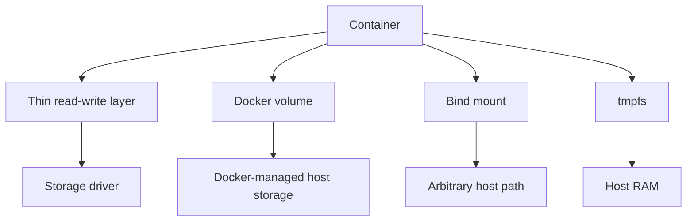
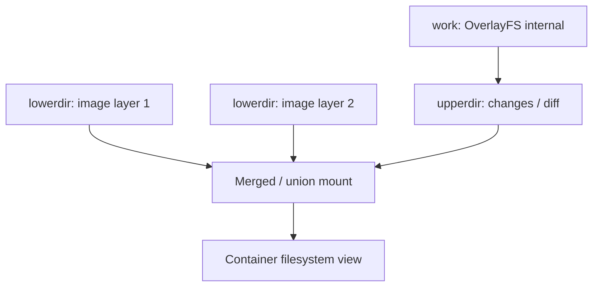
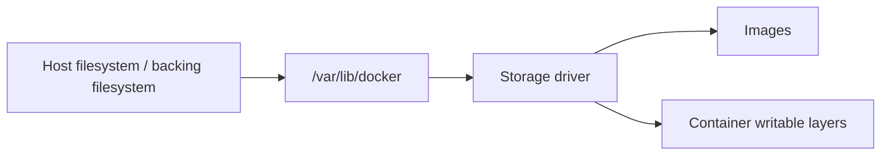
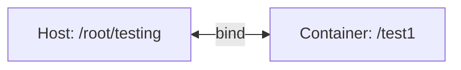
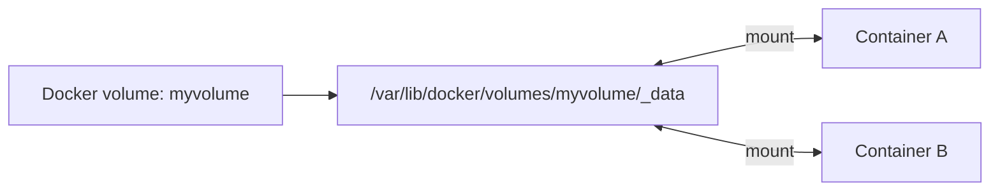
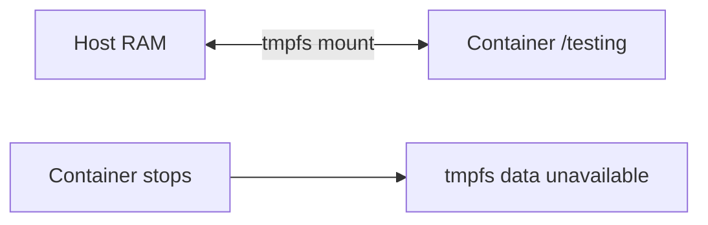
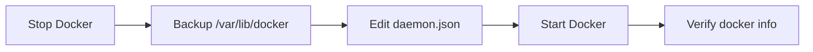

# Диаграммы: storage drivers и volumes

## Writable layer vs persistent storage

## Overlay2

Lower layers остаются неизменяемыми; изменения записываются в upperdir.

## Backing filesystem dependency

Совместимость storage driver зависит от backing filesystem и kernel support.

## Bind mount

Путь выбирается на host и не обязан находиться в Docker-managed area.

## Named volume

Один volume может использоваться несколькими containers.

## tmpfs

tmpfs не предоставляет persistence после остановки container.

## Storage-driver change

Это disruptive workflow; backup — обязательная точка возврата в логике главы.
